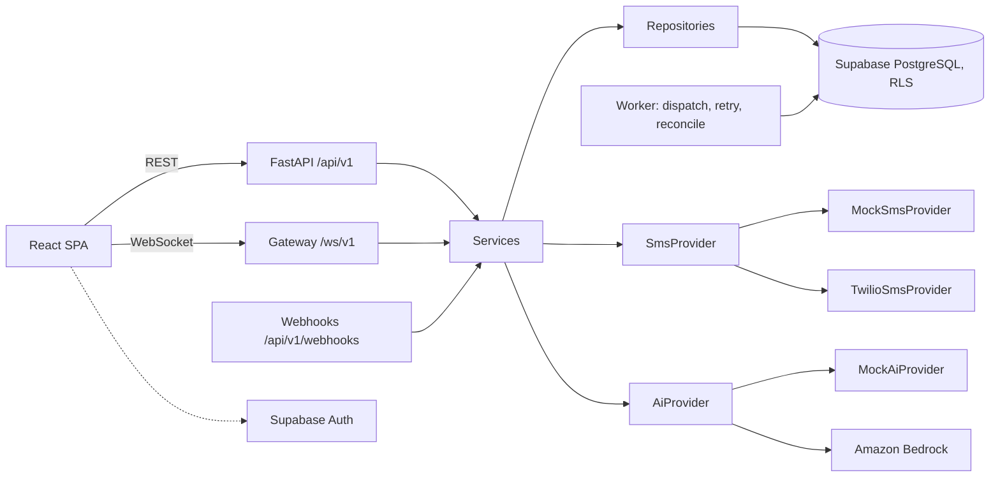

# Chikka Reborn

**The Messenger That Refused to Die.**

> A Kiroween 2026 project, **Resurrection** category.
>
> Chikka Reborn is an independent project inspired by the original Chikka service. It is not an official relaunch and is not affiliated with or endorsed by Chikka Philippines, Inc., Smart Communications or any original owner or carrier. It uses original branding.

## What this is

Chikka was a Filipino service, founded in 2000, that let people chat from a computer with friends who only had an ordinary mobile phone. It connected to the major Philippine carriers in the early 2000s and was shut down in 2018.

Chikka Reborn rebuilds that idea: chat between registered users, plus web-to-SMS and SMS-to-web messages in the same conversation, with an AI writing assistant and honest delivery tracking.

> "Everyone should be able to communicate, whether they have a smartphone, an internet connection, or just a basic mobile phone."

### What is real and what is simulated

| Area | State |
|---|---|
| Chikka-to-Chikka chat, contacts, notifications, credits, admin, Classic and Modern Mode | Working, covered by automated tests |
| SMS | **Simulation mode only has been run.** No real text is sent. Every simulated message is labelled SIMULATED. A simulated "delivered" is not carrier delivery |
| Live SMS (Twilio) | Implemented, **never run against a real account**. Tested against an in-process fake. Philippine sender registration unverified |
| AI assistant | The mock provider returns canned drafts. The Amazon Bedrock adapter is implemented and unit-tested with stubs, **never called against the live service** |
| Authentication | Tested against a fake Supabase Auth. Not yet run on a hosted Supabase project |
| Credits | Simulated ledger. There is no payment or top-up |

## Screenshots

Screenshots are stored in `docs/submission/screenshots/`. The shot list is in [docs/submission/devpost-submission.md](docs/submission/devpost-submission.md#6-screenshot-plan).

<!-- Add after capture:


-->

## Features

| Module | What it does | Notes |
|---|---|---|
| Accounts | Registration with email verification, sign-in with lockout, password reset, sessions, profile, photo, presence, account deletion | Mobile number verification is simulated |
| Contacts and buddy list | Discovery by exact username, requests, groups, favourites, blocking | SMS contacts are not in the buddy list yet |
| Chikka-to-Chikka chat | Real-time messages, typing, read and delivery state, attachments, unread counts, archive | WebSocket gateway, single backend instance |
| Internet-to-SMS | Quote with segments and cost, consent, send, retry, delivery tracking | Simulation mode |
| SMS-to-internet | Signed inbound webhooks, reply routing, STOP/START opt-out, unmatched-reply queue | Simulation mode |
| AI assistant | Smart replies, translation, rewriting and tone, summaries, SMS length optimisation, drafting | Mock provider. Drafts only, never sent automatically |
| Notifications | In-app, email and in-page browser notifications, quiet hours | No Web Push. Email is mock by default |
| Credits | Reservation, deduction on acceptance, refund on failure, ledger | Simulated |
| Administration | Users, SMS monitoring, providers, country capabilities, AI usage, audit log | |
| Classic and Modern Mode | Nostalgic buddy-list layout or modern chat layout | |

Delivery statuses are `queued`, `retrying`, `accepted`, `sent`, `delivered`, `undelivered` and `failed`. Only a provider delivery confirmation sets `delivered`.

## Architecture



A modular monolith: one SPA and one API. Direction is router → service → repository. Vendor code lives only in `backend/app/integrations/`. More in [docs/architecture/](docs/architecture/).

## Technology stack

| Area | Technology |
|---|---|
| Frontend | React 19, TypeScript, Vite, Tailwind CSS, Radix UI, React Router, TanStack Query, React Hook Form, Zod |
| Backend | Python 3.12, FastAPI, Pydantic 2, async SQLAlchemy, httpx |
| Data | Supabase PostgreSQL, Auth, Storage, Row Level Security |
| Testing | pytest, Vitest, React Testing Library, Playwright |
| Quality | Ruff, mypy (strict), ESLint, Prettier, `tsc --noEmit` |

## Installation

Requirements: Python 3.12, Node.js 22.19 or newer (22.17 works with an npm warning), PowerShell on Windows.

```powershell
scripts\setup.ps1            # creates the venv, installs dependencies, copies .env.example files
```

Or by hand:

```powershell
cd backend
python -m venv .venv
.\.venv\Scripts\python.exe -m pip install -r requirements-dev.txt
copy .env.example .env

cd ..\frontend
npm ci
copy .env.example .env.local
```

## Environment variables

Copy `backend/.env.example` to `backend/.env` and `frontend/.env.example` to `frontend/.env.local`. Never commit them. Only `VITE_`-prefixed values reach the browser, so no secret belongs in the frontend file.

| Variable | Purpose |
|---|---|
| `SUPABASE_URL`, `SUPABASE_ANON_KEY` | Project for sign-in |
| `SUPABASE_SERVICE_ROLE_KEY` | Backend only. Photos and account deletion |
| `SUPABASE_JWT_SECRET` | Only for projects on the legacy HS256 secret. Signing-key projects use JWKS |
| `DATABASE_URL` | PostgreSQL connection string |
| `APP_SECRET_KEY` | 32+ characters. Required in staging and production |
| `SMS_PROVIDER_MODE` | `mock` (default) or `live` |
| `AI_PROVIDER_MODE` | `mock` (default) or `bedrock` |
| `VITE_API_BASE_URL` | Backend URL for the frontend |

The full list, with defaults, is in [docs/deployment/environment-configuration.md](docs/deployment/environment-configuration.md).

## Running locally

```powershell
scripts\dev-backend.ps1      # http://localhost:8000  (API docs at /docs)
scripts\dev-frontend.ps1     # http://localhost:5173  (second terminal)
```

Signing in needs a Supabase project (or a local Supabase). Set the Supabase values in `backend/.env` and use the email templates in `supabase/templates/`. Everything else works without accounts. Guide: [docs/deployment/local-development.md](docs/deployment/local-development.md).

To try the simulated SMS flow, see [section 7 of the local development guide](docs/deployment/local-development.md#7-trying-sms-locally-simulation). It lists fictional phone numbers that trigger failures, retries and delays, and shows how an administrator injects a simulated reply.

## Testing

```powershell
# Backend
cd backend
.\.venv\Scripts\python.exe -m pytest
# Frontend
cd frontend
npm run test                      # vitest --run
npm run lint
npm run typecheck
# Database constraints, ledger and RLS (in-process PostgreSQL, no Docker)
cd supabase\tools
npm ci
npm test
# Browser end to end (Chromium once: npx playwright install chromium)
scripts\e2e-browser.ps1           # frees stale ports first
# Everything static
scripts\check.ps1
```

At the final review the backend suite had 717 passing and 2 skipped tests (93% line coverage), the frontend suite 319 passing and 15 skipped (89.8%), the browser suite 48 of 48 and the SQL tests 5 of 5 files. The skipped tests need Twilio test credentials or a running local stack. No test calls a real SMS, AI or auth service. See [docs/quality/final-engineering-review.md](docs/quality/final-engineering-review.md).

## SMS configuration

The backend runs in exactly one mode, chosen at startup by `SMS_PROVIDER_MODE`.

- **Simulation (default).** `MockSmsProvider`. Nothing is sent and nothing costs money. Delivery callbacks go through the real signed-webhook code path.
- **Live.** `TwilioSmsProvider`. Needs `SMS_LIVE_CONFIRMED=true`, `TWILIO_ACCOUNT_SID`, `TWILIO_AUTH_TOKEN`, `SMS_PUBLIC_BASE_URL`, an administrator's per-environment confirmation, a verified route for each destination country and, for the Philippines, an approved sender registration. If live cannot start, the server refuses to start. It never falls back to simulation.

Do not enable live mode without reading [docs/deployment/sms-live-activation.md](docs/deployment/sms-live-activation.md). Live mode has not been exercised against a real account.

## AI configuration

- **Mock (default).** `AI_PROVIDER_MODE=mock` returns canned demo drafts.
- **Amazon Bedrock.** `AI_PROVIDER_MODE=bedrock` with `BEDROCK_REGION`, `BEDROCK_MODEL_ID` and `BEDROCK_API_KEY`. Check that the model handles Filipino and the other languages you offer. Not exercised against the live service.

Each user switches the assistant on for their own account, and it is off by default. AI output is always a draft. There is no code path that sends it for the user.

## Deployment

Frontend as a static build on Vercel. Backend as a single instance, because the WebSocket hub and presence are held in memory. Database, Auth and Storage on a Supabase project. Apply the migrations in `supabase/migrations/` with Supabase tooling, and only with explicit approval for production. Simulation stays the default in every environment. Nothing is deployed from this repository yet. See [docs/deployment-strategy.md](docs/deployment-strategy.md).

## Known limitations

- Live SMS and Bedrock have never been run against the real services.
- Authentication, Row Level Security and Storage have not been tested on a hosted Supabase project.
- Data export and in-app message reporting are not implemented, although both are planned requirements.
- No message deletion or editing, social login, credit top-up, Web Push, contact import or mute, and SMS contacts are not part of the buddy list.
- One backend instance only (in-memory realtime hub and presence).
- No load testing, no automated accessibility scan, and only Chromium is tested in the browser.

The complete list is in [docs/quality/final-engineering-review.md](docs/quality/final-engineering-review.md).

## Security considerations

- Provider credentials exist only in backend environment variables. They never reach the frontend or the logs.
- Webhook signatures are checked on the raw bytes before parsing, with no development bypass. Events are deduplicated by provider event ID.
- Row Level Security is enabled on all 30 tables. Server-only tables have no client policies.
- Phone numbers are masked in logs and message bodies are not logged.
- Login, sign-up, reset, SMS sending and AI calls are rate limited.
- Consent and opt-out are enforced on every send.
- A security audit is in [docs/quality/security-audit-report.md](docs/quality/security-audit-report.md). It lists the findings that remain open.

## Built with Kiro

The repository includes the Kiro setup used for development: 15 steering files in `.kiro/steering/` and 15 hooks in `.kiro/hooks/`, with the hook scripts in `scripts/hooks/`. Details and caveats are in [docs/quality/kiro-hooks.md](docs/quality/kiro-hooks.md) and [docs/submission/devpost-submission.md](docs/submission/devpost-submission.md#2-how-kiro-was-used).

## Documentation

| Area | Path |
|---|---|
| Product | [docs/product/](docs/product/) |
| Architecture and decisions | [docs/architecture/](docs/architecture/) |
| UI/UX | [docs/design/](docs/design/) |
| API reference | [docs/api/](docs/api/) |
| Database, migrations, RLS | [docs/database/](docs/database/) |
| Quality and testing | [docs/quality/](docs/quality/) |
| Deployment | [docs/deployment/](docs/deployment/) |
| Risks, backlog, decision log | [docs/project-management/](docs/project-management/) |

The older single-file documents directly under `docs/` (`prd.md`, `frs.md` and so on) are marked superseded and kept for history.

## Acknowledgements

Inspired by the original Chikka Text Messenger and the people who built and used it. Built for Kiroween 2026 with [Kiro](https://kiro.dev). Chikka names and trademarks belong to their respective owners.

## Licence

No licence file has been added yet. Add one before publishing.
