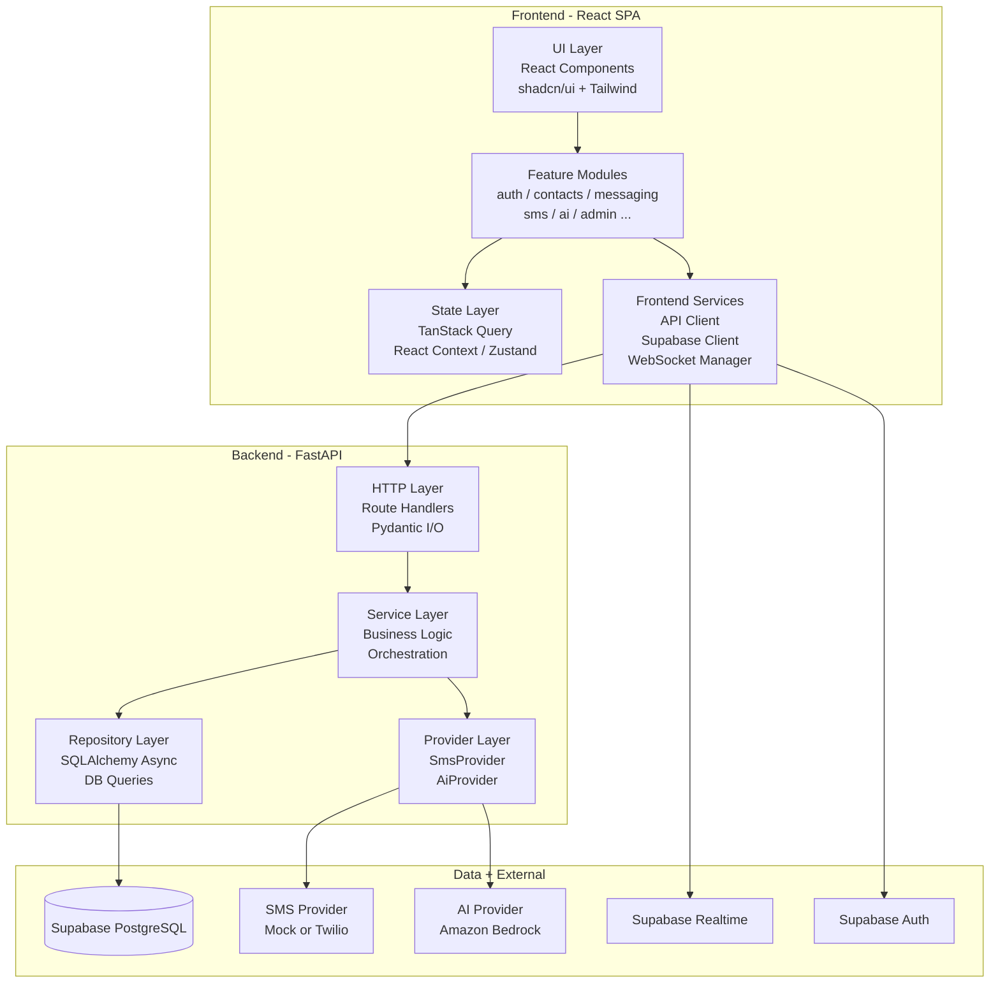
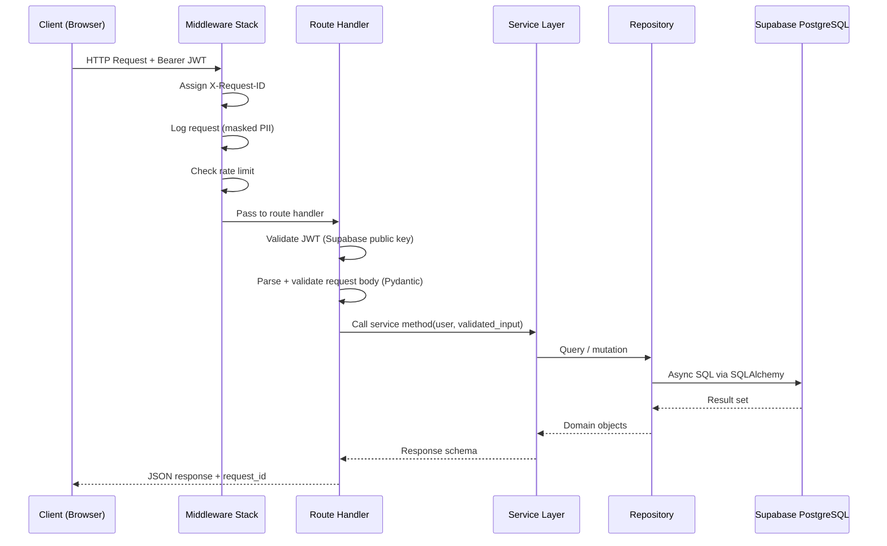
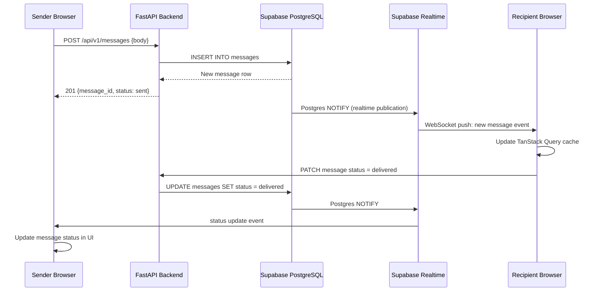
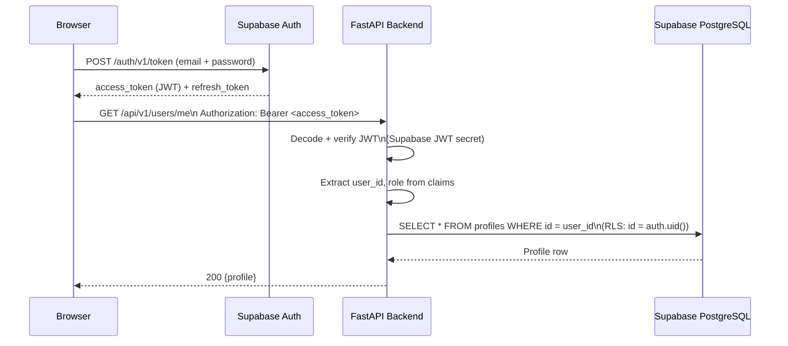

# Application Architecture

**Document:** CHKR-ARCH-002  
**Project:** Chikka Reborn  
**Version:** 1.0  
**Status:** Draft  
**Last Revised:** November 2026  

---

## Purpose

This document describes the internal application architecture of Chikka Reborn — the layers, modules, data flow patterns, and cross-cutting concerns that apply across both the frontend and backend. It bridges the high-level system architecture (`docs/architecture/system-architecture.md`) with the component-level details in the frontend and backend architecture documents.

## Scope

Both tiers (frontend and backend). All phases.

---

## 1. Layered Architecture Overview



---

## 2. Module Boundaries

Both tiers are organised as a **modular monolith**: one deployable unit per tier, with internal module boundaries enforced by directory structure.

### Frontend Modules

Each feature module in `frontend/src/features/` owns its own:
- UI components
- Custom hooks
- API call functions
- Local types

No module may import from another module's internal files. Shared code lives in `frontend/src/lib/` or `frontend/src/components/`.

### Backend Modules

Each domain in `backend/api/v1/` owns its route handler file. Business logic lives in `backend/services/`. Database access in `backend/repositories/`. External service calls in `backend/providers/`.

**Dependency direction:** Routes → Services → Repositories → Database. Routes → Services → Providers → External. No layer skips another.

---

## 3. Request-Response Lifecycle (Backend)



---

## 4. Real-Time Message Delivery (Phase 1)



---

## 5. Authentication Flow



---

## 6. Error Handling Architecture

All errors follow a consistent structure regardless of where they originate.

### Error Response Schema (all environments)
```json
{
  "error": {
    "code": "INSUFFICIENT_CREDITS",
    "message": "You do not have enough credits to send this message.",
    "details": {
      "required": 2,
      "available": 1
    }
  },
  "request_id": "550e8400-e29b-41d4-a716-446655440000"
}
```

### Error Handling Rules
- Route handlers never catch generic exceptions — they let a global exception handler produce the consistent structure.
- Services raise typed exceptions (e.g. `InsufficientCreditsError`, `PhoneNotVerifiedError`).
- The global exception handler maps typed exceptions to error codes and HTTP status codes.
- Stack traces never appear in API responses. They are logged server-side with the `request_id`.
- Provider errors (SMS, AI, DB) are wrapped in typed exceptions before propagating up.

---

## 7. Background Tasks

Long-running or non-blocking operations that must not delay the API response:

| Task | Trigger | Mechanism |
|---|---|---|
| SMS retry | Provider transient failure | FastAPI `BackgroundTasks` + scheduled retry |
| SMS delivery status poll | For providers without webhooks | Periodic background task |
| AI inference (Phase 3) | User AI request | FastAPI `BackgroundTasks` or async task |
| Data export generation | User export request | Background task, result to Storage |
| Notification delivery | New message, SMS status change | Triggered from service layer, non-blocking |

Phase 2+ may introduce a lightweight task queue (e.g. ARQ or Celery) if background task volume warrants it. This is an architectural decision pending evaluation — see ADL-009 in `docs/architecture/architecture-decisions.md`.

---

## 8. Feature Flag Architecture

The primary runtime feature flag is `SMS_PROVIDER_MODE` (`mock` | `live`).

Additional feature flags will be stored in a `platform_config` database table, editable via the admin dashboard without a code deploy. This allows:
- Enabling/disabling AI features per environment.
- Enabling/disabling browser push notifications.
- Toggling Classic Mode availability.

Feature flags are loaded at application startup and cached. Changes via admin dashboard invalidate the cache.

---

## 9. Cross-Cutting Concerns

| Concern | Implementation |
|---|---|
| Request tracing | `X-Request-ID` UUID assigned by middleware; propagated to all log lines and responses |
| Structured logging | JSON logs: `{timestamp, level, request_id, user_id, service, message, duration_ms}` |
| Rate limiting | Per-route middleware; limits defined in NFR-SEC-006 |
| CORS | Backend allows only configured frontend origins; wildcard never used in production |
| PII masking | Phone numbers masked in logs: country code + last 4 digits |
| Idempotency | SMS send operations carry client-generated idempotency keys |

---

## 10. Inter-Module Dependency Map

```
AUTH ──────────────────────────────────────┐
  │                                        │
  ├──▶ CONTACTS                            │
  │       └──▶ MSG (open conversation)     │
  │       └──▶ SMS (add SMS contact)       │
  │                                        │
  ├──▶ CREDIT ◀── SMS (deduction/refund)   │
  │                                        │
  ├──▶ NOTIF ◀── MSG, SMS (trigger notifs) │
  │                                        │
  ├──▶ PRIVACY                             │
  │                                        │
  └──▶ ADMIN ──▶ all modules (read/config) │
                                           │
AI ──▶ MSG, SMS (suggestions only) ────────┘
```

No circular dependencies. ADMIN has read access to all modules. AI is a pure suggestion layer — it does not write to conversations or trigger sends.

---

## 11. Revision History

| Version | Date | Author | Notes |
|---|---|---|---|
| 1.0 | November 2026 | Kiro (Principal Architect) | Initial draft |
