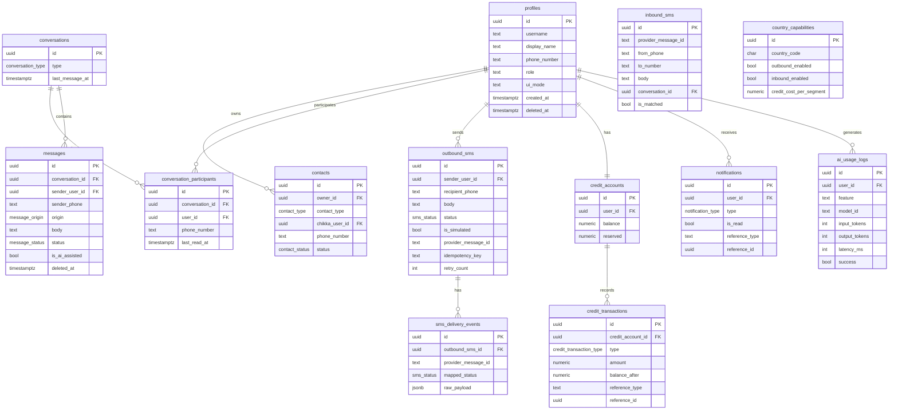

# Database Architecture

**Document:** CHKR-ARCH-007  
**Project:** Chikka Reborn  
**Version:** 1.0  
**Status:** Draft  
**Last Revised:** November 2026  

---

## Purpose

This document describes the database architecture decisions, design patterns, and structural overview for Chikka Reborn. Detailed table definitions, SQL DDL, and migration strategy are in `docs/database/database-schema.md`. RLS policies are in `docs/database/row-level-security.md`.

## Scope

All database tables, relationships, constraints, access patterns, and storage configuration.

---

## 1. Database Platform

| Attribute | Value |
|---|---|
| Database | Supabase PostgreSQL 15+ |
| Access | SQLAlchemy 2.x async (backend) + Supabase JS SDK (frontend auth/realtime) |
| Auth integration | Supabase Auth — `auth.users` table is the identity source |
| Real-time | Supabase Realtime publication on selected tables |
| Storage | Supabase Storage (S3-compatible) for avatars and exports |
| Region | TBD — OD-008 (Singapore recommended for PH primary market) |

---

## 2. Schema Design Principles

| Principle | Application |
|---|---|
| UUID primary keys | `DEFAULT gen_random_uuid()` on all tables |
| Audit timestamps | `created_at`, `updated_at` (TIMESTAMPTZ) on all tables |
| Soft deletes | `deleted_at TIMESTAMPTZ NULL` on sensitive records |
| E.164 phone numbers | All phone numbers stored in E.164 format |
| Enum types | PostgreSQL `CREATE TYPE` for all status and mode fields |
| Text content | `TEXT` type; length limits enforced at application layer |
| RLS on every table | No table accessible without an explicit RLS policy |

---

## 3. Entity Relationship Overview



---

## 4. Table Inventory

| Table | Phase | Description |
|---|---|---|
| `profiles` | 1 | User profiles; extends `auth.users` |
| `contacts` | 1 | User contact list (Chikka + SMS contacts) |
| `conversations` | 1 | Conversation threads |
| `conversation_participants` | 1 | Conversation membership |
| `messages` | 1 | All messages (Chikka-origin and SMS-origin) |
| `notifications` | 1 | In-app notification records |
| `outbound_sms` | 2 | All outbound SMS records |
| `sms_delivery_events` | 2 | Immutable delivery status event log |
| `inbound_sms` | 2 | Inbound SMS from provider webhooks |
| `credit_accounts` | 2 | One per user; current balance |
| `credit_transactions` | 2 | Immutable credit ledger |
| `country_capabilities` | 2 | Admin-managed per-country SMS config |
| `ai_usage_logs` | 3 | AI call metadata (no message content) |

---

## 5. Key Constraints and Integrity Rules

### Contacts
```sql
CONSTRAINT contacts_chikka_xor_sms CHECK (
    (contact_type = 'chikka' AND chikka_user_id IS NOT NULL AND phone_number IS NULL)
    OR (contact_type = 'sms' AND phone_number IS NOT NULL AND chikka_user_id IS NULL)
)
```
A contact is either a Chikka user or an SMS number — never both.

### Conversation Participants
```sql
CONSTRAINT participants_user_xor_phone CHECK (
    (user_id IS NOT NULL AND phone_number IS NULL)
    OR (user_id IS NULL AND phone_number IS NOT NULL)
)
```
A participant is either a registered user or an SMS-only phone number.

### Credit Accounts
```sql
CONSTRAINT credit_balance_non_negative CHECK (balance >= 0)
CONSTRAINT credit_reserved_non_negative CHECK (reserved >= 0)
```
Balance can never go below zero.

### Outbound SMS Idempotency
```sql
CONSTRAINT outbound_sms_idempotency_key UNIQUE (idempotency_key)
```
Prevents double-sends from client retries.

---

## 6. Indexes

| Table | Index | Columns | Reason |
|---|---|---|---|
| `profiles` | `idx_profiles_username` | username | Contact search |
| `profiles` | `idx_profiles_phone_number` | phone_number | Inbound SMS matching |
| `contacts` | `idx_contacts_owner_id` | owner_id | Contact list lookup |
| `messages` | `idx_messages_conversation_id` | (conversation_id, created_at DESC) | Paginated message history |
| `outbound_sms` | `idx_outbound_sms_provider_id` | provider_message_id | Webhook matching |
| `outbound_sms` | `idx_outbound_sms_status` | status | Retry queue queries |
| `inbound_sms` | `idx_inbound_sms_from_phone` | from_phone | Conversation matching |
| `credit_transactions` | `idx_credit_tx_user` | (user_id, created_at DESC) | Transaction history |
| `notifications` | `idx_notifications_user_unread` | (user_id, is_read, created_at DESC) | Unread notification badge |

---

## 7. Supabase Realtime Configuration

Tables published to the Supabase Realtime publication:

| Table | Events | Notes |
|---|---|---|
| `messages` | INSERT | New message delivery to conversation participants |
| `notifications` | INSERT | Push notification badge updates |
| `outbound_sms` | UPDATE (status) | Delivery status tracking in conversation |

RLS policies automatically restrict which users receive which Realtime events.

---

## 8. Supabase Storage Buckets

| Bucket | Contents | Access Policy |
|---|---|---|
| `avatars` | User profile photos | Public read; owner write only |
| `exports` | User data export archives | Owner read only (signed URL, time-limited) |

---

## 9. Migration Strategy

All schema changes are managed as numbered SQL migration files in `supabase/migrations/`:

```
supabase/migrations/
├── 20261101000000_create_profiles.sql
├── 20261101000001_create_contacts.sql
├── 20261101000002_create_conversations.sql
├── 20261101000003_create_messages.sql
├── 20261101000004_create_notifications.sql
├── 20261115000000_create_outbound_sms.sql
├── 20261115000001_create_inbound_sms.sql
├── 20261115000002_create_credits.sql
├── 20261115000003_create_country_capabilities.sql
└── 20261201000000_create_ai_usage_logs.sql
```

Rules:
- Migrations are atomic; they succeed or fail in full.
- Each migration includes its RLS policies.
- Destructive migrations require human approval before production application.
- Seed data for `country_capabilities` is in `supabase/seed.sql`.

---

## 10. Open Database Decisions

| ID | Question | Impact |
|---|---|---|
| DB-OD-001 | Message retention: how long to retain `messages` and `outbound_sms` records? | Storage costs, compliance |
| DB-OD-002 | Application-level encryption for message body in addition to Supabase at-rest encryption? | Security posture |
| DB-OD-003 | Supabase region (OD-008 from PRD) | Data residency compliance |
| DB-OD-004 | Archive strategy for messages older than retention period | Long-term scalability |

---

## 11. Revision History

| Version | Date | Author | Notes |
|---|---|---|---|
| 1.0 | November 2026 | Kiro (Principal Architect) | Initial draft |
