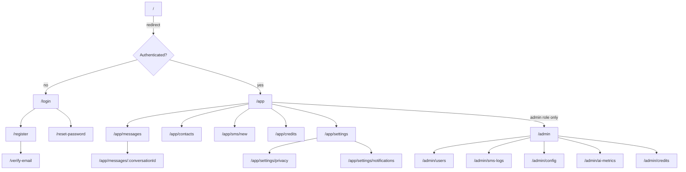

# Frontend Architecture

**Document:** CHKR-ARCH-003  
**Project:** Chikka Reborn  
**Version:** 1.0  
**Status:** Draft  
**Last Revised:** November 2026  

---

## Purpose

This document defines the internal architecture of the Chikka Reborn React frontend application — its module structure, state management strategy, routing, real-time integration, and component design patterns.

## Scope

`frontend/` directory. All phases.

---

## 1. Technology Stack

| Technology | Version | Role |
|---|---|---|
| React | 18 | UI framework |
| TypeScript | 5.x (strict) | Type safety |
| Vite | 5.x | Build tool, dev server |
| Tailwind CSS | 3.x | Utility-first styling |
| shadcn/ui | Latest | Accessible component library |
| React Router | v6 | Client-side routing |
| TanStack Query | v5 | Server state management |
| React Hook Form | v7 | Form state management |
| Zod | v3 | Schema validation |
| Supabase JS SDK | v2 | Auth, Realtime, Storage |

---

## 2. Directory Structure

```
frontend/
├── index.html
├── vite.config.ts
├── tsconfig.json
├── tailwind.config.ts
├── public/
│   └── assets/                   # Static assets (icons, fonts)
└── src/
    ├── main.tsx                   # Application entry point
    ├── App.tsx                    # Root component; router setup
    │
    ├── components/                # Shared UI (not feature-specific)
    │   ├── ui/                    # shadcn/ui base components (generated)
    │   └── common/                # App-specific shared components
    │       ├── PageLayout.tsx
    │       ├── ErrorBoundary.tsx
    │       ├── LoadingSpinner.tsx
    │       ├── EmptyState.tsx
    │       └── SimulatedBadge.tsx # SIMULATED label for SMS
    │
    ├── features/                  # Feature modules (domain-aligned)
    │   ├── auth/
    │   │   ├── components/        # LoginForm, RegisterForm, etc.
    │   │   ├── hooks/             # useAuth, useLogin, useRegister
    │   │   ├── api.ts             # API call functions (typed)
    │   │   ├── types.ts           # Feature-local TypeScript types
    │   │   └── routes.tsx         # Feature route definitions
    │   ├── contacts/
    │   ├── messaging/             # Chikka-to-Chikka
    │   ├── sms-send/              # Internet-to-SMS
    │   ├── sms-receive/           # Inbound SMS display
    │   ├── ai-assistant/          # AI suggestion panel
    │   ├── notifications/
    │   ├── credits/
    │   ├── privacy/
    │   ├── admin/
    │   └── modes/                 # Classic / Modern toggle
    │
    ├── lib/
    │   ├── api-client.ts          # fetch wrapper: auth headers, error parsing
    │   ├── supabase.ts            # Supabase client singleton
    │   ├── query-client.ts        # TanStack Query client config
    │   └── utils.ts               # Shared utilities
    │
    ├── hooks/                     # Global shared hooks
    │   ├── useCurrentUser.ts
    │   ├── useRealtimeMessages.ts
    │   └── useSmsSegments.ts
    │
    ├── stores/                    # Global UI state (Zustand if needed)
    │   └── uiStore.ts             # Theme, active mode, sidebar state
    │
    ├── types/                     # Global TypeScript types
    │   ├── api.ts                 # API response shapes
    │   ├── models.ts              # Domain model types
    │   └── enums.ts               # Shared enums
    │
    └── styles/
        └── globals.css            # Tailwind directives + custom CSS vars
```

---

## 3. Routing Architecture



Route protection:
- `/app/*` — requires valid Supabase session. Redirect to `/login` if absent.
- `/admin/*` — requires `role = 'admin'` in JWT claims. Return 403 page if role missing.

---

## 4. State Management Strategy

| State Type | Tool | Rationale |
|---|---|---|
| Server data (API responses) | TanStack Query | Cache, refetch, optimistic updates |
| Real-time messages | Supabase Realtime → TanStack Query cache update | Single source of truth |
| Form state | React Hook Form | Uncontrolled, performant, Zod-integrated |
| Global UI state | React Context (theme/mode) or Zustand | Small scope; Context sufficient unless frequent re-renders emerge |
| Local component state | `useState` / `useReducer` | Ephemeral UI state |

**No Redux.** Redux is not introduced. TanStack Query replaces the server-state use case Redux is often misused for.

### TanStack Query Key Conventions

```typescript
// Query keys follow [domain, resource, id?] pattern
['conversations']                          // all conversations
['conversations', conversationId]          // single conversation
['conversations', conversationId, 'messages']  // messages in conversation
['contacts']                               // contact list
['credits', 'balance']                     // credit balance
['sms', 'outbound']                        // outbound SMS history
['ai', 'suggestions', conversationId]      // AI suggestions (no-cache)
```

---

## 5. Real-Time Integration

### Phase 1 — Supabase Realtime

```typescript
// useRealtimeMessages.ts
const channel = supabase
  .channel(`conversation:${conversationId}`)
  .on('postgres_changes', {
    event: 'INSERT',
    schema: 'public',
    table: 'messages',
    filter: `conversation_id=eq.${conversationId}`,
  }, (payload) => {
    // Append new message to TanStack Query cache
    queryClient.setQueryData(
      ['conversations', conversationId, 'messages'],
      (old) => [...(old ?? []), payload.new]
    );
  })
  .subscribe();
```

Typing indicators use Supabase Realtime **broadcast** (not database changes — ephemeral):
```typescript
channel.send({ type: 'broadcast', event: 'typing', payload: { user_id } });
```

### Phase 2+ — Custom WebSocket Fallback

If Supabase Realtime connection limits are approached, a `WebSocketManager` class (`lib/websocket.ts`) wraps a custom FastAPI WebSocket endpoint with:
- Exponential backoff reconnection
- Message queuing during reconnection
- Transparent swap from Supabase subscription

---

## 6. API Client Pattern

All backend API calls go through `lib/api-client.ts`:

```typescript
// Automatically injects auth header, parses errors consistently
const apiClient = {
  get: <T>(path: string) => fetchWithAuth<T>('GET', path),
  post: <T>(path: string, body: unknown) => fetchWithAuth<T>('POST', path, body),
  patch: <T>(path: string, body: unknown) => fetchWithAuth<T>('PATCH', path, body),
  delete: <T>(path: string) => fetchWithAuth<T>('DELETE', path),
};

async function fetchWithAuth<T>(method: string, path: string, body?: unknown): Promise<T> {
  const session = await supabase.auth.getSession();
  const response = await fetch(`${API_BASE_URL}${path}`, {
    method,
    headers: {
      'Content-Type': 'application/json',
      'Authorization': `Bearer ${session.data.session?.access_token}`,
    },
    body: body ? JSON.stringify(body) : undefined,
  });
  if (!response.ok) {
    const err = await response.json();
    throw new ApiError(err.error.code, err.error.message, err.error.details);
  }
  return response.json();
}
```

---

## 7. Form Pattern

All forms use React Hook Form + Zod:

```typescript
// Example: SendSmsForm
const sendSmsSchema = z.object({
  to: z.string().regex(/^\+[1-9]\d{6,14}$/, 'Must be E.164 format'),
  body: z.string().min(1, 'Message is required').max(1600, 'Too long'),
});

type SendSmsFormValues = z.infer<typeof sendSmsSchema>;

const { register, handleSubmit, formState: { errors } } = useForm<SendSmsFormValues>({
  resolver: zodResolver(sendSmsSchema),
});
```

---

## 8. Component Design Principles

- **All states handled:** Every data-dependent component renders loading, empty, success, and error states.
- **Composition over props drilling:** Use React Context or component composition before passing props more than 2 levels deep.
- **shadcn/ui as base:** Extend shadcn components. Do not re-implement accessible primitives (dialogs, dropdowns, tooltips).
- **Mobile-first:** All layouts designed for 375px viewport first; tablet and desktop via Tailwind `md:` / `lg:` breakpoints.
- **No inline styles:** All styling via Tailwind utility classes.
- **Accessible by default:** Use semantic HTML, ARIA labels, keyboard navigation. Follow WCAG 2.1 AA.

### UI State Component Pattern

```typescript
// Standard pattern for data-dependent components
function ConversationList() {
  const { data, isLoading, isError, error } = useQuery({
    queryKey: ['conversations'],
    queryFn: () => apiClient.get('/conversations'),
  });

  if (isLoading) return <LoadingSpinner />;
  if (isError) return <ErrorState message={error.message} />;
  if (!data?.length) return <EmptyState message="No conversations yet." />;

  return <ConversationListItems conversations={data} />;
}
```

---

## 9. Classic vs Modern Mode Architecture

Both modes share the **same routing, state, and API layer**. The difference is purely visual:

- Modern Mode: default Tailwind/shadcn styles. Split-panel layout.
- Classic Mode: an alternative CSS theme (`classic-theme.css`) applied at the root `<div>` via a `data-mode="classic"` attribute. Components remain identical; only the theme changes.

The mode is stored in the user's profile (`ui_mode: 'modern' | 'classic'`) and in a React Context that applies the theme class.

---

## 10. Revision History

| Version | Date | Author | Notes |
|---|---|---|---|
| 1.0 | November 2026 | Kiro (Principal Architect) | Initial draft |
