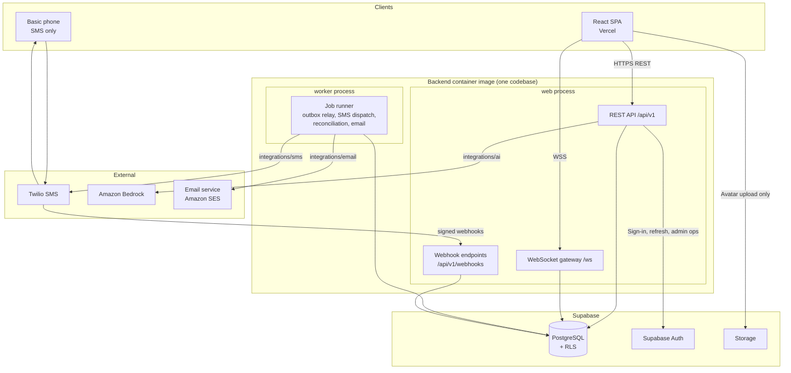
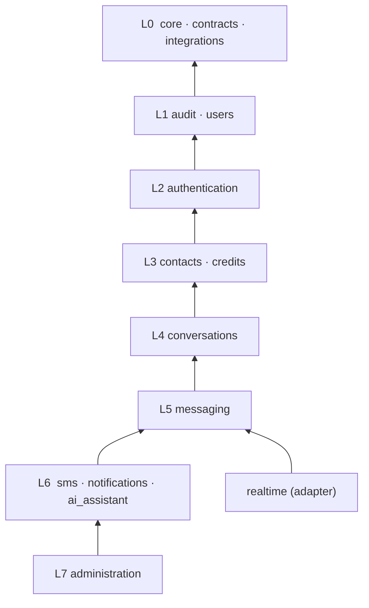
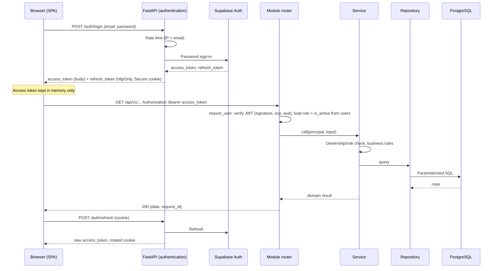
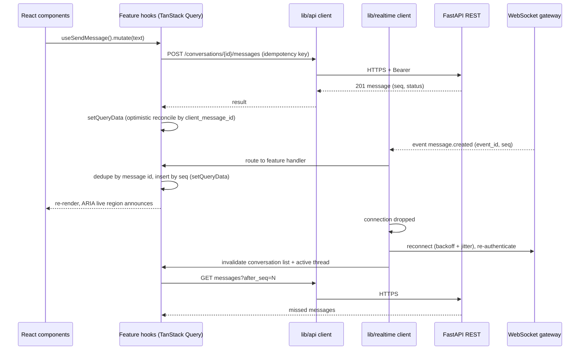
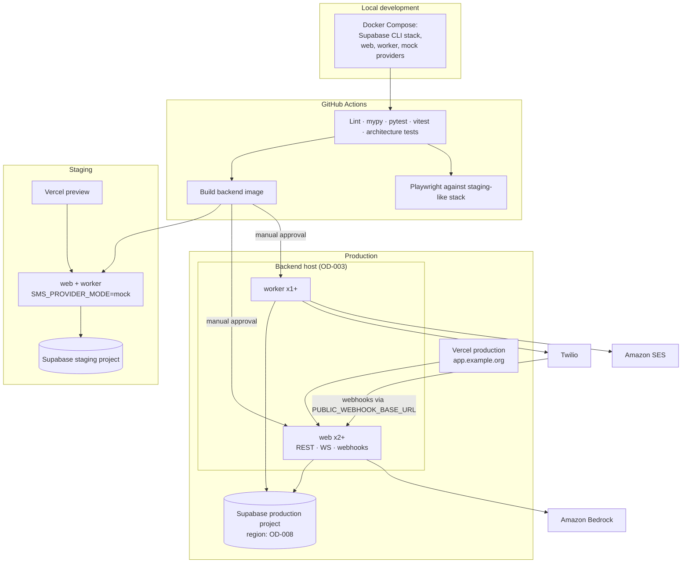

# Modular Monolith Design

**Document:** CHKR-ARCH-010  
**Project:** Chikka Reborn  
**Version:** 0.1  
**Status:** Proposed — awaiting review  
**Last Revised:** November 2026  

---

## Purpose

Defines the target architecture for the Chikka Reborn backend and its surrounding system: module boundaries, dependency rules, request flow, shared infrastructure, and deployment. It refines `system-architecture.md` and `backend-architecture.md`. On approval it replaces the directory layout and module list in `backend-architecture.md`.

Companion documents:

| Document | Covers |
|---|---|
| `sms-gateway-design.md` | Provider abstraction, lifecycle, outbound/inbound flows, retries, consent, capability |
| `ai-assistant-design.md` | AI pipeline, validation, context minimisation, human approval |
| `realtime-design.md` | WebSocket gateway, authentication, ordering, reconnection, offline notification |
| `architecture-decisions.md` | ADL-010 to ADL-017 (Proposed) |

## Scope

All backend modules and the infrastructure around them. Phase tags show when a module first needs real behaviour. Nothing here is built ahead of its phase (see `product.md`); later-phase modules exist only as empty, documented boundaries until their phase starts.

---

## 1. Review Flags

Items where this design differs from existing documents or steering. Each needs an explicit decision.

| # | Flag | Existing position | Proposed position |
|---|---|---|---|
| F1 | Real-time transport | ADL-002: Supabase Realtime in Phase 1 | Backend WebSocket gateway; Postgres `LISTEN/NOTIFY` fan-out (ADL-013) |
| F2 | Module names | `architecture.md` steering: `auth, chat, sms_outbound, sms_inbound, ai, admin, privacy, display_mode` | Your list: `authentication, users, contacts, conversations, messaging, sms, ai_assistant, notifications, credits, administration, audit`. Consent and opt-out live in `sms`; privacy settings in `users`; display mode is a `users` setting plus frontend theme |
| F3 | Directory layout | `backend-architecture.md`: `services/`, `repositories/`, `providers/` by type | `modules/<name>/` by domain, matching steering `coding-standards.md` |
| F4 | `SmsProvider` method names | Steering: `handle_inbound_webhook`, `validate_webhook_signature` | `validate_webhook`, `parse_inbound_message`, `parse_status_callback` (your names, plus one needed for delivery callbacks) |
| F5 | `AiProvider` shape | Steering: one method per feature (`translate`, `summarise`, …) | One primitive, `complete()`. Prompts live in `ai_assistant`, not in vendor code |
| F6 | RLS role | ADL-006: RLS is the primary authorisation layer | Steering `architecture.md`/`security.md`: backend is primary, RLS is last line of defence. The backend connects with a privileged role, so RLS cannot be primary there |
| F7 | Background work | ADL-009 pending; `BackgroundTasks` | Durable Postgres-backed job queue and outbox (ADL-016) |
| F8 | SMS status vocabulary | `outbound_sms` enum has `pending`, `permanently_failed` | Steering set only: `queued, accepted, sent, delivered, failed, undelivered`. Retry state is attributes, not statuses |
| F9 | Session storage (OD-014) | Open | Access token in memory; refresh token in an httpOnly cookie set by the backend |
| F10 | Email vendor | Not chosen | Amazon SES behind an `EmailSender` interface (AWS is already in the stack). Needs your confirmation |

---

## 2. System Architecture



Key properties:

- One codebase, one image, two process types (`web`, `worker`). Both import the same modules.
- `web` handles interactive traffic and never blocks on providers for SMS or email. Those go through the job queue.
- AI calls are synchronous from the user's point of view but run non-blocking on the event loop, and never gate sending.
- The browser talks to Supabase only for Auth token flows via the backend and avatar storage. It does not query tables directly, so there is one authorisation path (the backend).
- PostgreSQL is the only datastore. No Redis or broker (restriction in `technology-stack.md`).

---

## 3. Backend Layout

```text
backend/app/
├── main.py                    # App factory, lifespan, router mounting
├── worker.py                  # Worker entry point (python -m app.worker)
├── bootstrap.py               # Composition root: wires providers, ports, subscribers
├── core/                      # Shared kernel: no business rules
│   ├── config.py              # pydantic-settings, fail-fast validation
│   ├── database.py            # Async engine, session factory, UnitOfWork
│   ├── security.py            # JWT verification, Principal
│   ├── errors.py              # Typed domain exceptions + central handler
│   ├── events.py              # EventBus (writes to outbox), subscriber registry
│   ├── jobs.py                # Job model, enqueue, runner, backoff with jitter
│   ├── rate_limit.py          # RateLimiter interface + Postgres implementation
│   ├── clock.py               # Clock + seeded Random, injectable for tests
│   ├── logging.py             # JSON logs, masking, request context
│   └── text/                  # Pure helpers: phone (E.164, masking), sms_segments
├── contracts/                 # Event contracts only (pydantic models, no logic)
│   ├── messaging_events.py
│   ├── sms_events.py
│   └── …
├── integrations/              # Only place vendor SDKs may be imported
│   ├── sms/    base.py, mock.py, twilio.py, errors.py, factory.py
│   ├── ai/     base.py, bedrock.py, mock.py, factory.py
│   ├── email/  base.py, ses.py, mock.py
│   └── supabase/  auth_admin.py
├── realtime/                  # WebSocket gateway (transport adapter, not a module)
│   ├── gateway.py, connection_manager.py, protocol.py, fanout.py, presence.py
├── modules/
│   ├── audit/            ├── users/            ├── authentication/
│   ├── contacts/         ├── credits/          ├── conversations/
│   ├── messaging/        ├── sms/              ├── notifications/
│   ├── ai_assistant/     └── administration/
│       └── each: router.py schemas.py service.py repository.py models.py public.py [ports.py] [tasks.py]
└── api/v1/router.py           # Aggregates module routers; webhooks mounted separately
```

Per-module files:

| File | Role |
|---|---|
| `router.py` | Thin handlers. Parse input, call service, return response model. |
| `service.py` | Business rules, authorisation, transaction boundary (via `UnitOfWork`). |
| `repository.py` | Only layer touching SQLAlchemy. Never commits. |
| `models.py` | SQLAlchemy models owned by this module. |
| `schemas.py` | Pydantic request/response models. |
| `public.py` | The module's public interface: Protocols and DTOs other modules may import. Nothing else is importable. |
| `ports.py` | Interfaces this module *needs* but does not implement (dependency inversion). |
| `tasks.py` | Job handlers registered with the job runner. |

---

## 4. Module Responsibilities

### 4.1 Overview

| Module | Phase | Owns (tables) | Responsibility |
|---|---|---|---|
| `audit` | 1 | `audit_logs` | Append-only audit trail. Masks phone numbers, rejects message bodies and secrets by schema. |
| `users` | 1 | `profiles`, `user_settings`, `user_presence` | Profiles, roles, account status, privacy and display settings (ui mode, AI opt-out, presence visibility), phone-verified flag, account deletion and export orchestration. |
| `authentication` | 1 | none (Supabase `auth.users`) | Sign-up, login, refresh, logout, reset, email verification, phone-verification state machine, session revocation, auth rate limits, JWT-to-principal resolution (`require_user`, `require_admin`). |
| `contacts` | 1 | `contacts` | Buddy list, SMS-only contacts, block/mute, contact lookup. |
| `credits` | 2 interface, 4 full | `credit_accounts`, `credit_transactions` | Balance, hold/capture/release/refund, append-only ledger. Never records simulated sends. |
| `conversations` | 1 | `conversations`, `conversation_participants` | Threads, participants, **membership authority**, per-conversation sequence counter, read markers. |
| `messaging` | 1 | `messages`, `message_receipts`, `message_hidden` | Message persistence, ordering (`seq`), idempotent send, status projection, channel dispatch via a port, domain events. Channel-agnostic. |
| `sms` | 2 | `sms_messages`, `sms_send_attempts`, `sms_delivery_events`, `sms_inbound_events`, `webhook_events`, `sms_consents`, `sms_opt_outs`, `country_capabilities` | Everything SMS: pre-send policy checks, provider calls, delivery tracking, inbound routing, consent and opt-out, capability config, quoting (segments and cost). |
| `notifications` | 2 | `notifications`, `push_subscriptions` | In-app notification records, email and push decisions, preferences, offline-recipient detection. Subscribes to events; calls no module other than `users`. |
| `ai_assistant` | 3 | `ai_usage_logs`, `ai_suggestions` | AI request pipeline. Read-only access to conversation context. **Cannot send.** |
| `administration` | 4 | none | Admin read models and actions composed from other modules' public services. Every action audit-logged. |

Phase 2 stubs: `credits` ships only the `CreditPort` contract with a simulation-aware no-op (see OD-009); full ledger arrives in Phase 4.

### 4.2 Cross-cutting infrastructure (not modules)

| Component | Why it is not a module |
|---|---|
| `core/` | No business rules. Used by everything. |
| `integrations/` | Vendor adapters behind interfaces defined in `integrations/*/base.py`. |
| `realtime/` | Transport adapter. Consumes events and asks `conversations` about membership. |
| `contracts/` | Pure data definitions for events. Lets subscribers avoid importing publisher modules. |

---

## 5. Dependency Rules

### 5.1 Layers

A module may import only from lower layers (and `core`, `contracts`, `integrations/*/base`). Never upward, never sideways.



### 5.2 Allowed dependency matrix

Row depends on column. Imports are via `public.py` only.

| Module | audit | users | authentication | contacts | credits | conversations | messaging |
|---|---|---|---|---|---|---|---|
| audit | – | | | | | | |
| users | ✔ | – | | | | | |
| authentication | ✔ | ✔ | – | | | | |
| contacts | ✔ | ✔ | ✔ (deps) | – | | | |
| credits | ✔ | ✔ | ✔ (deps) | | – | | |
| conversations | ✔ | ✔ | ✔ (deps) | ✔ | | – | |
| messaging | ✔ | ✔ | ✔ (deps) | | | ✔ | – |
| sms | ✔ | ✔ | ✔ (deps) | ✔ | ✔ | ✔ | ✔ |
| notifications | ✔ | ✔ | ✔ (deps) | | | | |
| ai_assistant | ✔ | ✔ | ✔ (deps) | | | ✔ | ✔ (read only) |
| administration | ✔ | ✔ | ✔ | ✔ | ✔ | ✔ | ✔ + sms, notifications, ai_assistant |

"(deps)" means the router imports the FastAPI dependency `require_user` from `authentication`; no service logic is shared.

Forbidden by rule, not just by layer:

- `messaging` must not import `sms`, `integrations.sms`, or any vendor SDK.
- `sms` must not import `ai_assistant`, `notifications`, or `administration`.
- `ai_assistant` must not import any send path: not `messaging` write functions and not `sms`. It gets a read-only `ConversationReader` Protocol.
- `notifications` must not import `messaging` or `sms`; it consumes `contracts/*_events.py`.
- No module reads another module's tables. Cross-module data goes through `public.py`.

### 5.3 How cycles are avoided: dependency inversion through ports

Three places where a lower module needs behaviour that a higher module provides. Each defines a port in the lower module and `bootstrap.py` injects the implementation.

| Lower module | Port (in `ports.py`) | Implemented by | Purpose |
|---|---|---|---|
| `messaging` | `OutboundChannel` + `ChannelRegistry` | `sms.SmsOutboundChannel` | Validate and accept an outbound SMS inside the message-send transaction |
| `authentication` | `OtpDelivery` | `sms.SmsOtpDelivery` | Deliver phone-verification codes |
| `users` / `conversations` | none needed | n/a | Events carry cleanup (e.g. `UserDeactivated`) |

Inbound direction (`sms` → `messaging`) uses `messaging.public.MessageIngress` normally. There is no cycle because `messaging` never imports `sms`.

### 5.4 Enforcement

- An architecture test in `tests/unit/architecture/` parses imports with the standard library `ast` module and fails CI on layer, public-interface, and forbidden-import violations. No new dependency needed. (`import-linter` would also work; adopting it needs an ADR and pinned version.)
- Vendor SDK imports outside `integrations/` fail the same test.
- Router-imports-repository fails the same test.

### 5.5 Events and transactions

- `EventBus.publish(event)` inserts a row in `outbox_events` inside the caller's transaction. It commits or rolls back with the business change.
- A relay (worker) delivers outbox rows to subscribers at least once. Subscribers must be idempotent (dedupe on `event_id`).
- Events trigger **side effects** (notifications, realtime fan-out, audit follow-ups). They are not used to enforce invariants that must hold at commit; those use direct service calls in one transaction.
- One service operation = one transaction (`UnitOfWork`). Repositories never commit.

---

## 6. Request Flow and Authentication



Rules:

- The role and `is_active` flag are read from the database via `users`, never from client claims.
- 401 triggers one automatic refresh then one retry in the API client. A second 401 signs the user out.
- The cookie is `HttpOnly; Secure; SameSite=Lax; Path=/api/v1/auth`. The SPA and API must share a registrable domain (for example `app.example.org`, `api.example.org`). This is a hosting constraint on OD-003.
- Auth endpoints, SMS send, AI, webhooks, and WebSocket connects are rate limited per user and per IP (429 with `Retry-After`).
- Errors use the standard envelope with `request_id`.

### 6.1 Frontend and backend interaction



The WebSocket carries events down and light signals up (typing, ack, heartbeat). Writes that must be idempotent, rate limited and validated (sending messages, SMS) use REST. Server state lives in TanStack Query only. Real-time events update the Query cache; there is no parallel store.

---

## 7. Cross-Cutting Concerns

| Concern | Design |
|---|---|
| Configuration | `pydantic-settings`; fail fast at startup. Live SMS requires explicit confirmation token (see SMS design). |
| Errors | Typed `ChikkaError` subclasses; one handler maps to `{error:{code,message,details}, request_id}`. No stack traces to clients. |
| Logging | JSON, request ID, user ID where safe, module, error type. Phone masked `+63****1234`. Never message bodies, AI content, tokens, secrets. |
| Rate limiting | `RateLimiter` interface. Postgres fixed-window counters for auth, SMS, AI, webhooks (shared across instances). In-memory token bucket for per-connection WebSocket frames. |
| Time and randomness | Injected `Clock` and seeded `Random` so retry jitter and expiry are deterministic in tests. |
| Health | `/healthz` (process alive), `/readyz` (database reachable, SMS provider initialised, event listener connected). |
| Data protection | RLS on all tables (default deny to `anon`/`authenticated`); backend uses a privileged role and enforces authorisation in services. RLS tests prove cross-user denial. |

---

## 8. Deployment Architecture



| Aspect | Decision |
|---|---|
| Frontend | Vercel, static SPA, preview per PR. |
| Backend | One container image. Two process types. Needs a host with long-lived connections, graceful SIGTERM draining and an always-on worker. Not serverless. Platform is OD-003 (criteria in ADL-017). |
| Database | Supabase. Separate staging and production projects. Region is OD-008; Singapore (`ap-southeast-1`) is the leading candidate for Philippine users, to be confirmed with legal for data-location concerns. |
| Connections | Request-path SQL via the transaction pooler (asyncpg with prepared-statement cache off). `LISTEN/NOTIFY` and the job-wakeup listener use a direct or session-mode connection (the transaction pooler cannot hold `LISTEN`). |
| Migrations | Supabase migrations only. Auto-apply to staging. Production requires human approval (per `development-principles.md`). Expand-then-contract. |
| Secrets | Host secret manager / env vars. `.env.example` with placeholders only. |
| SMS mode | Default `mock` everywhere, including production (DEC-PROD-001). Live needs a per-environment confirmation token and a restart. |
| Scaling | `web` scales horizontally (fan-out is via Postgres NOTIFY). `worker` scales via `FOR UPDATE SKIP LOCKED`. |
| Webhooks | Public base URL is explicit configuration, not derived from request headers, because Twilio signatures cover the exact URL. |

---

## 9. Documents to Update on Approval

Per `documentation.md`, these change in the same change set as the approval:

| Document | Change |
|---|---|
| `architecture/backend-architecture.md` | Replace layout, DI examples, `SmsProvider`/`AiProvider` contracts, async task section |
| `architecture/sms-gateway-architecture.md` | Replace with `sms-gateway-design.md` content (status vocabulary, attempts, correlation) |
| `architecture/ai-architecture.md` | Replace provider shape and pipeline |
| `architecture/system-architecture.md` | Realtime section, deployment diagram |
| `architecture/frontend-architecture.md` | Realtime client and reconnection (not reviewed in this pass) |
| `api/messaging-api.md`, `api/notifications-api.md`, `api/sms-api.md` | Remove Supabase Realtime references; add `/realtime/*` and WS protocol |
| `database/database-schema.md`, `row-level-security.md` | New tables (see each design doc), rename `permanently_failed`/`pending` statuses, scope idempotency uniqueness to user |
| `deployment/environment-configuration.md` | New env vars (confirmation token, webhook base URL, job tuning) |
| Steering: `architecture.md`, `sms-provider-guidelines.md`, `ai-guidelines.md`, `backend-guidelines.md` | Module names, interface names, AI provider shape |
| `project-management/decision-log.md` | DEC-ARCH-008 to DEC-ARCH-015 |

---

## 10. Revision History

| Version | Date | Author | Notes |
|---|---|---|---|
| 0.1 | November 2026 | Kiro (Principal Architect) | Proposed design for review |
