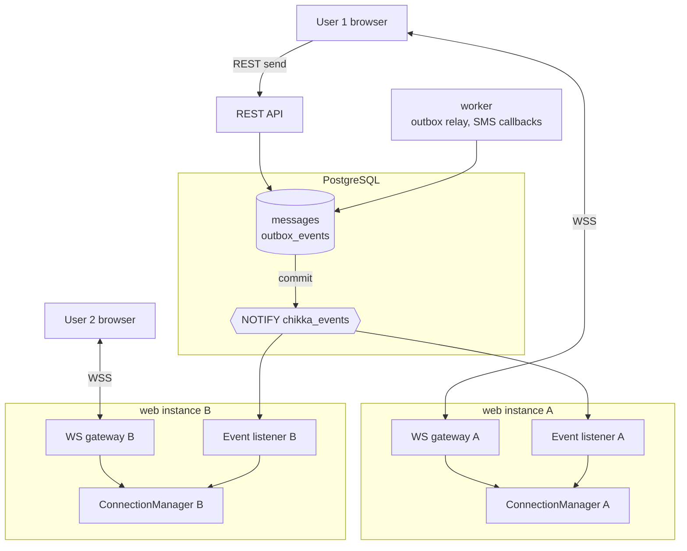
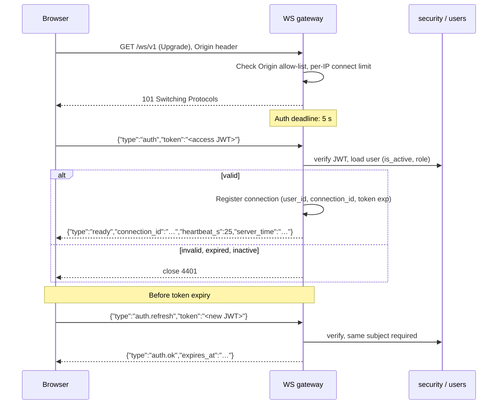
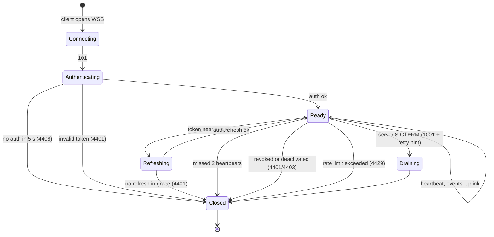
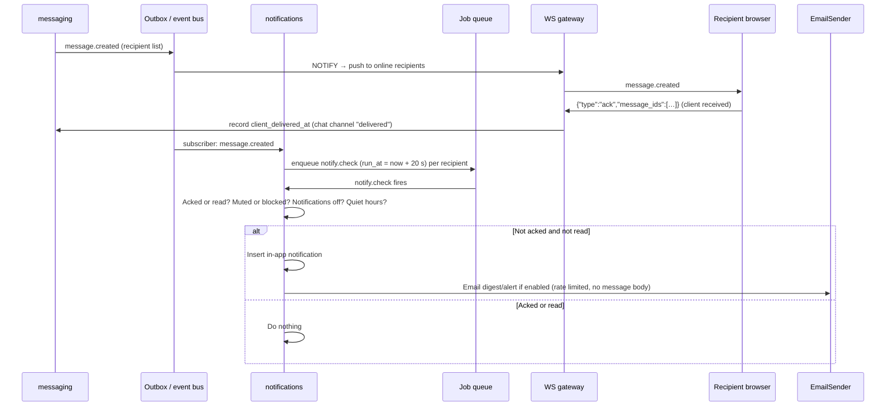

# Real-Time Design

**Document:** CHKR-ARCH-013  
**Project:** Chikka Reborn  
**Version:** 0.1  
**Status:** Accepted (ADL-013), implemented in Implementation 04 with in-process fan-out (ADL-020). The NOTIFY listener in section 2 is deferred until a second backend instance runs. Wire protocol: [realtime-api.md](../api/realtime-api.md).  
**Last Revised:** November 2026  

---

## Purpose

Defines how messages and status changes are persisted and pushed to online users: WebSocket authentication, membership checks, connection lifecycle, reconnection, duplicate handling, ordering, presence and offline notification. This design supersedes ADL-002 and ADL-008 (Supabase Realtime first) if approved. See ADL-013.

## Scope

`realtime/` package, `messaging`, `conversations`, `notifications`, and the frontend realtime client.

---

## 1. Principles

1. The database commit is the source of truth. Pushing an event is a best-effort speed-up; correctness comes from REST reconciliation.
2. Writes go through REST (idempotent, validated, rate limited). The socket is mostly downlink.
3. Authorisation is rechecked at delivery time, not only at connect time.
4. Order comes from a server-assigned per-conversation sequence, not from clocks.
5. Clients must tolerate duplicates, gaps and reordering.

---

## 2. Architecture



- **Persist first.** `messaging.send_message` allocates `seq`, inserts the message and an `outbox_events` row in one transaction, and issues `pg_notify` in that transaction. PostgreSQL delivers the notification only on commit.
- **Fan-out without Redis.** Every `web` instance holds a `LISTEN` connection. NOTIFY carries only `event_id`, `type`, `conversation_id` (well under the 8 KB limit; no content). The listener loads the event, resolves recipients, and writes to local sockets.
- **Producers are interchangeable.** REST handlers, the worker (SMS inbound, delivery status), and admin actions all emit events through the same bus.
- **Outbox as a safety net.** NOTIFY is lossy (listener restarts, connection blips). The relay in the worker re-delivers undispatched outbox rows to subscribers (notifications, audit follow-ups). Realtime push itself does not need the relay: a missed push is repaired by the client's REST sync.
- **Connections.** `LISTEN` needs a direct or session-mode connection, not the transaction pooler.

Scale limit: a single NOTIFY channel with small payloads is comfortable at the expected early scale. The trigger to revisit (ADL-013) is sustained listener lag or a cross-instance fan-out cost that matters, at which point a broker is introduced via a new ADR.

---

## 3. Authentication

Browsers cannot set an `Authorization` header on a WebSocket, and URL tokens leak into access logs, so authentication is the first frame.



Rules:

- No message or event is processed before authentication. Unauthenticated sockets get a 5-second deadline (close `4408`).
- `Origin` must be in the allow-list.
- The socket never trusts a client-supplied user ID.
- The token's expiry applies to the socket. The client refreshes with `auth.refresh`. If none arrives within a 30-second grace after expiry, the server closes with `4401`.
- Revocation: an access token stays cryptographically valid until it expires, so logout cannot cut a live socket by itself. The server closes the user's sockets on logout, deactivation, and password change via `UserSessionRevoked` and `UserDeactivated` events (`disconnect_user`). This is deterministic for events the backend sees; a token revoked directly in Supabase is covered only at expiry (at most one token lifetime).
- Per-user connection cap (default 5). The oldest connection is closed with `4409` when exceeded.

---

## 4. Conversation Membership

Recipients are resolved at delivery time, not by client "subscribe" requests.

1. An event names a `conversation_id`.
2. `fanout.py` asks `conversations.public.list_participant_user_ids(conversation_id)`. Results are cached for a few seconds per instance and invalidated by `ParticipantAdded` / `ParticipantRemoved` / `UserBlocked` events.
3. Online recipients (local connections) receive the frame. Removed or blocked users receive nothing, even if they connected before the change.
4. Per-user events (notification created, SMS status for the sender, session revoked) target the user directly.

Uplink frames that name a conversation (`typing`, `ack`) go through `conversations.require_member(conversation_id, principal)` (cached). A failure returns `{"type":"error","code":"FORBIDDEN"}` without closing the socket; repeated violations close with `4403` and write an audit entry.

---

## 5. Connection Lifecycle



| Aspect | Design |
|---|---|
| Heartbeat | Server `ping` every 25 s; client replies `pong`. Two missed beats close the socket. Keeps proxies from idling the connection out |
| Frame limits | Max 8 KB per frame; per-connection token bucket (for example 10 uplink frames per second, burst 20); `4429` on abuse |
| Presence | Connect and heartbeat update `user_presence.last_seen_at` (throttled to every 30 s). A user is "online" if seen within 60 s. A crashed instance expires naturally. Privacy setting can hide presence |
| Graceful shutdown | On SIGTERM the gateway stops accepting, sends `{"type":"reconnect","after_ms":<jittered>}` and closes with `1001`. Deploy drain window 30 s |
| Backpressure | Each connection has a bounded send queue (for example 256 frames). Overflow closes the socket with `4413`; the client reconnects and resyncs via REST |

---

## 6. Message Ordering

- `conversations.last_seq` is a counter. `send_message` runs `UPDATE conversations SET last_seq = last_seq + 1 WHERE id = $1 RETURNING last_seq` inside the transaction. The row lock serialises concurrent senders, so `seq` is gap-free for committed messages in that conversation.
- A unique index `(conversation_id, seq)` enforces it.
- Inbound SMS and Chikka messages use the same allocator, so a mixed thread has one order.
- Clients order by `seq`, never by timestamp.
- Status events (delivery, read) are not ordered by `seq`; they carry `status_version` per message (monotonic). Clients apply a status only if its version is greater than what they have.

Trade-off: the counter makes each conversation a serial write path. That is appropriate for chat-sized conversations. It would need rethinking only for very large group rooms, which are out of scope.

---

## 7. Duplicate and Missing Events

| Problem | Handling |
|---|---|
| Client resends after a timeout | `client_message_id` unique per conversation and sender. Same ID returns the original message. No new `seq` |
| Duplicate push (listener retry, reconnect overlap) | Every event has `event_id`. Client dedupes on message ID for `message.created`, on `(message_id, status_version)` for status |
| Out-of-order push | Messages inserted by `seq`. Status ignored if older version |
| Gap detected (`seq` jumps) | Client calls `GET /conversations/{id}/messages?after_seq=<last>` and merges |
| Missed push while disconnected | Same REST sync on reconnect |
| Optimistic message | Client generates `client_message_id`, shows pending. When the server returns or pushes the persisted message with the same `client_message_id`, it replaces the pending entry |

Event envelope (server → client):

```json
{
  "type": "message.created",
  "event_id": "6f1c…",
  "conversation_id": "a2b9…",
  "seq": 41,
  "data": { "message": { "id": "…", "client_message_id": "…", "channel": "chikka|sms", "simulated": false } },
  "sent_at": "2026-11-10T09:00:00Z"
}
```

Other types: `message.status_changed` (`status`, `status_version`), `message.read`, `conversation.updated`, `typing`, `presence.changed`, `notification.created`, `session.revoked`, `reconnect`, `error`. A wire protocol document (`docs/api/realtime-api.md`) is written alongside the first implementation.

---

## 8. Reconnection

Client (`lib/realtime`):

1. Exponential backoff with full jitter, base 1 s, cap 30 s. Reset after a connection stays up for 60 s.
2. On `4401`, refresh the access token once through `/auth/refresh`, then reconnect; if that fails, sign out.
3. On `4403`, do not retry automatically.
4. After `ready`, invalidate: conversation list, the open conversation (`after_seq` fetch), unread counts, notifications. Then resume normal event handling.
5. While offline, show a non-colour-only banner (icon and text) and announce reconnection through an ARIA live region. Sending falls back to REST and stays queued locally with its `client_message_id`.
6. Browser `online`/`offline` events and tab visibility trigger early reconnect attempts.

No server-side replay buffer is needed: the REST sync is the replay.

---

## 9. Offline Notifications

Presence across instances is eventually consistent, so the decision to notify is based on acknowledgement, not on "is the user connected".



Rules:

- Notification content does not include the message body by default (privacy). Titles say who and where, not what.
- Email is rate limited per user and batched (a burst of messages in one conversation produces one email). Respect preferences; honour opt-out links. Content is generated server-side. Email provider choice is flagged F10.
- The in-app `notification.created` event is pushed over the same socket.
- Push notification service (OD-004) is a later delivery channel on the same `notify.check` path; Web Push is the likely candidate and needs its own decision.
- Muted conversations and blocked senders are checked at `notify.check` time, not enqueue time.

The same mechanism covers SMS events for the sender: `sms.failed` produces a notification; `sms.status_changed` is a push only.

---

## 10. Chat Delivery Semantics

For Chikka-to-Chikka messages, "delivered" means the recipient's client acknowledged it, and "read" means the recipient opened it. This is distinct from SMS delivery, which is a carrier-level confirmation. The UI uses one badge component that renders the right wording per channel and never shows an SMS message as delivered because the chat ack path fired.

---

## 11. Security and Abuse

- Origin allow-list, per-IP connection rate, per-user connection cap, frame size and rate limits.
- All uplink frames validated with Pydantic discriminated unions; unknown types are errors.
- Nothing about a conversation leaves the server before a membership check.
- Event payloads to clients contain only what the REST API would return to the same user.
- Logs: connection ID, user ID, event type, close code. Never frame contents.

---

## 12. Testing Notes

- Unit: protocol parsing, backoff calculation, version/ordering reducers, fan-out recipient resolution with fake membership.
- Integration (real database, FastAPI test client WebSocket support): auth deadline, expired token, refresh, forbidden conversation, removed participant stops receiving, two instances via two listeners, duplicate event handling, gap repair, graceful drain.
- Frontend: reducer tests for dedupe and ordering; reconnect behaviour with fake timers; ARIA live announcements.
- E2E (Playwright): two browser contexts exchange messages; offline reconnect shows missed messages.

---

## 13. Open Items

| ID | Item |
|---|---|
| OD-004 | Push notification service |
| OD-013 | "Delete for me" model; fan-out must respect per-user hidden messages |
| New | Confirm Supabase connection mode available for long-lived `LISTEN` on the chosen plan |
| New | Whether to keep Supabase Realtime enabled for anything (proposal: no) |

---

## 14. Revision History

| Version | Date | Author | Notes |
|---|---|---|---|
| 0.1 | November 2026 | Kiro (Principal Architect) | Proposed design for review |
