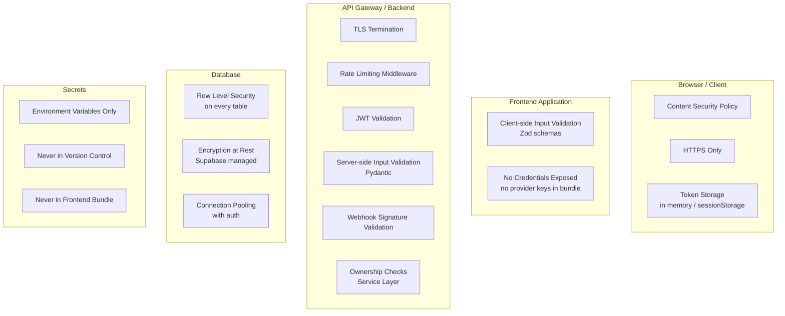
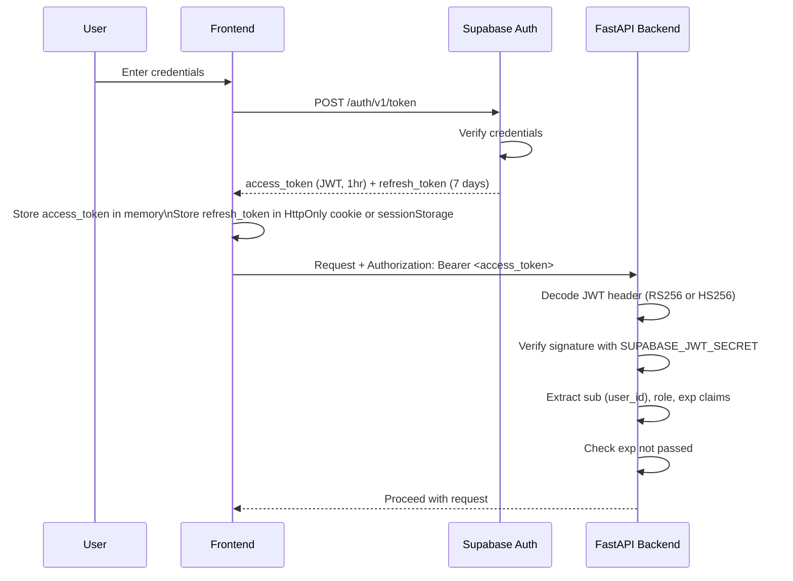

# Security Architecture

**Document:** CHKR-ARCH-008  
**Project:** Chikka Reborn  
**Version:** 1.0  
**Status:** Draft  
**Last Revised:** November 2026  

---

## Purpose

This document defines the security architecture of Chikka Reborn — authentication, authorisation, data protection, transport security, secrets management, webhook security, rate limiting, and the security controls applied at each layer.

## Scope

All tiers (frontend, backend, database, provider integrations) and all phases.

---

## 1. Security Layers



---

## 2. Authentication

Authentication is managed entirely by **Supabase Auth**.

### Flow



### Token Storage Policy

| Token | Storage | Rationale |
|---|---|---|
| Access token (JWT) | In-memory (React state) | Not persisted to disk; cleared on page close |
| Refresh token | `sessionStorage` or Supabase SDK managed | Survives page refresh; cleared on tab close |

`localStorage` is never used for tokens — it is accessible to any JavaScript on the page (XSS risk).

### Session Expiry

| Event | Behaviour |
|---|---|
| Access token expires (1hr) | Supabase SDK auto-refreshes using refresh token |
| Refresh token expires (7 days inactivity) | User redirected to login |
| Explicit logout | Both tokens revoked; user redirected to login |
| Password reset | All existing sessions invalidated |

---

## 3. Authorisation

Two authorisation layers operate in parallel:

### Layer 1 — Supabase Row Level Security (Primary)

RLS policies at the database level ensure that even if the application layer has a bug, users can only access their own data.

```sql
-- Example: Users can only read their own messages
CREATE POLICY "messages_conversation_participant" ON messages
    FOR SELECT USING (
        EXISTS (
            SELECT 1 FROM conversation_participants cp
            WHERE cp.conversation_id = messages.conversation_id
            AND cp.user_id = auth.uid()
        )
    );
```

### Layer 2 — Service Layer Ownership Checks (Secondary)

Before any mutation, the service layer verifies ownership:
```python
# In MessageService
async def delete_message(self, user_id: UUID, message_id: UUID, scope: str):
    message = await self.message_repo.get_by_id(message_id)
    if message.sender_user_id != user_id:
        raise ForbiddenError("You can only delete your own messages.")
    ...
```

### Admin Role

- Admin role is stored as `role = 'admin'` in the `profiles` table.
- The `get_admin_user` dependency verifies this claim before any admin route is processed.
- Admin role is never self-assignable — it must be set by a superadmin or directly in the database by an operator.

---

## 4. Transport Security

| Connection | Protocol | Notes |
|---|---|---|
| Browser → Vercel | HTTPS (TLS 1.3) | Managed by Vercel |
| Browser → FastAPI | HTTPS (TLS 1.3) | Managed by hosting platform |
| Browser → Supabase | HTTPS / WSS | Managed by Supabase |
| FastAPI → Supabase DB | PostgreSQL/TLS | Enforced by Supabase |
| FastAPI → Twilio | HTTPS | Twilio API |
| FastAPI → Amazon Bedrock | HTTPS / AWS SigV4 | AWS SDK |

HTTP is not used in production for any connection.

---

## 5. Secrets Management

| Secret | Storage | Access |
|---|---|---|
| `SUPABASE_SERVICE_ROLE_KEY` | Backend env var | Backend only — never in frontend |
| `SUPABASE_JWT_SECRET` | Backend env var | Backend only |
| `VITE_SUPABASE_ANON_KEY` | Frontend env var (VITE_) | Bundled into frontend (safe — anon key by design) |
| `TWILIO_AUTH_TOKEN` | Backend env var | Backend only |
| `TWILIO_WEBHOOK_SECRET` | Backend env var | Backend only |
| `AWS_ACCESS_KEY_ID` | Backend env var | Backend only |
| `AWS_SECRET_ACCESS_KEY` | Backend env var | Backend only |

Rules:
- No secret ever appears in source code.
- No secret ever appears in version control (`.gitignore` covers `.env` files).
- The `VITE_SUPABASE_ANON_KEY` is intentionally public — it is the row-level-security-enforced anon key, not a service role key.
- Secrets are rotated on team member departure or suspected exposure.

---

## 6. Webhook Security

All inbound webhooks (SMS delivery status, inbound SMS) are validated before processing:

```python
# providers/sms/twilio_provider.py
from twilio.request_validator import RequestValidator

async def validate_webhook_signature(
    self, payload: bytes, signature: str, url: str
) -> bool:
    validator = RequestValidator(self.webhook_secret)
    # Twilio uses URL + POST params for signature
    form_params = parse_qs(payload.decode())
    return validator.validate(url, form_params, signature)
```

```python
# api/v1/webhooks.py
@router.post("/sms/status")
async def sms_status_webhook(
    request: Request,
    sms_service: SmsService = Depends(get_sms_service),
):
    payload = await request.body()
    signature = request.headers.get("X-Twilio-Signature", "")
    url = str(request.url)
    
    provider = get_sms_provider()
    if not await provider.validate_webhook_signature(payload, signature, url):
        logger.warning("Invalid webhook signature", extra={"url": url})
        raise HTTPException(status_code=403, detail="Invalid signature")
    
    # Only process after validation passes
    await sms_service.process_delivery_event(...)
```

---

## 7. Input Validation

| Layer | Tool | What Is Validated |
|---|---|---|
| Frontend forms | Zod schemas | User input before submission |
| API request bodies | Pydantic v2 models | All request bodies and query params |
| Phone numbers | `utils/phone.py` | E.164 format, country code validity |
| Webhook payloads | Pydantic + provider-specific parsing | All webhook fields |
| AI prompt content | Structured injection | User content isolated from system prompt |

No raw SQL construction from user input. All queries use SQLAlchemy ORM parameterised statements.

---

## 8. Rate Limiting

| Endpoint | Limit | Window | Action on Breach |
|---|---|---|---|
| `POST /auth/login` | 5 attempts | 15 min / IP | 429 + lockout |
| `POST /auth/reset-password` | 3 attempts | 1 hr / IP | 429 |
| `POST /auth/verify-phone` (OTP send) | 3 attempts | 30 min / account | 429 |
| `POST /sms/send` | Configurable | Per day / user | 429 |
| `POST /ai/*` | Configurable | Per hour / user | 429 |
| `POST /webhooks/*` | 1000/min | Per provider IP | Passive (no 429 to provider) |

---

## 9. PII Handling

| Data | In Logs | In DB | Masking |
|---|---|---|---|
| Phone numbers | Masked: `+63****1234` | Full E.164 | Always masked in logs |
| Email addresses | Not logged | Full | Excluded from all logs |
| Message content | Never logged | Full TEXT | Excluded from all logs |
| AI prompt content | Never logged | Not stored | Never persisted |
| User display name | Not logged | Full | — |

---

## 10. Content Security Policy

```
Content-Security-Policy:
  default-src 'self';
  connect-src 'self' https://*.supabase.co wss://*.supabase.co https://api.chikka-reborn.app;
  img-src 'self' data: https:;
  style-src 'self' 'unsafe-inline';
  font-src 'self';
  frame-ancestors 'none';
  form-action 'self';
```

Additional security headers:
- `X-Frame-Options: DENY`
- `X-Content-Type-Options: nosniff`
- `Referrer-Policy: strict-origin-when-cross-origin`
- `Strict-Transport-Security: max-age=31536000; includeSubDomains`

---

## 11. Security Review Schedule

| Activity | When | Owner |
|---|---|---|
| Dependency vulnerability scan | Every PR (automated) | CI pipeline |
| OWASP Top 10 checklist | Before each production deploy | Engineering lead |
| Secrets rotation review | Quarterly | DevOps |
| RLS policy review | When schema changes | Engineering |
| Full security audit | Phase 6 (before production launch) | External / Engineering |

---

## 12. Revision History

| Version | Date | Author | Notes |
|---|---|---|---|
| 1.0 | November 2026 | Kiro (Principal Architect) | Initial draft |
