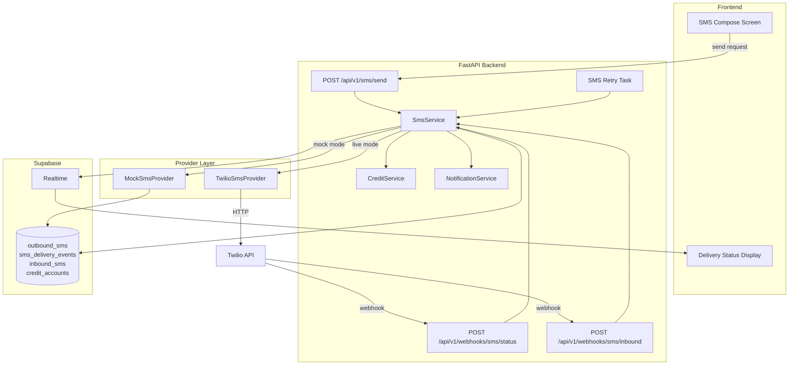
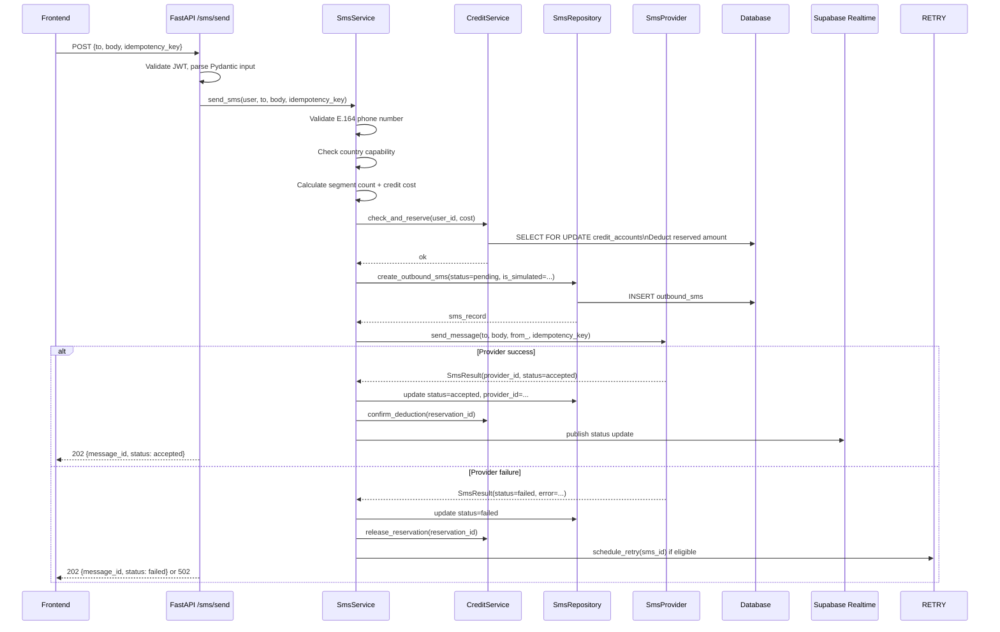
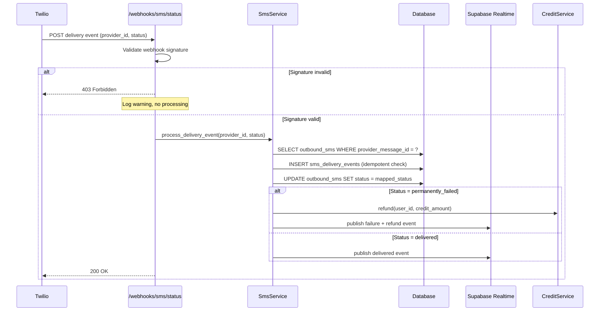
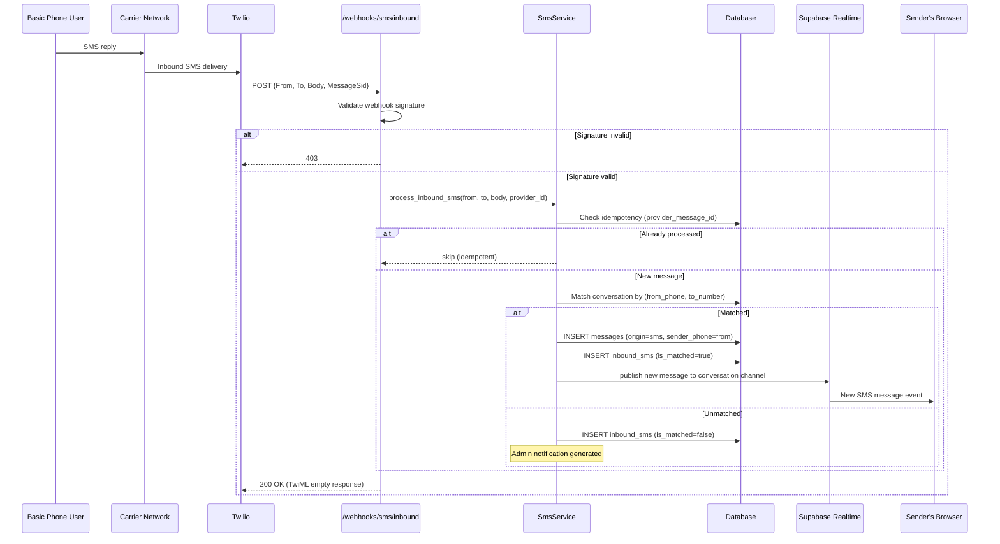
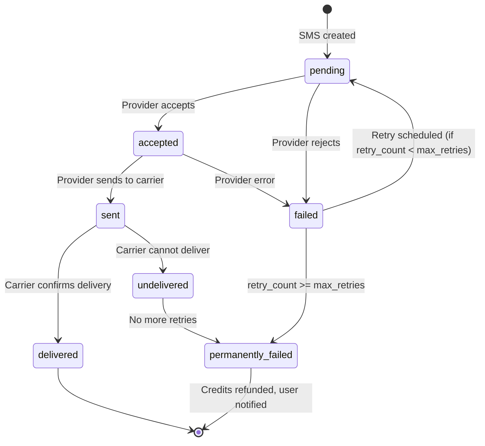

# SMS Gateway Architecture

**Document:** CHKR-ARCH-005  
**Project:** Chikka Reborn  
**Version:** 1.0  
**Status:** Draft  
**Last Revised:** November 2026  

---

## Purpose

This document defines the complete SMS subsystem architecture — provider abstraction, outbound flow, inbound flow, retry mechanism, idempotency, country capability, credit integration, and the two operating modes (simulation and live).

## Scope

All SMS-related backend components and their interactions with the database, the frontend, and external SMS providers.

---

## 1. SMS Subsystem Overview



---

## 2. Provider Abstraction

All SMS providers implement `SmsProvider` (see `docs/architecture/backend-architecture.md`). The active provider is selected at runtime from `SMS_PROVIDER_MODE`.

| Mode | Provider | Real SMS | Credits | UI Badge |
|---|---|---|---|---|
| `mock` | `MockSmsProvider` | No | Not consumed | "SIMULATED" |
| `live` | `TwilioSmsProvider` | Yes | Consumed | Status per provider |

**Invariant:** The system never silently falls back from live to mock. If live mode fails to initialise, the application fails to start with a clear error.

---

## 3. Outbound SMS Flow



---

## 4. Delivery Status Webhook Flow



---

## 5. Inbound SMS Webhook Flow



---

## 6. Retry Architecture



### Retry Configuration

| Parameter | Default | Configurable |
|---|---|---|
| Max retries | 3 | Yes (env var) |
| Base delay | 30 seconds | Yes |
| Backoff multiplier | 2x | Yes |
| Jitter | ±25% of delay | Fixed |
| Retry-eligible statuses | `failed` (transient) | Fixed in code |
| Non-retry statuses | `undelivered`, provider opt-out errors | Fixed in code |

### Idempotency

Every outbound SMS carry a client-generated `idempotency_key` (UUID). The `outbound_sms` table has a `UNIQUE` constraint on this key. If the same key is submitted twice:
- The original record is returned with its current status.
- No double send occurs.
- No double credit deduction occurs.

---

## 7. Country Capability System

The `country_capabilities` table (admin-managed) defines per-country SMS behaviour:

```python
class CountryCapability:
    country_code: str          # ISO 3166-1 alpha-2 (e.g. "PH")
    country_name: str
    outbound_enabled: bool
    inbound_enabled: bool      # Two-way SMS availability
    alphanumeric_sender_id: bool
    requires_registered_sender: bool
    credit_cost_per_segment: Decimal
    notes: str | None
```

### Philippines Configuration (Initial)

| Field | Value | Notes |
|---|---|---|
| `outbound_enabled` | `true` | Outbound SMS supported |
| `inbound_enabled` | **requires verification** | ⚠ Depends on Twilio PH routing and carrier agreements |
| `alphanumeric_sender_id` | `false` | Not universally supported by PH carriers |
| `requires_registered_sender` | `true` | A2P sender registration required |
| `credit_cost_per_segment` | TBD | Set when Twilio PH rates confirmed |

> **⚠ Provider Verification Required:** Two-way SMS (inbound) availability in the Philippines is dependent on Twilio's carrier routing agreements for PH numbers. This capability must be verified with Twilio before it is exposed to users or marketed as available. See RISK-001 in `docs/project-management/risk-register.md`.

---

## 8. Simulation Mode Behaviour

MockSmsProvider simulates the full provider lifecycle without sending any real SMS:

| Event | Behaviour |
|---|---|
| Send | Records message as `accepted` immediately |
| Delivery callback | After configurable delay (default 2s), transitions to `delivered` |
| Provider error simulation | Triggered by special test phone numbers (e.g. `+15005550001` = failure) |
| Inbound SMS simulation | Admin can POST to a test endpoint to simulate an inbound SMS |
| UI label | "SIMULATED" badge on every affected message — permanent, not removable |

---

## 9. SMS Audit Logging

All SMS events are logged with:

| Field | Description |
|---|---|
| `message_id` | Internal UUID |
| `idempotency_key` | Client-provided dedup key |
| `provider` | `mock` or `twilio` |
| `recipient_phone` | Masked: country code + last 4 digits |
| `status` | Current status enum value |
| `is_simulated` | Boolean |
| `segment_count` | Number of SMS segments |
| `credit_cost` | Credits deducted |
| `timestamp` | UTC timestamp |

Audit logs retained for minimum 90 days. Read-only from admin UI.

---

## 10. Revision History

| Version | Date | Author | Notes |
|---|---|---|---|
| 1.0 | November 2026 | Kiro (Principal Architect) | Initial draft |
