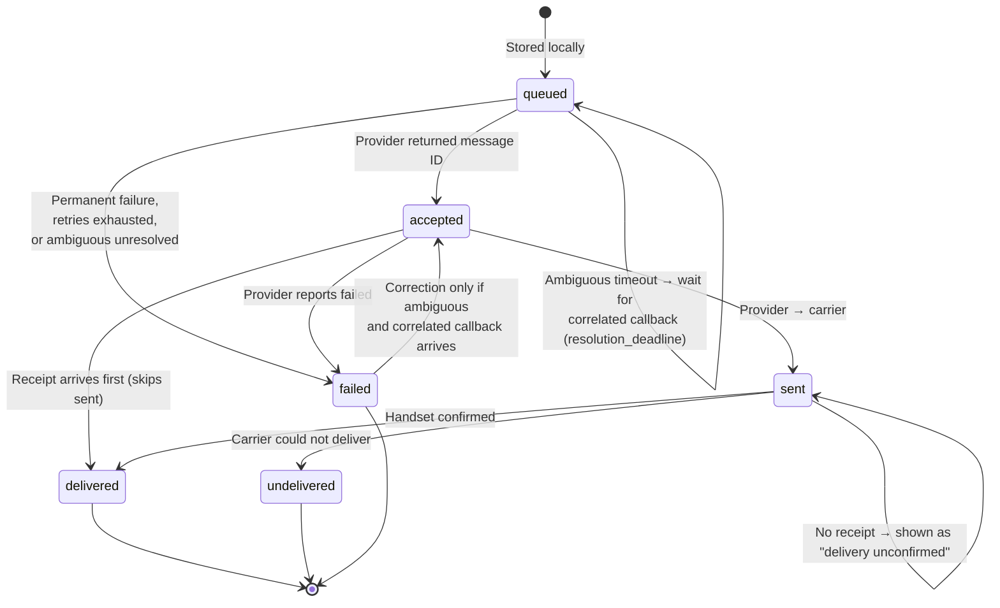
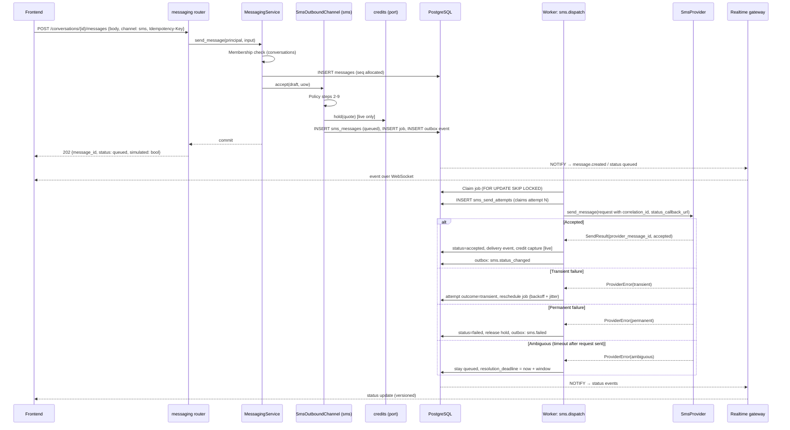
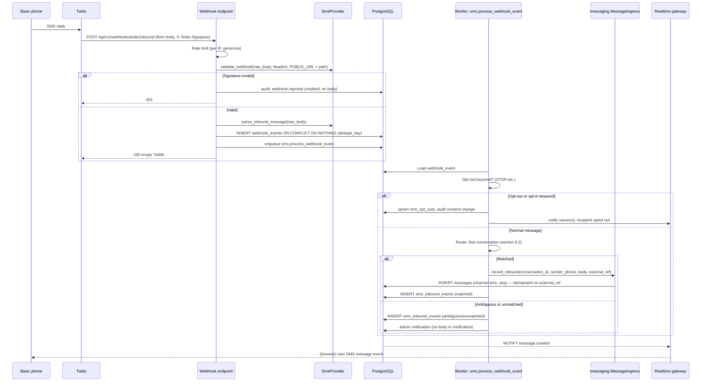

# SMS Gateway Design

**Document:** CHKR-ARCH-011  
**Project:** Chikka Reborn  
**Version:** 0.1  
**Status:** Implemented in Phase 2. Deviations and decisions are recorded in DEC-SMS-001 (decision log); the API as built is in `docs/api/sms-api.md`  
**Last Revised:** November 2026  

---

## Purpose

Defines the SMS subsystem: provider abstraction, simulation and live modes, message lifecycle, outbound and inbound flows, idempotency, retries, failure classification, webhook verification, delivery-event persistence, country capability, rate limits and consent. On approval it replaces `sms-gateway-architecture.md`.

## Scope

Modules `sms` and `messaging` (the channel boundary), `integrations/sms/`, and the worker. Credits integrate through a port (Phase 4 detail in `module-h-credits.md`).

Twilio behaviour referenced here (status values, per-message status callback URL, error codes, out-of-order callbacks) is taken from Twilio's public documentation. Items marked **verify** must be confirmed against the Twilio account and current docs before live mode is enabled.

---

## 1. Principles

1. Provider acceptance is not carrier submission, and neither is delivery. Three different states.
2. `delivered` is set only by a provider delivery callback or a provider status lookup.
3. Simulation and live are separate modes, stored on every message, never mixed, never silently substituted.
4. Prefer a missed retry over a duplicate SMS to a real person.
5. Policy checks (consent, opt-out, capability, rate, credits) all run before anything is queued.
6. Messaging does not know which provider exists.

---

## 2. Provider Abstraction

### 2.1 Interface

Lives in `integrations/sms/base.py`. Services depend on this and nothing vendor-specific.

```python
from abc import ABC, abstractmethod
from collections.abc import Mapping

class SmsProvider(ABC):
    name: ProviderName          # "mock" | "twilio"
    mode: SmsMode               # "simulation" | "live"

    @abstractmethod
    async def send_message(self, request: SendRequest) -> SendResult:
        """Submit one message. Raises ProviderError subclasses; never returns
        success without a provider message ID."""

    @abstractmethod
    async def get_message_status(self, provider_message_id: str) -> ProviderStatusSnapshot: ...

    @abstractmethod
    async def validate_webhook(
        self, raw_body: bytes, headers: Mapping[str, str], url: str
    ) -> bool:
        """Verify the signature over the raw request. False means reject."""

    @abstractmethod
    async def parse_inbound_message(
        self, raw_body: bytes, headers: Mapping[str, str]
    ) -> InboundSmsEvent: ...

    @abstractmethod
    async def parse_status_callback(
        self, raw_body: bytes, headers: Mapping[str, str]
    ) -> ProviderStatusEvent: ...
```

Typed models (Pydantic, frozen):

| Model | Fields |
|---|---|
| `SendRequest` | `to` (E.164), `body`, `sender` (number or registered sender ID), `correlation_id` (our `sms_messages.id`), `idempotency_key`, `status_callback_url` |
| `SendResult` | `provider_message_id`, `provider_status`, `mapped_status`, `segments_reported`, `raw_error` (none on success) |
| `ProviderStatusEvent` | `provider_message_id`, `provider_status`, `mapped_status`, `error_code`, `occurred_at` (provider time if given), `dedupe_key`, `correlation_id` |
| `InboundSmsEvent` | `provider_message_id`, `from_phone`, `to_number`, `body`, `received_at`, `dedupe_key` |
| `ProviderError` | Subclasses carry a `FailureClass` (section 8) |

`parse_status_callback` is added beyond the four methods you listed. A delivery callback is not an inbound message, and the existing design already needs it.

### 2.2 Implementations

| Provider | Mode | Behaviour |
|---|---|---|
| `MockSmsProvider` | `simulation` | Sends nothing. Returns `accepted` with a synthetic ID (`SIM-` prefix). Emits scripted status callbacks (`sent` then `delivered`) through the **same** webhook pipeline using a mock signer (`HMAC-SHA256` over the raw body with `MOCK_WEBHOOK_SECRET`). Scenario table keyed by fictional numbers (the `+1 555 01xx` range): transient failure, permanent failure, ambiguous timeout, undelivered, duplicate callback, out-of-order callbacks, opt-out reply. Delays come from the injected `Clock`. |
| `TwilioSmsProvider` | `live` | REST send via `httpx`; per-message `StatusCallback` URL carries `?sms_id=<correlation_id>`. Signature check uses Twilio's scheme (HMAC-SHA1 over URL plus sorted form parameters, with the auth token), against the configured public URL. Maps Twilio statuses (section 4.2) and error codes (section 8). |

The mock exercises the same code from webhook intake onward as production, so a bug in signature handling, de-duplication, ordering or persistence shows up in simulation.

### 2.3 Dependency injection and mode selection

```python
# integrations/sms/factory.py (design sketch)
def build_sms_provider(settings: Settings) -> SmsProvider:
    if settings.sms_provider_mode == "mock":
        return MockSmsProvider(clock, signer, scenarios)
    # live
    settings.require_live_confirmation()      # raises ConfigurationError
    provider = TwilioSmsProvider.from_settings(settings)
    return provider                           # constructor validates credentials
```

- Built once in the app lifespan and stored on `app.state`. Injected through `Depends(get_sms_provider)`. Tests override the dependency.
- **Live confirmation:** `SMS_PROVIDER_MODE=live` additionally requires `SMS_LIVE_CONFIRMATION=ENABLE_LIVE_SMS:<ENVIRONMENT_NAME>` where the suffix equals `APP_ENV`. A token copied from staging fails in production. Missing or wrong token stops startup.
- **Fail loudly:** any failure constructing the live provider raises and the process exits non-zero. `/readyz` reports the provider mode and initialised state. There is no `except: return Mock…` path anywhere. The architecture test fails if `integrations.sms.mock` is imported outside the factory and tests.
- Mode is startup configuration, not a runtime toggle. Changing it needs a redeploy and the confirmation token, which satisfies "explicit operator confirmation per environment" and keeps the audit trail in deploy history. Startup writes an `sms.mode_started` audit entry.
- The mode is recorded on every `sms_messages` row (`provider`, `provider_mode`, `is_simulated`). A check constraint ties `is_simulated = true` to `provider = 'mock'`. Reports and credit ledgers exclude simulated rows by construction.

### 2.4 How `messaging` stays provider-agnostic

`messaging` defines the port; `sms` implements it; `bootstrap.py` registers it.

```python
# modules/messaging/ports.py
class OutboundChannel(Protocol):
    channel: MessageChannel                     # "sms"
    async def accept(self, draft: OutboundDraft, uow: UnitOfWork) -> OutboundAcceptance:
        """Run all policy checks, persist channel records, enqueue dispatch.
        Raises typed domain errors (opted out, unsupported country, over limit,
        insufficient credits). Runs inside the caller's transaction."""
```

`messaging.send_message` persists the message, then calls `ChannelRegistry.get(message.channel).accept(...)` in the same transaction. If `accept` raises, the message row rolls back and the user gets the specific error. Messaging never imports `sms` or any provider type.

---

## 3. Data Model Changes (SMS)

Refines `outbound_sms`, `sms_delivery_events` and `inbound_sms` from `database-schema.md`. Names below follow `database.md` conventions; DDL is written when the migration is authored.

| Table | Key columns | Constraints and notes |
|---|---|---|
| `sms_messages` (replaces `outbound_sms`) | `id`, `message_id` (FK `messages`), `sender_user_id`, `recipient_phone`, `segment_count`, `encoding`, `quoted_credits`, `status`, `provider`, `provider_mode`, `is_simulated`, `provider_message_id`, `idempotency_key`, `request_fingerprint`, `failure_class`, `failure_code`, `attempt_count`, `max_attempts`, `resolution_deadline`, `status_version`, `accepted_at`, `sent_at`, `terminal_at` | `UNIQUE (sender_user_id, idempotency_key)`; `UNIQUE (provider, provider_message_id)` where not null; `status` check against the six statuses; body is stored on `messages`, not duplicated |
| `sms_send_attempts` | `id`, `sms_message_id`, `attempt_no`, `started_at`, `finished_at`, `outcome` (`accepted`/`transient`/`permanent`/`ambiguous`/`configuration`), `http_status`, `provider_error_code` | `UNIQUE (sms_message_id, attempt_no)`. Row is inserted **before** the provider call (claims the attempt) |
| `sms_delivery_events` | `id`, `sms_message_id`, `provider_message_id`, `provider_status`, `mapped_status`, `error_code`, `occurred_at`, `received_at`, `dedupe_key`, `source` (`send_response`/`callback`/`poll`/`simulation`), `applied` (bool), `webhook_event_id` | Append-only. `UNIQUE (provider, dedupe_key)` |
| `webhook_events` | `id`, `provider`, `kind` (`status`/`inbound`), `dedupe_key`, `raw_payload` (jsonb), `received_at`, `processed_at`, `process_attempts`, `result` | Server-only. `UNIQUE (provider, kind, dedupe_key)`. Raw payload purged after 30 days (metadata kept 90) |
| `sms_inbound_events` | `id`, `provider_message_id`, `from_phone`, `to_number`, `conversation_id`, `message_id`, `routing_result` (`matched`/`ambiguous`/`unmatched`/`opt_out`), `received_at` | `UNIQUE (provider_message_id)`. Body lives in `messages` when matched |
| `sms_consents` | `id`, `owner_user_id`, `recipient_phone`, `basis` (`sender_attestation`/`recipient_opt_in`), `statement_version`, `granted_at`, `revoked_at` | One active consent per `(owner_user_id, recipient_phone)` |
| `sms_opt_outs` | `id`, `phone_hash`, `phone_e164`, `source` (`keyword`/`provider_block`/`admin`/`user_request`), `keyword`, `opted_out_at`, `opted_in_at` | **Platform-wide** and persistent. Overrides any consent |
| `country_capabilities` | As in `database-schema.md`, plus `max_segments`, `content_rules` (jsonb), `sender_id_options`, `verified_at`, `verified_by` | Philippines seeded disabled until `verified_at` is set |

Phone numbers are stored in E.164, masked in logs, and never appear in log lines unmasked. Message bodies are never logged.

---

## 4. Message Lifecycle

### 4.1 States

The vocabulary matches `sms-provider-guidelines.md`. Retry and reconciliation are attributes of the row, not extra statuses.

| Status | Meaning | Set by |
|---|---|---|
| `queued` | Stored locally. Not yet accepted by the provider. May carry `attempt_count`, `next_attempt_at`, or `resolution_deadline` | Our service |
| `accepted` | Provider received the request and returned a message ID. **Not** carrier submission, **not** delivery | Send response, or a provider `accepted`/`queued`/`sending` event |
| `sent` | Provider handed the message to the carrier | Provider `sent` event or status lookup |
| `delivered` | Provider confirms handset delivery | Provider `delivered` event or status lookup only |
| `undelivered` | Carrier or handset could not deliver after submission | Provider event |
| `failed` | Never reached the carrier: rejected, provider failure, or retries exhausted or non-retriable | Provider event or our policy |

Terminal: `delivered`, `undelivered`, `failed`.

**Unconfirmed delivery.** Some routes never return receipts. A message stuck in `sent` stays `sent`. The API adds `delivery_confirmation: "unconfirmed"` once `SMS_DLR_WAIT_HOURS` (default 24) passes, and the UI shows "Sent — delivery not confirmed". It is never promoted to `delivered` and never silently turned into `failed`.

### 4.2 Provider event mapping (Twilio)

| Twilio status | Internal status | Notes |
|---|---|---|
| `accepted`, `scheduled`, `queued`, `sending` | `accepted` | Provider has it; not at the carrier yet |
| `sent` | `sent` | Carrier submission |
| `delivered` | `delivered` | Handset confirmation |
| `undelivered` | `undelivered` | Carrier-side failure |
| `failed` | `failed` | Failed at or before the carrier hand-off |
| `canceled` | `failed` | `failure_code = canceled` |
| `receiving`, `received` | not outbound | Inbound path only |

Unknown provider statuses are stored in `sms_delivery_events` with `applied = false` and raise an alert. They never change message status.

Mock statuses map one-to-one. Mock `delivered` is always flagged `source = simulation`, and the UI shows SIMULATED beside it.

### 4.3 Transition rules

Rank: `queued` 0 → `accepted` 1 → `sent` 2 → terminal 3.

1. Status only moves forward in rank. Callbacks can arrive out of order; Twilio documents that. An event of lower or equal rank is stored (`applied = false`) and ignored for status.
2. A later event may skip states (`delivered` arriving before `sent` is applied, and `sent_at` is back-filled from the event).
3. The first terminal state wins. A conflicting later terminal event (for example `delivered` after `undelivered`) is stored, `applied = false`, and flagged for review.
4. One exception: a row with `failure_class = ambiguous` marked `failed` may be corrected forward by a correlated provider event (section 8.3). The correction is audit-logged.
5. All updates run under `SELECT … FOR UPDATE` on the `sms_messages` row and bump `status_version`. Realtime events carry `status_version` so clients ignore stale ones.

### 4.4 State diagram



### 4.5 Where the three milestones are visible

| Milestone | Status | Evidence stored | UI text |
|---|---|---|---|
| Provider acceptance | `accepted` | `provider_message_id`, `accepted_at`, delivery event `source=send_response` | "Accepted by provider" |
| Carrier submission | `sent` | `sent_at`, delivery event | "Sent to carrier" |
| Confirmed delivery | `delivered` | `terminal_at`, delivery event with provider timestamp | "Delivered" |

The frontend renders one shared delivery badge and one SIMULATED label (`coding-standards.md`). It has no code path that shows "delivered" from `accepted`.

---

## 5. Outbound Workflow

### 5.1 Pre-send policy pipeline

Runs inside `SmsOutboundChannel.accept()` in the send transaction. Any failure rejects the send with a specific error and nothing is queued.

| Step | Check | Error code | Mode |
|---|---|---|---|
| 1 | Principal owns the conversation; sender account active | `FORBIDDEN` | both |
| 2 | Idempotency: same key and fingerprint returns the original; same key with different payload is rejected | `IDEMPOTENCY_KEY_REUSED` (422) | both |
| 3 | Recipient valid E.164; country resolved | `INVALID_PHONE` | both |
| 4 | Sender has a verified phone and a usable sender identity for the destination | `SENDER_NOT_VERIFIED` | both |
| 5 | Country capability: outbound enabled, sender-ID rules, content rules, max segments | `SMS_COUNTRY_UNSUPPORTED` / `SMS_CONTENT_RESTRICTED` | both |
| 6 | Opt-out list (platform-wide) | `PHONE_OPTED_OUT` | both |
| 7 | Consent record exists and not revoked | `CONSENT_REQUIRED` | both |
| 8 | Rate limits (section 11) | `RATE_LIMITED` (429) | both |
| 9 | Segmentation and quote (segments, encoding, credit cost) | – | both |
| 10 | Credit hold | `INSUFFICIENT_CREDITS` | **live only** (simulation: "would cost" preview, see OD-009) |
| 11 | Insert `sms_messages` (`queued`), enqueue `sms.dispatch` job (dedupe key = `sms_message_id`), publish `sms.queued` | – | both |

Simulation runs steps 1–9 so users see realistic validation and rate limiting, and skips only the ledger.

A separate `POST /sms/quote` endpoint runs steps 3, 5, 6, 7 and 9 without side effects, so the compose screen can show segment count, credit cost, country capability and consent state before sending.

### 5.2 Sequence



Credit semantics (live mode): **hold** at step 10, **capture** when the provider accepts, **release** if the message fails before acceptance, **refund** if it later fails permanently after capture. Every movement writes an append-only ledger row with user, message, provider, country, segments, amount, timestamp. Simulated messages never touch the ledger. Whether `undelivered` is refunded is a product decision; the default proposed is yes, flagged for Phase 4.

---

## 6. Inbound Workflow



### 6.1 Verification and intake rules

- Signature is validated before any parsing or persistence. The provider verifies over the exact raw bytes it received; the endpoint reads the body once as `bytes` and passes that to both validation and parsing.
- No development bypass. Simulation uses the mock signer through the same validator.
- Valid but duplicate events (same `dedupe_key`) return 200 and do nothing. Twilio may send an idempotency header on webhook retries (**verify**); if present it is the dedupe key, otherwise `(MessageSid, MessageStatus)` for status and `MessageSid` for inbound.
- The endpoint persists and acknowledges quickly. Processing happens in the worker. This keeps responses well inside Twilio's webhook timeout.
- Unknown message IDs on status callbacks are stored as orphaned and re-processed by the worker for 10 minutes (the callback can overtake our database commit of the provider ID). The `sms_id` query parameter on the callback URL lets us correlate without waiting.

### 6.2 Inbound routing

Matching on `(from_phone, to_number)` is ambiguous when one platform number serves many users who text the same phone (OD-011). Proposed default, pending your decision:

1. Candidate conversations: conversations with an outbound `sms_messages` row to `from_phone` from `to_number` within `SMS_REPLY_WINDOW_HOURS` (default 72).
2. Exactly one candidate: matched.
3. More than one: `ambiguous`. The message is held, the platform sends nothing automatically, and the candidate owners see a "reply needs routing" item (user picks the conversation). An admin can resolve if no user does.
4. None: `unmatched`, admin queue only.

Per-user or per-conversation numbers, or reply codes, remove the ambiguity but carry provider cost and capability implications that must be verified with Twilio and local carriers. Two-way SMS in the Philippines is not assumed; the capability row stays `inbound_enabled = false` until verified.

### 6.3 Opt-out handling

- Keywords (configurable per locale): `STOP, STOPALL, UNSUBSCRIBE, CANCEL, END, QUIT`. Opt-in keywords: `START, UNSTOP, YES`. Filipino-language equivalents are to be confirmed with native speakers before launch in the Philippines.
- Applied immediately on webhook processing and stored platform-wide. It overrides any sender-attested consent. Opt-outs are never deleted by account deletion of a sender.
- Twilio may block opted-out recipients itself and return an error on send. That error is classified `permanent` and also writes an opt-out row with `source = provider_block`.
- Owners who had messaged that recipient are told why further sends are blocked.

---

## 7. Idempotency

| Layer | Mechanism |
|---|---|
| Client request | `Idempotency-Key` header (UUID generated once per user intent and kept until success). `UNIQUE (sender_user_id, idempotency_key)` plus `request_fingerprint` (hash of recipient, body, conversation). Same key and fingerprint: return the original record and current status, no new send, no new charge. Same key, different fingerprint: 422 |
| Chat messages | `client_message_id` unique per `(conversation_id, sender_user_id)` |
| Job enqueue | `dedupe_key = sms:dispatch:<sms_message_id>`; unique among non-finished jobs |
| Provider call | The attempt row is inserted first. A crashed worker resumes at the attempt record: if an attempt has no outcome and no provider ID, it is treated as `ambiguous`, not retried blindly |
| Provider-side | **No provider-side idempotency is assumed.** I found no documented idempotency key on Twilio's message-create call, so duplicate prevention is ours (**verify** against current Twilio docs) |
| Webhooks | `webhook_events` and `sms_delivery_events` unique on dedupe key |
| Credits | Ledger entries keyed `(reference_type, reference_id, entry_type)` unique, so a retried capture or refund is a no-op |
| Events | Subscribers dedupe on `event_id` |

---

## 8. Failure Classification and Retry

### 8.1 Classes

| Class | Meaning | Examples | Action |
|---|---|---|---|
| `policy` | Blocked by our rules before the provider | Opted out, consent missing, country unsupported, rate limited, insufficient credits | Rejected at send time. Never queued, never retried, never charged |
| `transient` | Provider call failed before acceptance and no message exists | Network error before request completion, HTTP 429 (honour `Retry-After`), 5xx, connection reset | Retry with backoff |
| `ambiguous` | Request may have reached the provider; outcome unknown | Read timeout after sending, connection dropped mid-response, worker crash mid-call | Do **not** resend. Hold in `queued` until `resolution_deadline` for a correlated callback; then `failed` |
| `permanent` | Retrying cannot help | Invalid number (Twilio 21211), recipient blocked (21610), landline or unreachable (30006), unknown destination (30005), carrier filtering (30007), unreachable handset (30003) | Terminal. No retry. Release or refund |
| `configuration` | Our credentials, sender or account state | HTTP 401/403, sender not registered or not approved, account suspended | No retry. Raise operator alert, open a circuit (pause dispatch for that provider), keep messages `queued` until an operator clears it or `SMS_QUEUE_MAX_AGE` expires them to `failed` |

Unknown error codes default to `permanent` (fail safe: no repeat sends). The code→class table lives in `integrations/sms/errors.py`, is unit tested, and is reviewed against Twilio's current error catalogue before live mode (**verify**).

Async failures reported by callbacks (`failed`, `undelivered`) are never auto-resent. The provider already attempted delivery; resending risks duplicates. The user is notified and can resend manually, which creates a new message with a new idempotency key.

### 8.2 Retry policy

Applies only to `transient` failures on the submission call.

| Parameter | Default | Setting |
|---|---|---|
| Max attempts (including first) | 4 | `SMS_MAX_ATTEMPTS` |
| Base delay | 30 s | `SMS_RETRY_BASE_SECONDS` |
| Multiplier | 2 | `SMS_RETRY_MULTIPLIER` |
| Jitter | ±25 % uniform | fixed in code, seeded RNG in tests |
| Cap | 15 min | `SMS_RETRY_MAX_DELAY_SECONDS` |
| Retry `Retry-After` | honoured if longer | – |

Delay for attempt *n* = `min(cap, base × multiplier^(n-1)) × (1 + jitter)`, jitter drawn from the injected seeded `Random`. After the last attempt the message becomes `failed` (`failure_class = transient`, `failure_code = retries_exhausted`), the hold is released, and the user is notified through the `sms.failed` event.

Defaults are configurable per environment. In tests, the clock is frozen and the RNG seeded.

### 8.3 Ambiguous outcomes

1. Worker records the attempt as `ambiguous` and sets `resolution_deadline = now + SMS_AMBIGUOUS_WINDOW` (default 15 minutes). Status stays `queued`.
2. If a status callback arrives carrying our `sms_id`, the provider ID is adopted and the row moves forward normally.
3. At the deadline with no evidence, the row becomes `failed` (`failure_class = ambiguous`, `failure_code = outcome_unknown`). The hold is released; no capture happened.
4. If a correlated callback shows up later, rule 4 in section 4.3 corrects the status forward, captures the charge if live, and writes an audit entry.
5. The UI states that delivery of the failed message could not be ruled out before the user chooses to resend.

`SMS_RETRY_AMBIGUOUS` (default `false`) exists for operators who accept duplicate risk. It is not enabled by default.

### 8.4 Reconciliation

A scheduled job polls `get_message_status` for messages in `accepted`/`sent` older than a threshold (5 min, then 30 min, then 24 h), using the same transition rules. It catches lost callbacks. It never invents `delivered` for a route without receipts.

---

## 9. Delivery Event Persistence

- Every provider signal (send response, callback, poll, simulated callback) writes one `sms_delivery_events` row, whether or not it changes status. `applied` records the outcome.
- Raw provider payloads are kept in `webhook_events.raw_payload` (30 days), never in application logs.
- Status projection to `messages` goes through `messaging.public.apply_delivery_status(message_id, status, status_version)`. `sms` is the source of truth. `messaging` keeps only a read projection and ignores older versions.
- Realtime `sms.status_changed` events are emitted from the same transaction as the status update (via the outbox).
- Audit log lines carry message ID, idempotency key, provider, masked recipient, status, timestamp. Retention at least 90 days.

---

## 10. Country Capability Configuration

`country_capabilities` is the source of truth. A guard (`CapabilityPolicy`) answers `can_send(country, sender_identity, body)` and `can_receive(country)` and is the only reader.

| Field | Used for |
|---|---|
| `outbound_enabled`, `inbound_enabled` | Gate send; gate two-way UI and reply routing |
| `alphanumeric_sender_id`, `requires_registered_sender`, `sender_id_options` | Choose sender identity; block send if registration required and absent |
| `content_rules` | Max segments, disallowed categories, required opt-out wording where applicable |
| `credit_cost_per_segment` | Quote |
| `verified_at`, `verified_by` | Capability cannot be turned on without evidence (admin must record it) |

Philippines seed: outbound and inbound **disabled**, sender registration required, alphanumeric ID not assumed, no unsolicited promotional content, grey routes forbidden. Enabling requires recorded verification with the provider and registered sender (OD-007, DEC-PROD-003). The UI states the real capability per country and never claims universal two-way SMS or free SMS.

---

## 11. Rate Limits

| Scope | Default (configurable) | Why |
|---|---|---|
| Per user, SMS sends | 30 per minute, 500 per day | Abuse and cost control |
| Per recipient number (all senders) | 10 per hour | Harassment protection; stays under Twilio's reply-loop guard (30 messages in 30 s between the same two numbers) |
| Per IP, SMS send endpoint | 60 per minute | Scripted abuse |
| Provider dispatch throughput | Token bucket matched to sender throughput | Avoid provider throttling |
| Webhook intake per IP | High ceiling | Only to survive floods; real traffic is never expected to hit it |
| OTP sends | 3 per number per hour | Phone verification abuse |

Limits are enforced by the `RateLimiter` (Postgres-backed counters) and return 429 with `Retry-After`. Simulation uses the same limits.

---

## 12. Consent

| Rule | Implementation |
|---|---|
| Recorded consent before messaging a recipient | `sms_consents` row required (step 7). Created when the sender adds an SMS contact and accepts the attestation (versioned wording that they have the recipient's permission and will honour opt-outs) |
| Opt-out is persistent and wins | `sms_opt_outs` is checked first (step 6). Only the recipient opting back in (START) clears it. Senders and admins cannot override |
| Blocked sends explain why | `PHONE_OPTED_OUT` returned to the sender; message not queued |
| Auditable | Grant, revoke, opt-out and opt-in write audit entries (masked number, source, keyword) |
| AI never sends | Not in this module's concern, but `ai_assistant` has no import path to `sms` or write access to `messaging` |

---

## 13. Testing Notes

Aligned with `testing.md`.

- Unit: transition rules (ordering, duplicates, conflicts), failure classification table, retry delay with seeded RNG and frozen clock, segmentation, idempotency fingerprinting.
- Integration (real test database): full outbound flow with `MockSmsProvider`, worker claim/lease behaviour, webhook intake with valid, invalid and duplicate signatures, out-of-order callbacks, ambiguous resolution and correction, RLS and cross-user denial.
- Must-have cases: unauthorised access denied, invalid signature rejected, duplicate idempotency key ignored, `accepted` never shown as delivered, no credit charge in simulation, refund on permanent failure.
- No test calls Twilio or any real provider.

---

## 14. Open Items

| ID | Item |
|---|---|
| OD-009 | Credit handling in simulation: proposal is to skip balance enforcement and show "would cost" |
| OD-011 | Inbound routing strategy (section 6.2) |
| OD-007 | Philippine sender approach and capability verification |
| New | Confirm Twilio webhook idempotency header and per-message idempotency options |
| New | Whether `undelivered` is refunded |
| New | Phone-number parsing library (E.164 validation and country resolution). Writing this by hand is error-prone. `phonenumbers` is the usual choice; adding it needs a decision-log entry with a pinned version |
| New | Opt-out keywords for Filipino and other target languages |

---

## 15. Revision History

| Version | Date | Author | Notes |
|---|---|---|---|
| 0.1 | November 2026 | Kiro (Principal Architect) | Proposed design for review |
