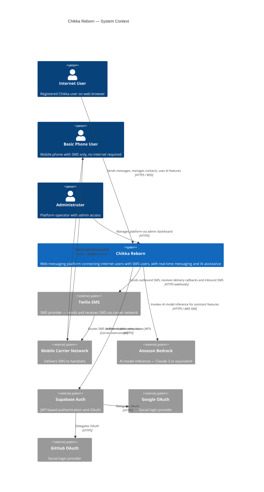
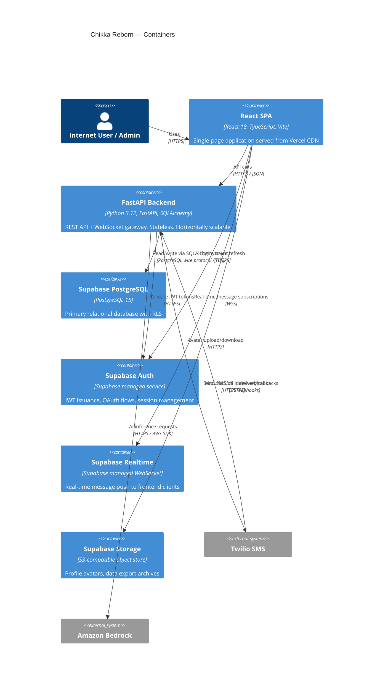
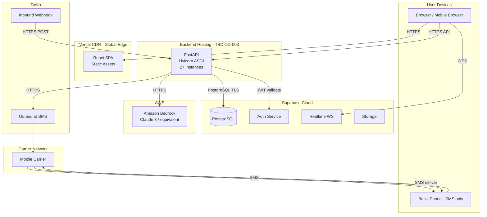

# System Architecture

**Document:** CHKR-ARCH-001  
**Project:** Chikka Reborn  
**Version:** 1.0  
**Status:** Draft  
**Last Revised:** November 2026  

---

## Purpose

This document defines the top-level system architecture of Chikka Reborn. It describes the external actors, system boundaries, deployment topology, and the interaction patterns between all major components.

## Scope

Covers all environments (development, staging, production) and all phases. Phase-specific variations are noted inline.

---

## 1. Architectural Style

Chikka Reborn follows a **three-tier modular monolith** architecture:

| Tier | Component | Host |
|---|---|---|
| Presentation | React SPA | Vercel CDN |
| Application | FastAPI backend | Render / Railway / Fly.io (OD-003) |
| Data | Supabase PostgreSQL | Supabase managed cloud |

**Why modular monolith?**  
Microservices introduce distributed systems complexity — inter-service auth, distributed tracing, deployment choreography — that is not justified at this scale. A well-structured monolith is faster to build, easier to test, and simpler to operate. Module boundaries are enforced by directory structure and import rules, not process boundaries. Individual modules can be extracted into services in future if specific scaling requirements emerge.

---

## 2. System Context Diagram

---

## 3. Container Diagram

---

## 4. Deployment Architecture

---

## 5. Communication Patterns

| Pattern | Protocol | Direction | Notes |
|---|---|---|---|
| User ↔ Frontend | HTTPS | Bidirectional | Served from Vercel edge |
| Frontend → Backend API | HTTPS/JSON | Client → Server | JWT Bearer token on all auth routes |
| Frontend ↔ Supabase Realtime | WSS | Bidirectional | Real-time message delivery, typing indicators |
| Backend → Supabase DB | PostgreSQL/TLS | Server → DB | Async SQLAlchemy |
| Backend → Twilio | HTTPS | Server → Provider | Outbound SMS send |
| Twilio → Backend | HTTPS POST | Provider → Server | Delivery status + inbound SMS webhooks |
| Backend → Amazon Bedrock | HTTPS/AWS SDK | Server → Provider | AI inference |
| User → Supabase Auth | HTTPS | Client → Auth | Login, OAuth, token refresh |

---

## 6. SMS Architecture Summary

Two modes, never mixed:

| Aspect | Simulation Mode | Live Mode |
|---|---|---|
| Provider | `MockSmsProvider` | `TwilioSmsProvider` |
| Real messages sent | No | Yes |
| UI label | "SIMULATED" badge | Status per provider event |
| Credits consumed | No | Yes |
| Activation | Default | Requires operator approval + re-auth |
| Silent fallback to mock | **Never permitted** | N/A |

---

## 7. AI Architecture Summary

- All AI calls proxied through the FastAPI backend. Frontend never calls Bedrock directly.
- Provider abstraction: `BedrockAiProvider` implements `AiProvider` ABC.
- AI responses returned as suggestions. User must explicitly accept before message is sent.
- No auto-send path exists. This is a permanent architectural constraint.
- AI call failures degrade gracefully — core messaging is never blocked.

---

## 8. Security Boundary Summary

| Boundary | Enforcement |
|---|---|
| User data access | Supabase RLS on every table |
| API authentication | JWT validation on every protected route |
| Webhook integrity | Provider signature validation before processing |
| Secret management | Environment variables only; never in code or frontend bundles |
| Logging | PII masked; no message content in logs |

---

## 9. Scalability Path

| Phase | WebSocket Strategy | Scale Approach |
|---|---|---|
| 1 | Supabase Realtime | Suitable for < ~1,000 concurrent users |
| 2+ | Evaluate Supabase limits | Upgrade plan or add custom WS layer |
| Future | FastAPI WebSocket + Redis pub/sub | Multi-instance horizontal scale |

The architecture is designed so that swapping from Supabase Realtime to a custom WebSocket layer requires changes only to the frontend subscription code and a new backend WebSocket endpoint — no changes to the message data model.

---

## 10. Architectural Decisions Index

All architectural decisions are recorded in `docs/architecture/architecture-decisions.md`.

Key decisions affecting this document:

| ADL ID | Decision |
|---|---|
| ADL-001 | Modular monolith over microservices |
| ADL-002 | Supabase Realtime for Phase 1 WebSocket |
| ADL-003 | Provider abstraction for SMS and AI |
| ADL-004 | Backend-proxied AI calls |
| ADL-006 | Supabase RLS as primary authorisation layer |

---

## 11. Revision History

| Version | Date | Author | Notes |
|---|---|---|---|
| 1.0 | November 2026 | Kiro (Principal Architect) | Initial draft with Mermaid diagrams |
