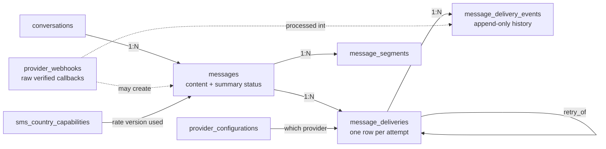

# Database Schema

**Document:** CHKR-DB-001  
**Project:** Chikka Reborn  
**Version:** 2.0  
**Status:** Proposed (implemented in `supabase/migrations/`, verified on a clean database)  
**Last Revised:** November 2026  

---

## Purpose

Explains the Chikka Reborn PostgreSQL schema: what each table is for, how the tables relate, why tables were added or left out, and how the message and delivery model works. The exact columns, types, defaults, constraints and indexes are in the generated [schema-reference.md](schema-reference.md), which is produced from the migrations and cannot drift from them. Relationships are drawn in [entity-relationships.md](entity-relationships.md). Policies are in [row-level-security.md](row-level-security.md).

This version replaces schema 1.0 (13 tables). It was designed against all 130 functional requirements; coverage is in [requirements-traceability.md](requirements-traceability.md).

---

## 1. Conventions

| Topic | Rule |
|---|---|
| Identifiers | `uuid` primary keys with `gen_random_uuid()`. Two exceptions with natural composite keys: `conversation_members (conversation_id, user_id)` and `messaging_credits (user_id, ledger_type)`. |
| Time | `timestamptz` everywhere. PostgreSQL stores UTC; clients convert to the user's `time_zone`. `created_at` and `updated_at` on every mutable table; `updated_at` is set by trigger. Append-only tables carry only the time of the event. |
| Status fields | `text` with named `CHECK` constraints rather than PostgreSQL enum types. Adding a status is a one-line constraint change; altering an enum type is harder to roll out safely. Names use the `ck_<table>_<rule>` convention. |
| Phone numbers | Domain `public.e164` (`^\+[1-9][0-9]{6,14}$`). Logs and audit rows hold masked numbers (`+63****1234`). |
| Money | Credits are stored as integer **units** (credits x 100) in `bigint`. No floating point. |
| Deletion | Profiles are never hard-deleted. Erasure scrubs personal fields and sets `status = 'deleted'`, so messages, ledgers and audit rows keep a valid reference (`ON DELETE RESTRICT` from `auth.users`). Other user-owned child data uses `ON DELETE CASCADE`. Ledgers and audit rows use `RESTRICT`. |
| Append-only | `credit_transactions`, `user_consents`, `message_delivery_events` and `audit_logs` reject `UPDATE`/`DELETE` by trigger. `audit_logs` rows may be deleted only after `retain_until`. |
| Integrity in the database | Checks that must hold regardless of which service writes (status ranks, ledger shape, ownership consistency) live in constraints and triggers, not only in application code. |
| Access | RLS enabled on all tables. `anon` has no privileges. Clients get column-level grants, so sensitive columns (OTP state, provider IDs, block suppression, AI flags) are unreadable even for a user's own rows. Writes with business or audit rules are backend-only. |
| Helper code | Functions live in the `private` schema (not exposed by the API) and are callable only as listed in the lockdown migration. |

---

## 2. Table Inventory

29 tables. The first 23 are the tables you asked to evaluate. The last six were added (section 4).

| # | Table | Purpose | Key relationships |
|---|---|---|---|
| 1 | `profiles` | Account profile, role, status, privacy and display settings | 1:1 with `auth.users` |
| 2 | `phone_numbers` | Phone numbers claimed or verified by an account, with OTP state | N:1 `profiles` |
| 3 | `contacts` | Owner-scoped address book: Chikka contacts (two rows per mutual pair) and SMS contacts | N:1 `profiles` (owner, contact user) |
| 4 | `contact_requests` | Pending, accepted, rejected, cancelled or expired requests | N:1 `profiles` (from, to) |
| 5 | `contact_groups` | Named groups per owner (max 20) | N:1 `profiles` |
| 6 | `contact_group_members` | Contacts in groups; composite keys force same owner | N:1 groups, N:1 contacts |
| 7 | `conversations` | A thread: `chikka` (two accounts) or `sms` (one account, one number) | 1:N members, 1:N messages |
| 8 | `conversation_members` | Membership plus each member's own state (pin, archive, mute, read position, AI opt-out) | N:1 conversations, N:1 profiles |
| 9 | `messages` | Logical message content and its summary status | N:1 conversations; 1:N deliveries |
| 10 | `message_deliveries` | One row per delivery attempt through a channel/provider | N:1 messages; self-link for retries |
| 11 | `message_segments` | Per-part detail for multi-part SMS | N:1 messages, optional N:1 deliveries |
| 12 | `provider_webhooks` | Verified raw provider callbacks (server-only) | optional links to delivery and message |
| 13 | `ai_assistance_logs` | AI request metadata, optional user history content | N:1 profiles; optional message link |
| 14 | `notification_preferences` | Per-user notification settings (one row) | 1:1 profiles |
| 15 | `notifications` | In-app notification feed | N:1 profiles |
| 16 | `user_blocks` | Blocks of accounts or phone numbers | N:1 profiles |
| 17 | `abuse_reports` | Reports with evidence snapshot and moderation workflow | N:1 profiles (reporter, reported) |
| 18 | `messaging_credits` | Current balance per user and ledger (live, demo) | 1:N credit_transactions |
| 19 | `credit_transactions` | Append-only credit ledger | N:1 messaging_credits; optional message |
| 20 | `user_consents` | Append-only consent history, including per-recipient SMS attestation | N:1 profiles |
| 21 | `sms_country_capabilities` | Versioned per-country SMS rules and pricing multiplier | referenced by messages and ledger |
| 22 | `provider_configurations` | Non-secret SMS provider settings; exactly one active | referenced by deliveries |
| 23 | `audit_logs` | Immutable audit trail (server-only) | optional actor link |
| 24 | `message_hides` | "Delete for me" markers per message and user | N:1 messages, N:1 profiles |
| 25 | `message_delivery_events` | Append-only normalised status history per attempt | N:1 deliveries |
| 26 | `sms_routes` | Reply routing: who holds a (platform number, remote number) pair | N:1 profiles, conversations |
| 27 | `sms_opt_outs` | Recipient opt-outs, platform-wide (server-only) | optional link to webhook |
| 28 | `system_settings` | Admin-changeable switches and defaults (server-only) | none |
| 29 | `rate_limit_counters` | Windowed counters and lockouts (server-only) | none |

---

## 3. The Message Data Model

A **message** is what was said. A **delivery** is one attempt to get it somewhere. They are separate tables, because one message can have several attempts, and a provider's view of an attempt (its own IDs, its own status names, its own errors) must not leak into the content record.

### How each case is represented

| Case | Representation |
|---|---|
| Internal (Chikka-to-Chikka) message | `messages` row, `channel = 'chikka'`, `direction = 'outbound'`, status `sent`/`delivered`/`read`/`failed`. One delivery row with `channel = 'chikka'`, no provider. "Delivered" means the recipient's client acknowledged it; "read" is stored only when the recipient has read receipts on. |
| Outbound SMS | `messages` row with `channel = 'sms'`, encoding, character and segment counts, `capability_id` (the rate version) and the quoted credit cost. Delivery attempt 1 starts `queued`; status moves forward as the provider reports. |
| Retry | A new `message_deliveries` row: `attempt_number + 1`, `retry_of_delivery_id` pointing at the failed attempt. The message shows `retrying` while the latest attempt failed transiently or is queued after a failure. |
| Inbound SMS | `messages` row with `direction = 'inbound'`, `sender_phone`, status `received`. One delivery row records receipt from the provider (`status = 'delivered'`, `provider_status` as reported, unique provider message ID). The raw callback is in `provider_webhooks`. |
| Provider message IDs | `message_deliveries.provider_message_id`, unique per provider configuration. Simulated IDs use the `SIM-` prefix. |
| Delivery events | `message_delivery_events`: one row per provider signal, with the raw `provider_status`, the `normalised_status`, and whether it was `applied` (out-of-order and duplicate signals are stored with an `ignore_reason`). |
| Failure reasons | `failure_class` (`policy`, `transient`, `ambiguous`, `permanent`, `configuration`), `is_permanent`, provider `failure_code`, redacted `failure_reason`, `http_status`. |
| Segment information | Totals on `messages` (`encoding`, `char_count`, `segment_count`). Per-part rows in `message_segments` when a provider reports parts or inbound parts need reassembly. |
| Simulation | `is_simulated` on the message and the delivery. The database refuses a delivery whose flag disagrees with the provider configuration's mode. |

### Status vocabularies are not assumed equal

Providers use different words. The database stores the provider's word untouched in `provider_status` and the platform's word in `status`. The mapping itself lives in the provider adapter (`integrations/sms`), and is unit tested there; this table shows the intended mapping.

| Platform status | Meaning | Twilio | Simulation (mock) | Internal chat |
|---|---|---|---|---|
| `queued` | Stored locally, not accepted by a provider | (not a provider state) | – | – |
| `accepted` | Provider accepted the request. Not carrier submission, not delivery | `accepted`, `scheduled`, `queued`, `sending` | `accepted` | – |
| `sent` | Provider handed it to the carrier | `sent` | `sent` | message persisted |
| `delivered` | Provider confirms handset delivery | `delivered` | `delivered` | recipient client acknowledged |
| `read` | Recipient opened it (chat only, if receipts are on) | – | – | `read` |
| `undelivered` | Carrier could not deliver | `undelivered` | `undelivered` | – |
| `failed` | Never reached the carrier, or retries exhausted | `failed`, `canceled` | `failed` | `failed` |

The message-level value `retrying` and the inbound value `received` exist only on `messages.status`.

### Rules the database enforces

- Status moves forward only (`queued` < `accepted` < `sent` < terminal < `read`). The first terminal state wins. The single exception is an attempt that failed with `failure_class = 'ambiguous'`, which a correlated provider event may correct forward.
- `status_version` increments on every change, so realtime clients can ignore stale events.
- `messages.status` is kept in step with the latest attempt by trigger; it is a projection, not an independent fact.
- `seq` is assigned by the database inside the conversation row lock: gap-free and monotonic for committed messages. Callers cannot choose it.
- A sender must be an active member of the conversation, and the channel must match the conversation type.
- A client-supplied idempotency key is unique per sender. The request hash column lets the backend detect a key reused with different content.
- A provider message ID can appear once per provider configuration.
- Message identity columns (conversation, seq, sender, channel, direction, key, created time) cannot be changed after insert.

---

## 4. Evaluation of the Required Tables

All 23 requested tables exist. Names, scope and merges are explained below.

| Requested | Decision | Reason |
|---|---|---|
| `profiles` | Kept | Adds status (`pending_verification`, `active`, `suspended`, `deleted`), privacy settings, display mode, AI opt-in. Username is nullable until onboarding completes (FR-AUTH-015). Created by trigger on `auth.users` (resolves OD-010). |
| `phone_numbers` | Kept, separate from `profiles` | Needs verification mode (live/simulated), OTP counters, release on change and per-mode uniqueness. A column on `profiles` could not express that. OTP columns are not client-readable. |
| `contacts` | Kept | One row per owner. A mutual Chikka contact is two rows, created together by `private.accept_contact_request()`. Mute, favourite and "clear from recent" are columns because they are per owner and per contact. |
| `contact_requests` | Kept | Supports pending, accepted, rejected, cancelled, expired. A partial unique index allows one pending request per pair in either direction. |
| `contact_groups`, `contact_group_members` | Kept | Max 20 groups per owner (trigger under an advisory lock), unique names per owner ignoring case. Composite foreign keys make a cross-owner group membership impossible. |
| `conversations`, `conversation_members` | Kept | `direct_key` makes pair creation idempotent. Members hold per-user state, so the old `conversation_participants` (which also allowed bare phone numbers) is replaced: the external number is an attribute of an `sms` conversation. |
| `messages` | Kept, redefined | Content plus summary status. SMS delivery detail moved out. |
| `message_deliveries` | Kept, one row per attempt | See section 3. |
| `message_segments` | Kept, deliberately optional | Totals are on `messages`. Rows exist only where per-part facts exist (provider part IDs, inbound reassembly), so most messages have none. |
| `provider_webhooks` | Kept | Only signature-verified events are stored. Rejections go to `audit_logs`. Server-only. 90-day purge date. |
| `ai_assistance_logs` | Kept, merged | Replaces `ai_usage_logs` and the earlier `ai_suggestions` idea. Usage metrics and the user's AI history are the same facts. Content columns are optional, expire, and administrators have no policy on this table. |
| `notification_preferences` | Kept as one row per user | The 8 types x 3 channels matrix stores only deviations from defaults in a validated `jsonb` object; mandatory notices cannot be switched off. |
| `notifications` | Kept | `read_at` and `dismissed_at` instead of a boolean. 90-day `expires_at`. |
| `user_blocks` | Kept | Blocks accounts or numbers. A blocked user has no way to see the block. |
| `abuse_reports` | Kept | Evidence `snapshot` survives edits and deletions. One report per reporter per message. |
| `messaging_credits` | Kept, replaces `credit_accounts` | Two rows per user (`live`, `demo`) with `balance_units` and `reserved_units`. Changed only by the ledger trigger. |
| `credit_transactions` | Kept | Entry types `grant`, `top_up`, `reservation`, `reservation_release`, `deduction`, `refund`, `adjustment`. Each type has a required sign pattern. A release or capture can only consume what that message reserved. |
| `user_consents` | Kept | Append-only. Includes per-recipient SMS sender attestation. |
| `sms_country_capabilities` | Kept, versioned | A save inserts a new version; messages and ledger rows reference the version used. Support levels are tri-state (`unsupported`, `requires_verification`, `supported`), and `supported` cannot be set without verification evidence. |
| `provider_configurations` | Kept | Never holds secrets, only `secret_ref`, the name of an environment variable or secret-manager key. Exactly one active row; a live row cannot be active without operator confirmation for an environment. |
| `audit_logs` | Kept | Rejects message-body keys, secret keys and unmasked phone numbers in metadata. |

### Tables added (6)

| Table | Why it is needed |
|---|---|
| `message_delivery_events` | A message that is accepted, then sent, then delivered, with duplicates and out-of-order callbacks, needs a history. `provider_webhooks` holds raw payloads; this table holds what the platform concluded and whether it applied. Required by FR-SMS-004. |
| `message_hides` | "Delete for me" is per user per message. A column on `messages` cannot express it (OD-013). |
| `sms_routes` | The SMS reply routing model (FR-SMSRECV, OD-011) keeps a (platform number, remote number) pair exclusive to one user for 30 days. |
| `sms_opt_outs` | Opt-outs are platform-wide per number, persist across account changes, and block every sender (FR-SMSRECV-012, FR-PRIVACY-003/008). They are not part of any one user's consent history. |
| `system_settings` | Administrators switch outbound SMS, AI and registration off and set the demo grant at runtime (FR-ADMIN-010, -013). Environment variables cannot do that without a redeploy. |
| `rate_limit_counters` | Account and IP lockout (FR-AUTH-006), contact search and request limits must hold across backend instances. There is no Redis in the stack. SMS and AI hourly limits are derived from `messages` and `ai_assistance_logs`, not from this table. |

### Earlier-design tables that no longer exist

| Old table | Replaced by |
|---|---|
| `conversation_participants` | `conversation_members` |
| `outbound_sms`, `inbound_sms` | `messages` + `message_deliveries` |
| `sms_delivery_events` | `message_delivery_events` |
| `credit_accounts` | `messaging_credits` |
| `country_capabilities` | `sms_country_capabilities` |
| `ai_usage_logs` | `ai_assistance_logs` |

### Deliberately not created yet

Each belongs to a requirement that is not in the current phase or depends on an open decision. Adding them later is an additive migration.

| Table | Requirement | Reason deferred |
|---|---|---|
| `user_sessions` | FR-AUTH-014 | Supabase `auth.sessions` holds sessions; device, browser and approximate location need a small metadata table once the backend session flow is built (Phase 1 task). |
| `message_attachments` | FR-MSG-010 | Depends on the storage bucket design. |
| `message_versions` | FR-MSG-011 | Edit history; the `edited_at` column already exists. |
| `push_subscriptions` | FR-NOTIF-002 | Depends on OD-004 (push service). |
| `data_exports` | FR-PRIVACY-002 | Export job tracking, built with the export feature. |
| `payments` | FR-CREDIT-004 | Depends on OD-001 (gateway). `credit_transactions.external_reference` already makes a payment event idempotent. |
| `jobs`, `outbox_events` | ADL-016 | The delivery table carries its own retry schedule (`next_attempt_at`, `locked_until`). The generic queue arrives with the backend core. |

---

## 5. Retention and Erasure

| Data | Rule | Mechanism |
|---|---|---|
| SMS audit entries | At least 90 days | `audit_logs.retain_until` default 90 days; security events set a longer value. Deletion is blocked before that date. |
| Raw provider webhooks | 90 days, then purged | `provider_webhooks.purge_after` |
| Notifications | 90 days | `notifications.expires_at` |
| AI history content | 30 days | `ai_assistance_logs.content_expires_at` (required whenever content is stored) |
| Unrouted inbound events | 90 days | `provider_webhooks.purge_after` |
| Account erasure | Within 30 days of request | Profile scrubbed and tombstoned (`status = 'deleted'`); contacts, preferences, AI history, notifications removed; other people's message history shows "Deleted user"; credit ledger and audit rows kept without personal data |
| Message content | **Open: OD-006** | No requirement defines it. Messages are kept until the owner deletes them or erasure applies. A retention decision is needed before launch. |

Purge jobs are backend tasks. The schema supplies the dates and indexes; it does not delete anything on its own, except by the explicit rules above.

---

## 6. Decisions Resolved by this Schema

| Item | Resolution |
|---|---|
| OD-010 profile bootstrap | Trigger on `auth.users` creates the profile; a second trigger creates credit rows, preferences and the demo grant. |
| OD-012 profile exposure | `profiles` is own-row (and admin) only. Other users read `public_profiles`, a four-column, visibility-filtered view. |
| OD-013 "delete for me" | `message_hides` per user per message; delete-for-everyone is `deleted_for_everyone_at` with the body cleared. |
| OD-011 inbound routing | `sms_routes` implements the FRS routing model. |
| OD-009 credits in simulation | Follows the FRS: a separate `demo` ledger with its own balance and a one-time grant. Demo credits cannot be bought or converted. Note this differs from the earlier SMS design proposal ("skip the ledger in simulation"). |
| Still open | OD-006 (message retention), OD-007 (Philippine sender approach), OD-008 (region). |

---

## 7. Revision History

| Version | Date | Author | Notes |
|---|---|---|---|
| 1.0 | November 2026 | Kiro (Principal Architect) | Initial 13-table draft |
| 2.0 | November 2026 | Kiro (Principal Architect) | 29 tables; message/delivery separation; implemented as migrations 20261110000001 to 15 |
