# Entity Relationships

**Document:** CHKR-DB-002  
**Project:** Chikka Reborn  
**Version:** 2.0  
**Status:** Proposed (matches `supabase/migrations/`)  
**Last Revised:** November 2026  

---

## Purpose

Shows how the 29 tables relate. Columns are limited to keys and the fields that shape a relationship. Full column lists are in [schema-reference.md](schema-reference.md).

## 1. Full Diagram

```mermaid
erDiagram
    AUTH_USERS ||--|| PROFILES : "has (restrict)"

    PROFILES ||--o{ PHONE_NUMBERS : owns
    PROFILES ||--o{ USER_CONSENTS : "records"
    PROFILES ||--o{ CONTACTS : "owns"
    PROFILES ||--o{ CONTACTS : "is contact of"
    PROFILES ||--o{ CONTACT_REQUESTS : "sends"
    PROFILES ||--o{ CONTACT_REQUESTS : "receives"
    PROFILES ||--o{ CONTACT_GROUPS : owns
    CONTACT_GROUPS ||--o{ CONTACT_GROUP_MEMBERS : contains
    CONTACTS ||--o{ CONTACT_GROUP_MEMBERS : "belongs to"
    PROFILES ||--o{ USER_BLOCKS : "blocks"
    PROFILES ||--o{ ABUSE_REPORTS : "files"
    PROFILES ||--o{ ABUSE_REPORTS : "is reported in"

    CONVERSATIONS ||--o{ CONVERSATION_MEMBERS : has
    PROFILES ||--o{ CONVERSATION_MEMBERS : "joins"
    CONVERSATIONS ||--o{ MESSAGES : contains
    PROFILES ||--o{ MESSAGES : "sends"
    MESSAGES ||--o{ MESSAGE_HIDES : "hidden by"
    PROFILES ||--o{ MESSAGE_HIDES : hides
    MESSAGES ||--o{ MESSAGE_SEGMENTS : "split into"
    MESSAGES ||--o{ MESSAGE_DELIVERIES : "attempted as"
    MESSAGE_DELIVERIES ||--o| MESSAGE_DELIVERIES : "retry of"
    MESSAGE_DELIVERIES ||--o{ MESSAGE_DELIVERY_EVENTS : "history"
    MESSAGE_DELIVERIES ||--o{ MESSAGE_SEGMENTS : "reports parts"
    PROVIDER_CONFIGURATIONS ||--o{ MESSAGE_DELIVERIES : "used by"
    PROVIDER_CONFIGURATIONS ||--o{ PROVIDER_WEBHOOKS : "received for"
    PROVIDER_WEBHOOKS ||--o{ MESSAGE_DELIVERY_EVENTS : "produces"
    PROVIDER_WEBHOOKS }o--o| MESSAGE_DELIVERIES : "matches"
    PROVIDER_WEBHOOKS }o--o| MESSAGES : "creates"
    PROVIDER_WEBHOOKS ||--o{ SMS_OPT_OUTS : "triggers"
    SMS_COUNTRY_CAPABILITIES ||--o{ MESSAGES : "rate version"
    SMS_COUNTRY_CAPABILITIES ||--o{ CREDIT_TRANSACTIONS : "rate version"
    CONVERSATIONS ||--o{ SMS_ROUTES : "routed by"
    PROFILES ||--o{ SMS_ROUTES : "holds"

    PROFILES ||--o{ MESSAGING_CREDITS : "has live and demo"
    MESSAGING_CREDITS ||--o{ CREDIT_TRANSACTIONS : "ledger"
    MESSAGES ||--o{ CREDIT_TRANSACTIONS : "charged by"

    PROFILES ||--|| NOTIFICATION_PREFERENCES : configures
    PROFILES ||--o{ NOTIFICATIONS : receives

    PROFILES ||--o{ AI_ASSISTANCE_LOGS : requests
    CONVERSATIONS ||--o{ AI_ASSISTANCE_LOGS : "context of"
    AI_ASSISTANCE_LOGS ||--o{ MESSAGES : "assisted"
    PROFILES ||--o{ AUDIT_LOGS : "acts in"

    PROFILES {
        uuid id PK
        text username "unique, case-insensitive"
        text role "user or admin"
        text status "pending_verification active suspended deleted"
        text profile_visibility
    }
    PHONE_NUMBERS {
        uuid id PK
        uuid user_id FK
        e164 e164
        text verification_mode "live or simulated"
        text status "pending verified released"
    }
    CONTACTS {
        uuid id PK
        uuid owner_id FK
        text contact_type "chikka or sms"
        uuid contact_user_id FK "chikka only"
        e164 phone_e164 "sms only"
    }
    CONTACT_REQUESTS {
        uuid id PK
        uuid from_user_id FK
        uuid to_user_id FK
        text status
    }
    CONVERSATIONS {
        uuid id PK
        text conversation_type "chikka or sms"
        text direct_key "unique pair key"
        bigint last_seq
    }
    CONVERSATION_MEMBERS {
        uuid conversation_id PK
        uuid user_id PK
        bigint last_read_seq
        bigint cleared_before_seq
    }
    MESSAGES {
        uuid id PK
        uuid conversation_id FK
        bigint seq "unique per conversation"
        text channel "chikka or sms"
        text direction "outbound or inbound"
        uuid sender_user_id FK "null when inbound"
        uuid idempotency_key "unique per sender"
        text status "projection of latest attempt"
        uuid capability_id FK
    }
    MESSAGE_DELIVERIES {
        uuid id PK
        uuid message_id FK
        smallint attempt_number "unique per message"
        uuid retry_of_delivery_id FK
        uuid provider_configuration_id FK
        text status "platform vocabulary"
        text provider_status "raw"
        text provider_message_id "unique per provider"
        text failure_class
        int status_version
    }
    MESSAGE_DELIVERY_EVENTS {
        uuid id PK
        uuid delivery_id FK
        text dedupe_key "unique per delivery"
        boolean applied
    }
    PROVIDER_WEBHOOKS {
        uuid id PK
        text provider
        text kind "status or inbound"
        text dedupe_key "unique per provider and kind"
        jsonb raw_payload
    }
    MESSAGING_CREDITS {
        uuid user_id PK
        text ledger_type PK "live or demo"
        bigint balance_units
        bigint reserved_units
    }
    CREDIT_TRANSACTIONS {
        uuid id PK
        text entry_type
        bigint balance_delta
        bigint reserved_delta
        uuid message_id FK
    }
    SMS_COUNTRY_CAPABILITIES {
        uuid id PK
        char country_code
        int version
        boolean is_current
    }
    PROVIDER_CONFIGURATIONS {
        uuid id PK
        text provider
        text mode "simulation or live"
        boolean is_active "only one"
    }
    AUDIT_LOGS {
        uuid id PK
        text category
        text action
        timestamptz retain_until
    }
```

`SYSTEM_SETTINGS` and `RATE_LIMIT_COUNTERS` have no relationships and are omitted from the diagram. `auth.users` is the Supabase Auth table.

## 2. Relationship Notes

| Relationship | Notes |
|---|---|
| `auth.users` to `profiles` | One to one, created by trigger. `ON DELETE RESTRICT`, so a profile (and everything that references it) cannot disappear because an auth user was deleted. |
| `contacts` | A mutual Chikka contact is two rows, one per owner. A composite unique `(id, owner_id)` lets group membership use composite foreign keys that force the group and the contact to share an owner. |
| `conversations` to `conversation_members` | Two members for `chikka`, one for `sms`. The external number of an `sms` conversation is `conversations.remote_phone`. |
| `messages` to `message_deliveries` | One to many. `(message_id, attempt_number)` is unique. Retries link to the failed attempt through `retry_of_delivery_id`. |
| `message_deliveries` to `provider_configurations` | Required for SMS, absent for chat. The database checks that `is_simulated` matches the configuration's mode. |
| `provider_webhooks` | Loose links (`ON DELETE SET NULL`) to the delivery and message it produced. A webhook can exist before its delivery is known (an orphan) and is matched later. |
| `credit_transactions` to `messages` | `ON DELETE RESTRICT`. A message with ledger entries cannot be hard-deleted, so the ledger stays explainable. |
| `messages` to `ai_assistance_logs` | Optional, `SET NULL`. Never exposed to the recipient. |
| `abuse_reports` | Message and conversation links are `SET NULL`; the evidence lives in `snapshot`. |
| `audit_logs` | Actor link is `RESTRICT` (profiles are tombstoned, not deleted). Targets are stored as text, not foreign keys, so audit rows never block deletion of what they describe. |

## 3. Nullable Fields and Their Meaning

| Field | Null means |
|---|---|
| `profiles.username` | Onboarding has not finished |
| `messages.sender_user_id` | Inbound SMS (sender is an external number) |
| `messages.body` | Deleted for everyone |
| `messages.capability_id` | Chat message, or inbound SMS |
| `message_deliveries.provider_configuration_id` | Chat delivery (no provider) |
| `message_deliveries.recipient_user_id` | Outbound SMS (recipient is a number) |
| `message_deliveries.next_attempt_at` | Not scheduled (in flight or finished) |
| `sms_opt_outs.platform_number` | Opt-out applies to every sender number |
| `conversation_members.left_at` | Still a member |
| `abuse_reports.message_id` | Report on a user or number, or the message was later removed |

## 4. Revision History

| Version | Date | Author | Notes |
|---|---|---|---|
| 1.0 | November 2026 | Kiro (Principal Architect) | Initial 13-table diagram |
| 2.0 | November 2026 | Kiro (Principal Architect) | 29-table diagram; message/delivery separation |
