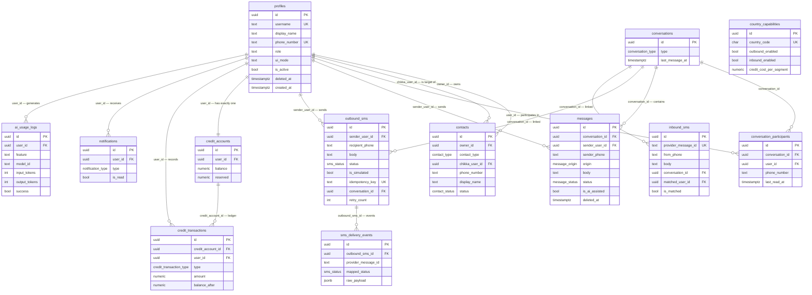

# Entity Relationships

**Document:** CHKR-DB-002  
**Project:** Chikka Reborn  
**Version:** 1.0  
**Status:** Draft  
**Last Revised:** November 2026  

---

## Purpose

Describes all entity relationships in the Chikka Reborn database — cardinality, constraints, and the business rules encoded in those relationships.

## Scope

All 13 tables. Complements the DDL in `docs/database/database-schema.md`.

---

## 1. Full Entity Relationship Diagram

---

## 2. Relationship Descriptions

### profiles → contacts (owner)
**Cardinality:** One profile owns zero or many contacts.  
**Rule:** `contacts.owner_id = profiles.id`. Cascade delete: when a profile is deleted, their contact list is deleted.

### profiles → contacts (target)
**Cardinality:** One profile may appear as the target (`chikka_user_id`) in zero or many other users' contact lists.  
**Rule:** `contacts.chikka_user_id = profiles.id`. Set null on delete: if a user deletes their account, they are removed as the contact target but the contact record persists (shows as "Deleted User").

### profiles → conversation_participants
**Cardinality:** One profile participates in zero or many conversations.  
**Rule:** A conversation participant is either a registered user (`user_id IS NOT NULL`) or an SMS-only phone number (`phone_number IS NOT NULL`). Never both. This constraint is enforced by a CHECK constraint.

### conversations → conversation_participants
**Cardinality:** One conversation has two or more participants.  
**Rule:** Phase 1 enforces exactly two participants per conversation. The application layer enforces this; the DB allows more for future group support.

### conversations → messages
**Cardinality:** One conversation has zero or many messages.  
**Rule:** Messages belong to exactly one conversation. Cascade delete: deleting a conversation deletes all its messages.

### messages (deleted)
**Rule:** When a message is deleted, `body` is set to `NULL` and `deleted_at` is set. The row is not removed — this preserves thread continuity and allows the "This message was deleted" placeholder. The CHECK constraint requires `body IS NOT NULL` only when `deleted_at IS NULL`.

### outbound_sms → sms_delivery_events
**Cardinality:** One outbound SMS has zero or many delivery events.  
**Rule:** Delivery events are immutable — they are never updated, only appended. The unique constraint `(provider_message_id, provider_status)` prevents duplicate event processing.

### profiles → credit_accounts
**Cardinality:** Exactly one credit account per profile.  
**Rule:** Created automatically by a trigger when a new profile is inserted. UNIQUE constraint on `user_id`. Balance and reserved are non-negative by CHECK constraint — the application layer uses `SELECT FOR UPDATE` to prevent concurrent over-deduction.

### credit_accounts → credit_transactions
**Cardinality:** One account has zero or many transactions.  
**Rule:** Transactions are immutable — they are never updated or deleted. They form an append-only ledger. `balance_after` records the account balance at the time of the transaction, enabling audit and reconstruction.

### inbound_sms → conversations (optional)
**Cardinality:** An inbound SMS is optionally linked to one conversation.  
**Rule:** Matching logic: find a conversation where one participant's `phone_number` matches `inbound_sms.from_phone` and another participant's virtual number matches `inbound_sms.to_number`. If matched, `is_matched = TRUE` and `conversation_id` is set. If not matched, `is_matched = FALSE` and `conversation_id` is NULL — logged for admin review.

### country_capabilities (standalone)
**Cardinality:** Zero or many capabilities records; one per country code.  
**Rule:** Not linked to any user data. Admin-managed reference data. Read by the SMS service to determine capability before allowing a send.

---

## 3. Constraints Summary

| Table | Constraint | Type | Description |
|---|---|---|---|
| `profiles` | `username_length` | CHECK | 3–30 characters |
| `profiles` | `username_format` | CHECK | Lowercase alphanumeric + underscore only |
| `profiles` | `valid_role` | CHECK | `user` or `admin` only |
| `profiles` | `valid_ui_mode` | CHECK | `modern` or `classic` only |
| `contacts` | `contacts_chikka_xor_sms` | CHECK | Either Chikka user OR phone, never both |
| `contacts` | `contacts_no_self` | CHECK | Cannot add yourself as a contact |
| `contacts` | `contacts_unique_chikka` | UNIQUE | One contact entry per Chikka user pair |
| `contacts` | `contacts_unique_sms` | UNIQUE | One SMS contact entry per phone number per owner |
| `conversation_participants` | `participants_user_xor_phone` | CHECK | Either user_id OR phone_number, never both |
| `messages` | `message_has_sender` | CHECK | Must have sender_user_id or sender_phone |
| `messages` | `message_body_required` | CHECK | Body only NULL when deleted_at is set |
| `outbound_sms` | `idempotency_key` | UNIQUE | Prevents duplicate sends |
| `outbound_sms` | `valid_provider` | CHECK | `mock` or `twilio` only |
| `sms_delivery_events` | `delivery_event_idempotent` | UNIQUE | `(provider_message_id, provider_status)` |
| `inbound_sms` | `provider_message_id` | UNIQUE | Prevents duplicate inbound processing |
| `credit_accounts` | `credit_balance_non_negative` | CHECK | Balance ≥ 0 always |
| `credit_accounts` | `credit_reserved_non_negative` | CHECK | Reserved ≥ 0 always |
| `ai_usage_logs` | `valid_ai_feature` | CHECK | Known feature names only |

---

## 4. Nullable Fields and Their Meaning

| Table | Field | Nullable? | Meaning when NULL |
|---|---|---|---|
| `profiles` | `phone_number` | Yes | No phone number associated |
| `profiles` | `deleted_at` | Yes | Account is active |
| `messages` | `sender_user_id` | Yes | Message originated from an SMS-only sender |
| `messages` | `sender_phone` | Yes | Message originated from a registered user |
| `messages` | `body` | Yes | Message has been deleted |
| `messages` | `deleted_at` | Yes | Message is not deleted |
| `outbound_sms` | `provider_message_id` | Yes | Not yet sent to provider |
| `outbound_sms` | `conversation_id` | Yes | Standalone SMS, not part of a conversation thread |
| `inbound_sms` | `conversation_id` | Yes | Inbound SMS could not be matched to a conversation |
| `inbound_sms` | `matched_user_id` | Yes | Inbound SMS could not be matched to a user |
| `ai_usage_logs` | `error_code` | Yes | AI call succeeded |

---

## 5. Revision History

| Version | Date | Author | Notes |
|---|---|---|---|
| 1.0 | November 2026 | Kiro (Principal Architect) | Initial draft |
