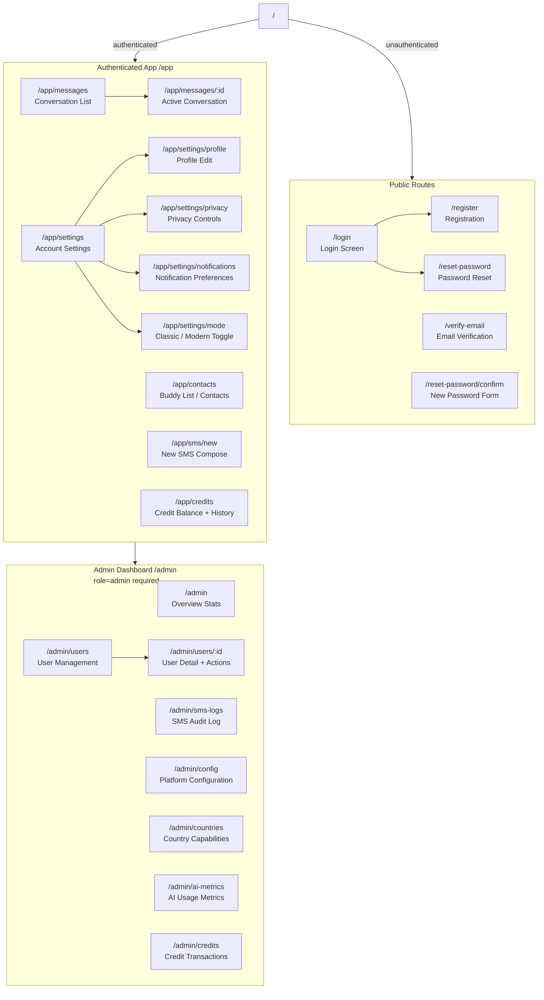

# Navigation Structure

**Document:** CHKR-DESIGN-003  
**Project:** Chikka Reborn  
**Version:** 1.0  
**Status:** Draft  
**Last Revised:** November 2026  

---

## Purpose

This document defines the complete navigation structure of Chikka Reborn — all routes, their access requirements, entry points, and how navigation differs between Modern Mode, Classic Mode, and the Admin Dashboard.

## Scope

All application routes across all phases. The navigation structure is implemented in `frontend/src/App.tsx` and individual feature `routes.tsx` files.

---

## 1. Route Map



---

## 2. Route Access Control

| Route Pattern | Access Requirement | Redirect if Not Met |
|---|---|---|
| `/login`, `/register`, `/verify-email`, `/reset-password*` | Unauthenticated (or skip if already auth) | `/app/messages` if already logged in |
| `/app/*` | Valid Supabase session | `/login` |
| `/admin/*` | Valid session + `role = 'admin'` | `/403` page |

---

## 3. Modern Mode Navigation

### Desktop Sidebar (always visible, 280px)

```
┌─────────────────────────┐
│  [Chikka Reborn Logo]   │
│                         │
│  💬  Messages      [3]  │  ← unread badge
│  👥  Contacts           │
│  📱  Send SMS           │
│                         │
│  ─────────────────────  │
│                         │
│  Credit: 4.90 ●         │  ← balance + top-up link if low
│                         │
│  ─────────────────────  │
│                         │
│  🔔  Notifications  [1] │
│  ⚙️  Settings           │
│  🛡  Admin              │  ← visible only to admins
│                         │
│  ─────────────────────  │
│                         │
│  [Avatar] Jericho R.    │  ← user menu trigger
│  Online ●               │
└─────────────────────────┘
```

### Mobile Bottom Tab Bar (4 primary tabs)

```
┌──────┬──────┬──────┬──────┐
│  💬  │  👥  │  📱  │  ⚙️  │
│ Msgs │Contacts│ SMS │Settings│
└──────┴──────┴──────┴──────┘
```

Notifications and credits are accessible from the Settings tab or via a top-bar icon on the conversation screen.

---

## 4. Classic Mode Navigation

Classic Mode uses a buddy-list navigation paradigm:

### Buddy List Panel (always visible, 240px)

```
┌──────────────────────────┐
│  Chikka Reborn           │
│  Jericho R. ●  [Status▼] │
├──────────────────────────┤
│  [Search buddies]        │
├──────────────────────────┤
│  ▼ ONLINE (3)            │
│    ● Rowena M.           │
│    ● Maria S.            │
│    ● (SMS) Lolo Ben      │
├──────────────────────────┤
│  ▶ OFFLINE (2)           │
│    ○ Mark T.             │
│    ○ (SMS) Nanay         │
├──────────────────────────┤
│  Credits: 4.90  [+]      │
│  [Send SMS]  [Settings]  │
└──────────────────────────┘
```

- Double-click a buddy → opens a message window (floating or inline depending on screen size).
- Classic Mode does not use the left/right split panel — messages open in a modal-style window like the original Chikka.

---

## 5. Admin Dashboard Navigation

Admin navigation is a separate top-level section. Accessible at `/admin` to users with `role = 'admin'`.

### Admin Sidebar

```
┌─────────────────────────┐
│  [←] Back to App        │
│  ─────────────────────  │
│  📊  Overview           │
│  👥  Users              │
│  📋  SMS Audit Log      │
│  ⚙️  Configuration      │
│  🌍  Country Settings   │
│  🤖  AI Metrics         │
│  💳  Credits            │
└─────────────────────────┘
```

---

## 6. Breadcrumbs and Back Navigation

| Screen | Breadcrumb / Back |
|---|---|
| Active Conversation (mobile) | ← Back to Messages list |
| Settings sub-page | ← Back to Settings |
| Admin user detail | ← Back to Users |
| Admin SMS log detail | ← Back to SMS Audit Log |

Breadcrumbs are shown on desktop for admin screens with depth > 1.

---

## 7. Deep Link Handling

The React SPA rewrites all paths to `index.html` (via `vercel.json`). React Router handles client-side routing. Direct navigation to any authenticated route redirects to login if unauthenticated, then returns to the original path after login (using `location.state` or query param).

---

## 8. 404 and Error Routes

| Route | Component |
|---|---|
| Any unmatched route | `NotFoundPage` — friendly 404 with back button |
| `/403` | `ForbiddenPage` — admin access denied |
| `/error` | `ErrorPage` — generic error with retry |

---

## 9. Revision History

| Version | Date | Author | Notes |
|---|---|---|---|
| 1.0 | November 2026 | Kiro (Principal Architect) | Initial draft |
