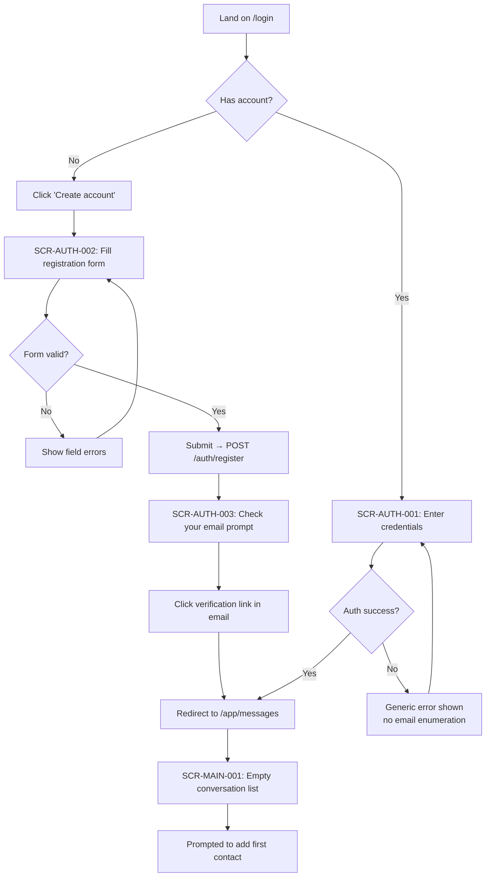
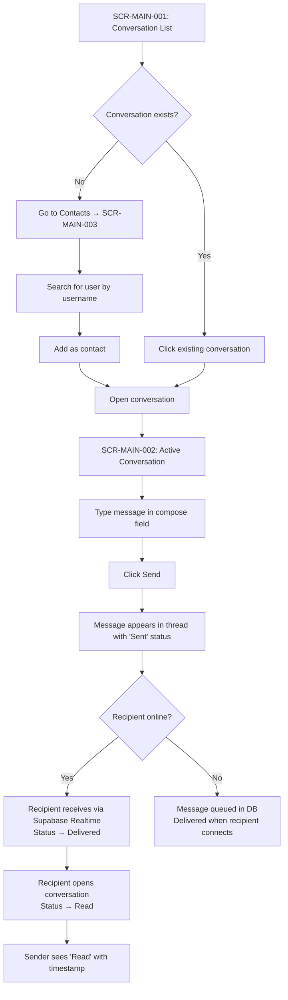
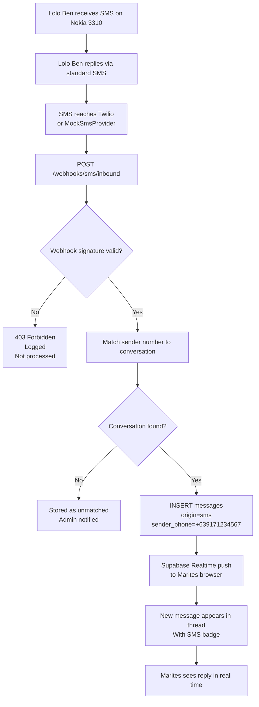
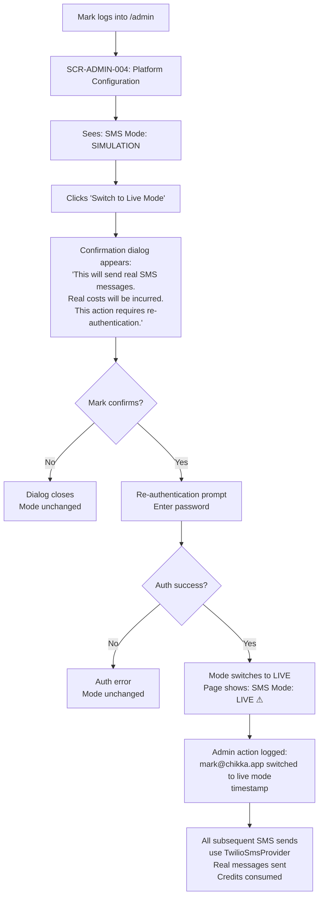
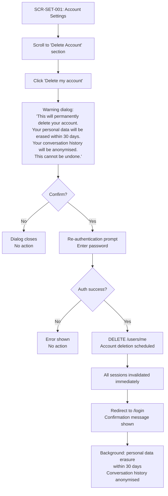
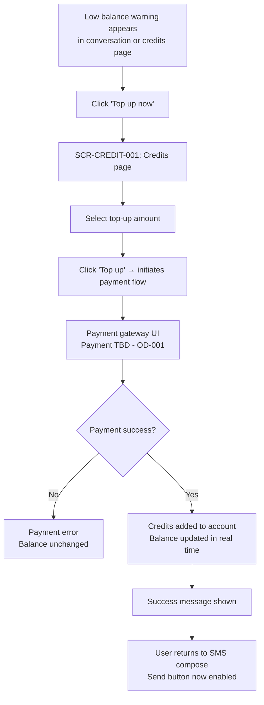

# User Journeys

**Document:** CHKR-DESIGN-005  
**Project:** Chikka Reborn  
**Version:** 1.0  
**Status:** Draft  
**Last Revised:** November 2026  

---

## Purpose

This document defines the critical user journeys through Chikka Reborn — the end-to-end paths a user takes to accomplish a core task. Each journey maps screens, decisions, happy paths, and error paths.

## Scope

Primary journeys for all five user personas. Used for E2E test scenario planning and UX validation.

---

## Journey 1 — New User Registration and First Login

**Persona:** Any new user (Marites, Jericho, Rowena)  
**Goal:** Create an account and access the messaging interface.



**Error Paths:**
- Duplicate email → field error on registration form.
- Expired verification link → "Resend" button available.
- 5 failed logins → rate limit message; 15-minute wait.

---

## Journey 2 — Sending a Chikka-to-Chikka Message

**Persona:** Jericho (registered Chikka user to registered Chikka user)  
**Goal:** Send a real-time message to a friend on Chikka.



---

## Journey 3 — Sending an Internet-to-SMS Message (Simulation Mode)

**Persona:** Marites (OFW sending to Lolo Ben)  
**Goal:** Send an SMS message to a basic phone user.

```mermaid
flowchart TD
    A[Click 'Send SMS' in sidebar] --> B[SCR-SMS-001: SMS Compose]
    B --> C[Enter recipient phone number\n+639171234567]
    C --> D[System checks country capability\nGET /sms/capability]
    D --> E{Country supported?}
    E -->|No| F[Error shown: Unsupported destination\nSend blocked]
    E -->|Yes| G[Capability info shown:\nOutbound: ✓  Inbound: requires verification\nCost: 0.05 credits/segment]
    G --> H[Type message body]
    H --> I[Real-time segment counter:\n'45 / 160 chars | 1 segment | 0.05 credits']
    I --> J{Sufficient credits?}
    J -->|No| K[Send button disabled\nLow balance warning shown\nLink to top-up]
    J -->|Yes| L[Click Send → POST /sms/send]
    L --> M[Message appears in thread\nWith SIMULATED badge\nStatus: Queued]
    M --> N[Mock callback after 2s\nStatus: Sent]
    N --> O[Mock callback after 2s\nStatus: Delivered]
    O --> P[Delivery notification appears\nin notification panel]
```

**Simulation Mode Invariants:**
- SIMULATED badge is visible at every step — Queued, Sent, Delivered.
- No real SMS is sent under any circumstances.
- No credits are deducted.

---

## Journey 4 — Receiving an Inbound SMS Reply

**Persona:** Marites (receiving Lolo Ben's reply)  
**Goal:** See a reply from the basic phone user in the conversation.



---

## Journey 5 — Using AI Translation

**Persona:** Rowena (translating a message from English to Filipino)  
**Goal:** Translate a draft message and send it after review.

```mermaid
flowchart TD
    A[SCR-MAIN-002: Active Conversation with Nanay] --> B[Rowena types draft in English:\n'I hope you are feeling better soon.']
    B --> C[Click AI button → 'Translate']
    C --> D[Language selector appears\nRowena selects: Filipino]
    D --> E[POST /ai/translate\nBody: text + target_language]
    E --> F{AI available?}
    F -->|No| G[Error shown:\n'AI unavailable. You can still send manually.'\nCompose field remains active]
    F -->|Yes| H[AI processes\nLoading indicator shown\nCompose field still editable]
    H --> I[Translation returned:\n'Umaasa akong mabilis kang mabuting muli.']
    I --> J[AI suggestion panel shows\nbefore: English | after: Filipino]
    J --> K{Rowena satisfied?}
    K -->|No, edit| L[Edits translation in panel]
    L --> M
    K -->|Yes| M[Click 'Use this translation']
    M --> N[Translation placed in compose field\nAI-assisted badge appears]
    N --> O{Send?}
    O -->|No| P[Can still edit compose field\nBadge persists until field cleared]
    O -->|Yes| Q[Click Send]
    Q --> R[Message sent\nAI-assisted badge removed from recipient's view]
```

**AI Safety Invariants:**
- The AI translation is never auto-sent.
- Rowena explicitly clicks "Use this translation" then separately clicks "Send".
- If she clears the compose field, the AI-assisted badge disappears.
- If AI fails at any step, her original English draft is preserved.

---

## Journey 6 — Admin Switching SMS to Live Mode

**Persona:** Mark (administrator enabling live SMS for integration testing)  
**Goal:** Switch from simulation to live SMS mode safely.



**Invariants:**
- At least 3 friction steps before live mode activates (click → confirm dialog → re-auth).
- Mode change is logged with admin ID, timestamp, and previous state.
- If re-auth fails, mode does not change.
- Switching back to simulation follows the same flow.

---

## Journey 7 — User Account Deletion

**Persona:** Any registered user  
**Goal:** Delete their account and all personal data.



---

## Journey 8 — Credit Top-Up (Phase 4)

**Persona:** Marites (running low on credits)  
**Goal:** Top up credit balance before sending an SMS.



> **Note:** Payment gateway is an open decision (OD-001). This journey will be updated when the gateway is selected.

---

## Journey Summary

| Journey | Persona | Phase | E2E Test Coverage |
|---|---|---|---|
| 1 — Registration + Login | All | 1 | ✅ Required Phase 1 |
| 2 — Chikka-to-Chikka Message | Jericho | 1 | ✅ Required Phase 1 |
| 3 — Internet-to-SMS (Simulation) | Marites | 2 | ✅ Required Phase 2 |
| 4 — Inbound SMS Reply | Marites / Lolo Ben | 2 | ✅ Required Phase 2 |
| 5 — AI Translation | Rowena | 3 | ✅ Required Phase 3 |
| 6 — Admin Live SMS Toggle | Mark | 2 | ✅ Required Phase 2 |
| 7 — Account Deletion | Any | 1 | ✅ Required Phase 1 |
| 8 — Credit Top-Up | Marites | 4 | ⬜ Required Phase 4 |

---

## Revision History

| Version | Date | Author | Notes |
|---|---|---|---|
| 1.0 | November 2026 | Kiro (Principal Architect) | Initial draft |
