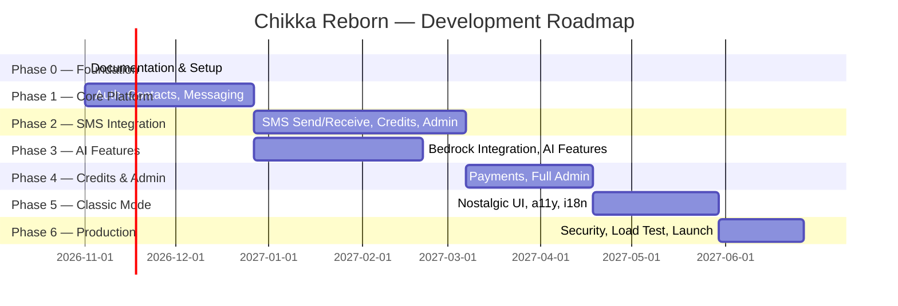

# Product Roadmap

**Document:** CHKR-PROD-008  
**Project:** Chikka Reborn  
**Version:** 1.0  
**Status:** Draft  
**Last Revised:** November 2026  

---

## Purpose

This document defines the phased delivery roadmap for Chikka Reborn. It specifies what is delivered in each phase, the acceptance criteria for completing that phase, and the dependencies that gate phase entry.

## Scope

Phases 0–6. Supersedes the high-level phase descriptions in `docs/roadmap.md` with detailed feature lists and acceptance criteria aligned to the feature catalogue (`docs/product/feature-catalogue.md`).

---

## Phase Overview

---

## Phase 0 — Foundation

**Goal:** Complete documentation, tooling, and project scaffolding. No application features.  
**Status:** ✅ In Progress  
**Gate:** Phase 0 acceptance criteria met → Phase 1 may begin.

### Deliverables

| ID | Deliverable | Status |
|---|---|---|
| P0.1 | All documentation files (this set) | ✅ Done |
| P0.2 | Kiro steering documents | ✅ Done |
| P0.3 | Supabase dev + staging projects created | ⬜ Pending |
| P0.4 | Frontend scaffold (Vite + React + Tailwind + shadcn) | ⬜ Pending |
| P0.5 | Backend scaffold (FastAPI + SQLAlchemy + config) | ⬜ Pending |
| P0.6 | CI pipeline (lint, type check, test) | ⬜ Pending |
| P0.7 | Vercel project connected to repo | ⬜ Pending |
| P0.8 | Backend hosting project created | ⬜ Pending |
| P0.9 | `.env.example` files (frontend + backend) | ⬜ Pending |
| P0.10 | Backend hosting platform decision resolved (OD-003) | ⬜ Pending |
| P0.11 | Supabase region decision resolved (OD-008) | ⬜ Pending |

### Phase 0 Acceptance Criteria
- All documentation files exist and are internally consistent.
- `npm run build` exits 0 on the frontend scaffold.
- `uvicorn main:app` starts without errors on the backend scaffold.
- CI pipeline runs on a test PR; all checks pass.
- Staging frontend URL accessible.

---

## Phase 1 — Core Platform

**Goal:** A working, deployable platform. Users can register, find each other, and exchange real-time messages.  
**No SMS. No AI. No credits.**  
**Gate:** Phase 0 complete. Supabase projects operational.

### Feature Deliverables

| Feature ID | Feature | Module |
|---|---|---|
| FEAT-AUTH-001–012 | Full auth (except phone OTP) | AUTH |
| FEAT-CONT-001, 002, 004, 005, 007, 008, 009, 011 | Contacts (Chikka users only) | CONTACTS |
| FEAT-MSG-001–008, 011 | Full real-time messaging | MSG |
| FEAT-NOTIF-001, 002 | In-app notification badges | NOTIF |
| FEAT-PRIV-001 | Profile visibility | PRIVACY |
| FEAT-MODE-001 | Modern Mode default UI | CLASSIC |

### Technical Deliverables
- Database migrations: `profiles`, `contacts`, `conversations`, `conversation_participants`, `messages`, `notifications`
- RLS policies for all Phase 1 tables
- Backend unit tests + API integration tests for all Phase 1 routes
- Frontend component tests for auth forms, messaging UI, contact list
- Staging deployment

### Phase 1 Acceptance Criteria
- User A registers, verifies email, and logs in.
- User A searches for User B and adds them as a contact.
- User A opens a conversation and sends a message; User B receives it in < 500ms.
- Typing indicator is visible.
- Read receipt updates in real time.
- Messages persist across page refresh.
- All Phase 1 backend tests pass in CI.
- No open critical or high security findings.

---

## Phase 2 — SMS Integration

**Goal:** Internet-to-SMS messaging works in simulation mode. SMS replies are received. Credits are tracked. Basic admin dashboard is live.  
**Gate:** Phase 1 acceptance criteria met. SMS provider account created (Twilio or mock-only for simulation).

### Feature Deliverables

| Feature ID | Feature | Module |
|---|---|---|
| FEAT-AUTH-010, 011 | Phone OTP verification | AUTH |
| FEAT-CONT-003, 006 | SMS contacts | CONTACTS |
| FEAT-SMS-001–013 | Full SMS send (simulation + live prep) | SMS |
| FEAT-RECV-001–006 | Inbound SMS / webhook | SMSRECV |
| FEAT-NOTIF-003, 004, 005, 006 | Push notifications + SMS notifications | NOTIF |
| FEAT-CRED-001–007 | Credits (excl. top-up) | CREDIT |
| FEAT-PRIV-002, 003, 004 | Data export, opt-out, reporting | PRIVACY |
| FEAT-ADMIN-001–006 | Admin dashboard (excl. AI/payments) | ADMIN |
| FEAT-MSG-009, 010 | Message deletion | MSG |
| FEAT-CONT-010 | Contact groups | CONTACTS |

### Technical Deliverables
- MockSmsProvider and TwilioSmsProvider implementations
- SMS audit tables: `outbound_sms`, `sms_delivery_events`, `inbound_sms`
- `credit_accounts`, `credit_transactions` tables with concurrency-safe deduction
- `country_capabilities` table with seed data for key countries including Philippines
- Webhook endpoints with signature validation
- SMS retry with exponential backoff and idempotency
- E2E tests: SMS simulation journey, admin mode toggle, credit deduction flow

### Phase 2 Acceptance Criteria
- User sends SMS in simulation mode; "SIMULATED" badge persists.
- Delivery status progresses: Queued → Sent → Delivered via mock callbacks.
- Simulated inbound SMS appears in correct conversation.
- Invalid webhook signature returns 403; not processed.
- Insufficient credits blocks send.
- Credits deducted on acceptance; refunded on permanent failure.
- Admin can toggle SMS mode with re-authentication confirmation.
- Philippine country capability entry correctly reflects outbound: true, inbound: requires-verification.

---

## Phase 3 — AI Features

**Goal:** All seven AI assistant features available. Amazon Bedrock integrated. All AI output requires user approval.  
**Gate:** Phase 1 complete. Amazon Bedrock access confirmed in target region (DEP-006).

### Feature Deliverables

| Feature ID | Feature | Module |
|---|---|---|
| FEAT-AI-001–013 | All AI features | AI |
| FEAT-ADMIN-007 | AI metrics in admin dashboard | ADMIN |

### Technical Deliverables
- `BedrockAiProvider` implementation
- AI provider abstraction layer
- AI suggestion review panel UI component
- `ai_usage_logs` table
- AI endpoint tests (mocked Bedrock responses)
- E2E AI assistant journey

### Phase 3 Acceptance Criteria
- Smart replies appear in a review panel; selecting one populates compose field without sending.
- Translation suggestion shown with before/after; user can edit before accepting.
- AI failure (mocked) shows error; compose field remains functional.
- No AI content logged to application logs.
- AI-assisted badge visible pre-send; not visible to recipient in history.
- Admin AI metrics dashboard shows feature counts, token totals, latency.

---

## Phase 4 — Credits and Administration

**Goal:** Full credit management including top-up. Complete administration dashboard.  
**Gate:** Phase 2 complete. Payment gateway decision finalised (OD-001).

### Feature Deliverables

| Feature ID | Feature | Module |
|---|---|---|
| FEAT-CRED-008 | Credit top-up via payment gateway | CREDIT |
| FEAT-ADMIN-008 | Credit overview in admin | ADMIN |

### Phase 4 Acceptance Criteria
- User completes payment flow and credits increase in real time.
- Admin can view credit transactions across all users.
- Credits cannot go below zero under concurrent sends (race condition test passes).

---

## Phase 5 — Classic Mode and Polish

**Goal:** Classic Chikka Mode delivered. Accessibility audited. Internationalisation ready.  
**Gate:** Phase 1–2 complete. Classic Mode design assets finalised (OD-005).

### Feature Deliverables

| Feature ID | Feature | Module |
|---|---|---|
| FEAT-MODE-001–004 | Classic Mode UI + toggle | CLASSIC |

### Technical Deliverables
- WCAG 2.1 AA accessibility audit and remediation
- i18n string externalisation (Filipino + English minimum)
- Responsive layout audit (375px, 768px, 1280px)
- Lighthouse performance audit; score ≥ 85 target

### Phase 5 Acceptance Criteria
- Classic Mode is visually distinct and authentic without reproducing licensed assets.
- All core features functional in Classic Mode.
- Lighthouse ≥ 85 mobile and desktop.
- axe scan: zero critical violations.
- Filipino and English UI strings functional via i18n.

---

## Phase 6 — Production Hardening

**Goal:** Platform ready for real users. Security audited. Load tested. Legal documents in place.  
**Gate:** All previous phases complete.

### Deliverables
- OWASP Top 10 security review
- Load testing (k6 or Locust): 1,000 concurrent users
- Penetration testing (scope TBD)
- Philippine sender ID registration confirmed (DEP-008) — *required for PH live SMS*
- Privacy Policy and Terms of Service (legal review — OD-006)
- Production monitoring and alerting
- Disaster recovery drill
- Production launch checklist execution

### Phase 6 Acceptance Criteria
- Load test passes at 1,000 concurrent users without degradation.
- No open critical or high security findings.
- Privacy Policy and ToS reviewed by a qualified party.
- Live SMS test message delivered to a real phone number in a supported country.
- All production launch checklist items checked.

---

## Open Decisions That Block Phase Start

| Decision ID | Decision | Blocks Phase | Due |
|---|---|---|---|
| OD-001 | Payment gateway selection | Phase 4 | Phase 3 end |
| OD-002 | Bedrock model selection | Phase 3 | Phase 2 end |
| OD-003 | Backend hosting platform | Phase 0 completion | Immediate |
| OD-004 | Push notification service | Phase 2 | Phase 1 end |
| OD-005 | Classic Mode design assets | Phase 5 | Phase 4 end |
| OD-006 | Message data retention period | Phase 1 DB | Immediate |
| OD-007 | PH SMS sender ID registration approach | Phase 6 PH live | Begin Phase 1 |
| OD-008 | Supabase region | Phase 0 completion | Immediate |

---

## Revision History

| Version | Date | Author | Notes |
|---|---|---|---|
| 1.0 | November 2026 | Kiro (Principal Architect) | Initial draft |
