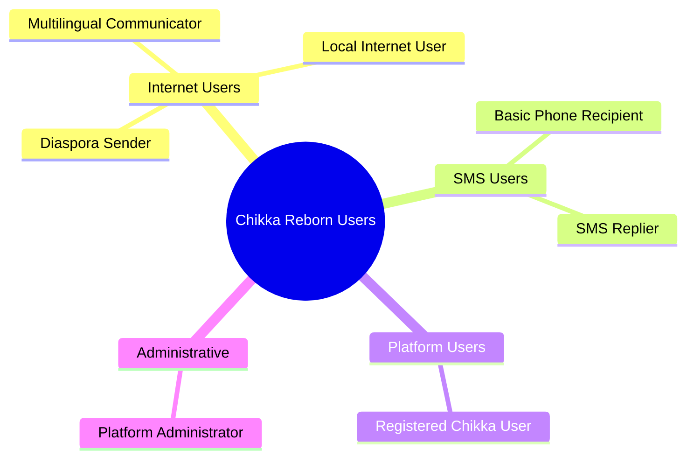

# Target Users

**Document:** CHKR-PROD-003  
**Project:** Chikka Reborn  
**Version:** 1.0  
**Status:** Draft  
**Last Revised:** November 2026  

---

## Purpose

This document defines the target user segments for Chikka Reborn. It describes who uses the platform, in what context, and what their primary communication needs are. User personas are defined in `docs/product/user-personas.md`.

## Scope

Covers all user-facing and administrator roles across all phases.

---

## 1. User Segment Overview

---

## 2. Primary User Segments

### 2.1 The Diaspora Sender

**Who they are:**  
An overseas Filipino worker (OFW) or immigrant living abroad. They have reliable internet access via a smartphone, tablet, or computer. They regularly communicate with family members back in the Philippines who use basic mobile phones.

**Primary need:**  
Send messages from a browser to a family member's mobile phone without requiring the recipient to install any application. Receive replies in the same interface.

**Technical context:**
- Uses the Chikka Reborn web application on desktop or mobile browser.
- Recipient has a basic or feature phone, no smartphone required.
- May communicate in Filipino, English, or a regional language (Cebuano, Ilocano, Hiligaynon, etc.).
- Values AI translation to compose messages in the recipient's preferred language.

**Pain points addressed:**
- Existing messaging apps (WhatsApp, Messenger) require the recipient to have the app and internet access.
- International SMS from mobile carriers is expensive.
- Language barriers when messaging older family members.

**Volume estimate:** Primary market. Estimated tens of millions of potential users globally.

---

### 2.2 The Local Internet User

**Who they are:**  
A Philippines-based user with internet access who communicates with contacts who may or may not have internet-connected devices.

**Primary need:**  
A single platform that handles both real-time messaging to other internet users and SMS reach to basic phone users — without switching applications.

**Technical context:**
- Uses Chikka Reborn in a browser, likely on a mobile phone.
- Some contacts are registered Chikka users; some are SMS-only.
- May prefer Classic Mode for its familiar nostalgic feel.

---

### 2.3 The Multilingual Communicator

**Who they are:**  
A user who regularly communicates across language boundaries — between Filipino and English, or between Filipino and a regional or foreign language.

**Primary need:**  
Compose messages in one language, translate them for the recipient, and confirm before sending.

**Technical context:**
- Uses the AI assistant for translation and rewriting.
- May communicate with elderly relatives who prefer Filipino or a regional language.
- Values the tone adjustment feature for formal vs. casual contexts (e.g. communicating with a boss vs. a sibling).

---

### 2.4 The Basic Phone Recipient / SMS User

**Who they are:**  
A mobile phone user in the Philippines (or another country) who does not have a smartphone or internet access, or who chooses to communicate primarily through SMS.

**Primary need:**  
Receive messages from Chikka Reborn users as standard SMS. Reply using standard SMS. No application installation, no internet access, no Chikka account required.

**Technical context:**
- Has no Chikka Reborn account.
- Receives messages as standard SMS from a platform-assigned number.
- Replies via standard SMS; replies appear in the sender's Chikka Reborn conversation.
- **⚠ Provider verification required:** Two-way SMS availability in the Philippines depends on carrier routing and sender registration. This capability must be verified before marketing it as available. See `docs/project-management/risk-register.md` RISK-001 and RISK-004.

---

### 2.5 The Registered Chikka User

**Who they are:**  
Any user who has created a Chikka Reborn account. They may be a diaspora sender, a local internet user, or a multilingual communicator. This segment overlaps with the above.

**Primary need:**  
A unified messaging experience — real-time Chikka-to-Chikka messages and SMS-to-phone messages, in one interface.

**Technical context:**
- Authenticated via email/password or social OAuth.
- May have a verified mobile number for phone-based features.
- Has a credit balance for SMS sending.
- Can choose between Modern Mode and Classic Mode.

---

## 3. Secondary User Segments

### 3.1 The Platform Administrator

**Who they are:**  
An operator with administrative access to the platform. Typically a developer, operations team member, or product owner during early phases.

**Primary need:**  
Manage the platform, configure SMS provider mode, view audit logs, manage user accounts, and monitor usage.

**Technical context:**
- Accesses the platform via `/admin` routes in the same web application.
- Has `role = 'admin'` in their JWT claims.
- Can switch SMS mode between simulation and live (with re-authentication confirmation).
- Can view AI usage metrics, SMS delivery statistics, and credit transactions.
- **Cannot** activate live SMS mode without re-authentication and explicit confirmation.

---

## 4. User Segment Matrix

| Segment | Has Chikka Account | Has Internet | Has Smartphone | Sends SMS | Receives SMS |
|---|---|---|---|---|---|
| Diaspora Sender | ✅ | ✅ | ✅ | ✅ | ✅ (via app) |
| Local Internet User | ✅ | ✅ | ✅ | ✅ | ✅ (via app) |
| Multilingual Communicator | ✅ | ✅ | ✅ | ✅ | ✅ (via app) |
| Basic Phone Recipient | ❌ | ❌ | ❌ | ✅ (reply) | ✅ (receives) |
| Registered Chikka User | ✅ | ✅ | optional | ✅ | ✅ (via app) |
| Platform Administrator | ✅ (admin) | ✅ | ✅ | ❌ (admin only) | ❌ |

---

## 5. Geographic Prioritisation

| Market | Priority | Rationale |
|---|---|---|
| Philippines (domestic) | Primary | Original Chikka's primary market; large SMS-reliant population |
| Filipino diaspora (global) | Primary | Core use case: overseas senders reaching domestic recipients |
| Southeast Asia | Secondary | Similar connectivity profiles; large SMS user base |
| Global | Tertiary | Supported via international SMS routing capability |

---

## 6. Accessibility Considerations by Segment

| Segment | Key Accessibility Need |
|---|---|
| Older Filipino relatives (SMS users) | Large text, simple UI, no app required (SMS only) |
| Diaspora users on mobile | Mobile-first responsive design, low-bandwidth tolerance |
| Users with disabilities | WCAG 2.1 AA, keyboard navigation, screen reader support |
| Regional language users | AI translation; i18n support for Filipino and regional languages (Phase 5) |

---

## 7. Revision History

| Version | Date | Author | Notes |
|---|---|---|---|
| 1.0 | November 2026 | Kiro (Principal Architect) | Initial draft |
