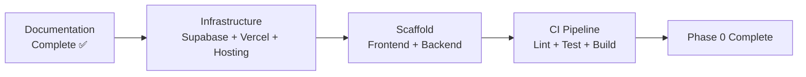

# Implementation Roadmap

**Document:** CHKR-PM-001  
**Project:** Chikka Reborn  
**Version:** 1.0  
**Status:** Draft  
**Last Revised:** November 2026  

---

## Purpose

The implementation roadmap translates the product roadmap into concrete engineering work. It defines the sequence of development, inter-feature dependencies, and the recommended order for building Chikka Reborn from the ground up.

## Scope

Phase 0–6. This is the engineering-facing complement to `docs/product/product-roadmap.md`.

---

## 1. Recommended Implementation Sequence

### Phase 0 — Foundation



**Order:**
1. Resolve OD-003 (hosting platform) and OD-008 (Supabase region)
2. Create Supabase dev + staging projects
3. Connect Vercel to repository
4. Create backend hosting project
5. Scaffold frontend (`npm create vite@latest`)
6. Scaffold backend (`fastapi`)
7. Wire CI pipeline (GitHub Actions)
8. Create `.env.example` files
9. Deploy empty app to staging

---

### Phase 1 — Core Platform

**Recommended build order:**

```
1. Database layer
   └── Migrations: profiles, contacts, conversations, messages, notifications
   └── RLS policies for all Phase 1 tables
   └── Unit test: RLS isolation

2. Backend — Auth module
   └── Supabase Auth integration + JWT validation
   └── User profile CRUD
   └── Rate limiting middleware
   └── Tests: FR-AUTH-001 through FR-AUTH-009

3. Backend — Contacts module
   └── Contact CRUD endpoints
   └── User search
   └── Block/unblock
   └── Tests: FR-CONTACTS-001 through FR-CONTACTS-004

4. Backend — Messaging module
   └── Conversation CRUD
   └── Message send + status update
   └── Realtime publication
   └── Tests: FR-MSG-001 through FR-MSG-006

5. Frontend — Auth screens
   └── SCR-AUTH-001 through SCR-AUTH-005
   └── Supabase Auth SDK integration
   └── Route protection

6. Frontend — Contact list
   └── SCR-MAIN-003 (buddy list, search, add)

7. Frontend — Messaging screens
   └── SCR-MAIN-001 (conversation list)
   └── SCR-MAIN-002 (active conversation)
   └── Supabase Realtime subscription

8. Notifications (in-app badge)
   └── Unread count, badge display

9. Staging deployment + Phase 1 acceptance criteria check
```

**Dependency constraint:** Backend auth must be complete before frontend auth screens can be tested end-to-end. Backend messaging must be complete before Realtime frontend integration.

---

### Phase 2 — SMS Integration

**Recommended build order:**

```
1. Database layer
   └── Migrations: outbound_sms, sms_delivery_events, inbound_sms, credit_accounts, credit_transactions, country_capabilities
   └── Seed: country_capabilities

2. Backend — SMS provider abstraction
   └── SmsProvider ABC
   └── MockSmsProvider (full implementation)
   └── Tests: test_mock_sms_provider.py

3. Backend — Credit service
   └── Credit deduction with SELECT FOR UPDATE
   └── Credit refund
   └── Credit transaction ledger
   └── Tests: concurrency + ledger integrity

4. Backend — SMS service + send endpoint
   └── POST /sms/send
   └── Idempotency enforcement
   └── Country capability check
   └── Tests: FR-SMS-001 through FR-SMS-005

5. Backend — SMS delivery webhooks
   └── POST /webhooks/sms/status (+ signature validation)
   └── POST /webhooks/sms/inbound (+ signature validation)
   └── Tests: UT-RECV-001 through UT-RECV-006

6. Backend — SMS retry task
   └── Exponential backoff + max retries

7. Backend — Admin dashboard
   └── GET /admin/stats, /admin/sms-logs, /admin/config, /admin/countries
   └── Mode toggle with re-auth

8. Frontend — SMS compose screen (SCR-SMS-001)
9. Frontend — Delivery status in conversation (SCR-SMS-002)
10. Frontend — Credits display (SCR-CREDIT-001)
11. Frontend — Admin dashboard screens (SCR-ADMIN-001 through SCR-ADMIN-005)

12. TwilioSmsProvider (after simulation mode tested)
    └── Only after MockSmsProvider + full test suite passes

13. Staging E2E — SMS simulation journey
14. Phase 2 acceptance criteria check
```

---

### Phase 3 — AI Features

**Gate:** Bedrock model + region confirmed (DEP-006, DEP-007)

```
1. Backend — AI provider abstraction
   └── AiProvider ABC
   └── MockAiProvider (for testing)
   └── BedrockAiProvider

2. Backend — AI service + endpoints
   └── All 6 AI features (suggest-replies, translate, rewrite, optimise-sms, summarise, compose)
   └── AI usage logging (metadata only)
   └── Tests: UT-AI-001 through UT-AI-010

3. Frontend — AI suggestion panel (SCR-AI-001)
4. Frontend — AI feature buttons in conversation view
5. Frontend — Admin AI metrics (SCR-ADMIN-006)

6. E2E — AI translation journey
7. Phase 3 acceptance criteria check
```

---

### Phases 4–6

Detailed sequences for Phases 4–6 to be defined when Phase 3 is complete, consistent with the product roadmap and open decisions resolved at that time.

---

## 2. Cross-Cutting Items (All Phases)

These items span all phases and must be maintained throughout:

| Item | Ongoing Activity |
|---|---|
| Migrations | Every schema change goes through migration files |
| RLS | Every new table gets RLS policies in the same migration |
| Tests | Feature tests written alongside feature code |
| Documentation | Architecture and API docs updated when implementation deviates |
| Security review | OWASP checklist item review before each phase completion |
| Dependency audit | `pip-audit` and `npm audit` run in CI on every PR |

---

## 3. Parallel Work Streams

Where backend and frontend work can proceed in parallel:

| Backend Track | Frontend Track | Sync Point |
|---|---|---|
| Auth endpoints | Auth screen designs | Phase 1 integration test |
| Messaging endpoints | Conversation UI | Phase 1 Realtime integration |
| SMS endpoints + webhooks | SMS compose screen | Phase 2 E2E test |
| AI endpoints | AI suggestion panel | Phase 3 E2E test |

---

## 4. Revision History

| Version | Date | Author | Notes |
|---|---|---|---|
| 1.0 | November 2026 | Kiro (Principal Architect) | Initial draft |
