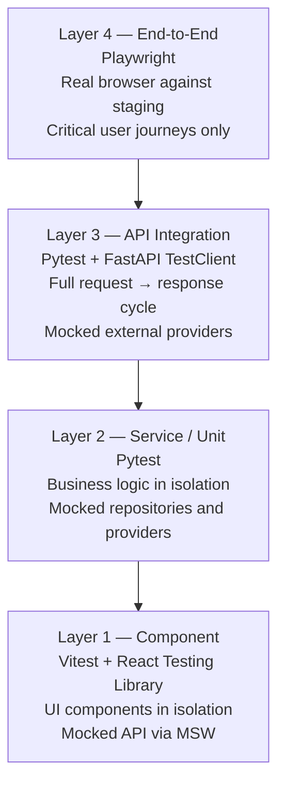
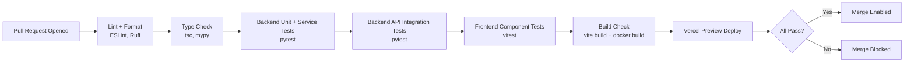
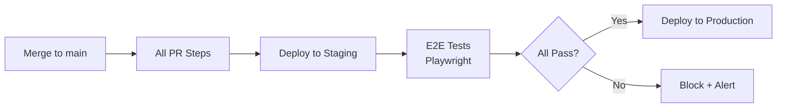

# Testing Strategy

**Document:** CHKR-QA-001  
**Project:** Chikka Reborn  
**Version:** 1.0  
**Status:** Draft  
**Last Revised:** November 2026  

---

## Purpose

Defines the overall testing philosophy, layer model, tooling, coverage targets, and CI integration for Chikka Reborn. Detailed test cases are in `docs/quality/test-plan.md`. Security testing is in `docs/quality/security-test-plan.md`. Performance testing is in `docs/quality/performance-test-plan.md`.

## Scope

All phases. All tiers (frontend, backend, database, integration, end-to-end).

---

## 1. Testing Philosophy

- **Test behaviour, not implementation.** Tests verify what the system does — not how classes are arranged internally.
- **Deterministic always.** No test depends on wall-clock time, execution order, or live external services.
- **Isolate external dependencies.** Supabase, Twilio, and Amazon Bedrock are mocked in all automated tests. No real API calls, no real SMS, no real AI charges.
- **Fast CI.** Unit and integration tests must complete in under 2 minutes on CI.
- **Tests ship with features.** A feature is not complete until its tests pass.
- **Honest coverage.** Coverage numbers are a guide, not a goal. One untested credit deduction edge case is more dangerous than a low aggregate percentage.

---

## 2. Testing Layers



| Layer | Tool | Scope | Speed | Run When |
|---|---|---|---|---|
| Component | Vitest + RTL | Frontend UI | ~30s | Every PR |
| Service/Unit | Pytest | Backend logic | ~45s | Every PR |
| API Integration | Pytest + TestClient | Backend HTTP | ~60s | Every PR |
| End-to-End | Playwright | Full stack | ~5min | Merge to main |

---

## 3. Backend Testing Stack

| Tool | Version | Role |
|---|---|---|
| `pytest` | 8.x | Test runner |
| `pytest-asyncio` | Latest | Async test support |
| `httpx` + FastAPI `TestClient` | Latest | HTTP-level integration tests |
| `pytest-cov` | Latest | Coverage measurement |
| `factory-boy` | Latest | Test data factories |
| `pytest-mock` / `unittest.mock` | Latest | Mocking dependencies |
| `Faker` | Latest | Realistic fake data |
| `respx` | Latest | Mock httpx HTTP calls (for provider tests) |

### Backend Test Directory

```
backend/tests/
├── conftest.py              # Fixtures: app, db session, auth tokens, mock providers
├── factories/               # factory-boy factories
│   ├── profile_factory.py
│   ├── conversation_factory.py
│   ├── message_factory.py
│   └── sms_factory.py
├── unit/                    # Pure logic, no I/O
│   ├── test_sms_segments.py
│   ├── test_phone_validation.py
│   ├── test_credit_calculations.py
│   └── test_idempotency.py
├── services/                # Service layer with mocked repos + providers
│   ├── test_auth_service.py
│   ├── test_message_service.py
│   ├── test_sms_service.py
│   ├── test_ai_service.py
│   └── test_credit_service.py
├── api/                     # Full HTTP request → response
│   ├── test_auth_routes.py
│   ├── test_contacts_routes.py
│   ├── test_messaging_routes.py
│   ├── test_sms_routes.py
│   ├── test_webhook_routes.py
│   ├── test_ai_routes.py
│   ├── test_credit_routes.py
│   └── test_admin_routes.py
├── rls/                     # Row Level Security isolation tests
│   └── test_rls.py
└── providers/               # Provider adapter tests with mocked HTTP
    ├── test_mock_sms_provider.py
    ├── test_twilio_provider.py
    └── test_bedrock_provider.py
```

---

## 4. Frontend Testing Stack

| Tool | Version | Role |
|---|---|---|
| `vitest` | Latest | Test runner (Vite-native) |
| `@testing-library/react` | Latest | Component rendering |
| `@testing-library/user-event` | Latest | Realistic user interactions |
| `msw` (Mock Service Worker) | Latest | Network-level API mocking |
| `@testing-library/jest-dom` | Latest | DOM matchers |

### Frontend Test Directory

```
frontend/src/features/{feature}/__tests__/
├── components/     # UI component tests
└── hooks/          # Custom hook tests
```

---

## 5. End-to-End Testing Stack

| Tool | Role |
|---|---|
| Playwright | Browser automation (Chromium, Firefox, WebKit) |
| Playwright fixtures | Test user creation, seeded data |
| Playwright route mocking | Intercept AI calls, simulate SMS callbacks |

E2E tests run against the **staging environment** with a seeded test database. SMS is always in **simulation mode**. AI calls are intercepted via Playwright route mocking — no real Bedrock calls.

---

## 6. Coverage Targets

| Area | Target |
|---|---|
| Service layer (business logic) | ≥ 80% line coverage |
| Auth flow | 100% branch coverage |
| SMS send flow (send, retry, credit deduction, refund) | 100% branch coverage |
| Webhook processing (delivery + inbound) | 100% branch coverage |
| Credit deduction + refund | 100% branch coverage |
| RLS isolation | All 13 tables tested |
| Frontend critical components (SMS compose, AI panel, auth forms) | ≥ 80% |

---

## 7. CI Pipeline Integration

### Pull Request Pipeline



### Merge to Main Pipeline



---

## 8. Test Data Management

- Fresh test data per test using `factory-boy` (backend) and Playwright fixtures (E2E).
- No shared mutable state between tests.
- Staging DB reset to a known seed state before each E2E run.
- Production data is never used in tests.
- Realistic fake data via `Faker` (e.g. real-looking Filipino names, valid E.164 PH numbers).
- No generic strings like `"test"`, `"foo"`, `"admin"` in test data.

---

## 9. What Is Not Automated

| Area | Reason | Alternative |
|---|---|---|
| Real SMS delivery | Costs money; carrier dependency | MockSmsProvider in all automated tests |
| Real AI output quality | Non-deterministic; subjective | Manual review per release |
| Full WCAG audit | Requires assistive technology | axe automated checks + manual review |
| Visual regression | Not in scope Phase 1–4 | Consider Chromatic in Phase 5+ |
| Load testing | Dedicated tool + environment | See `docs/quality/performance-test-plan.md` |

---

## 10. Revision History

| Version | Date | Author | Notes |
|---|---|---|---|
| 1.0 | November 2026 | Kiro (Principal Architect) | Initial draft |
