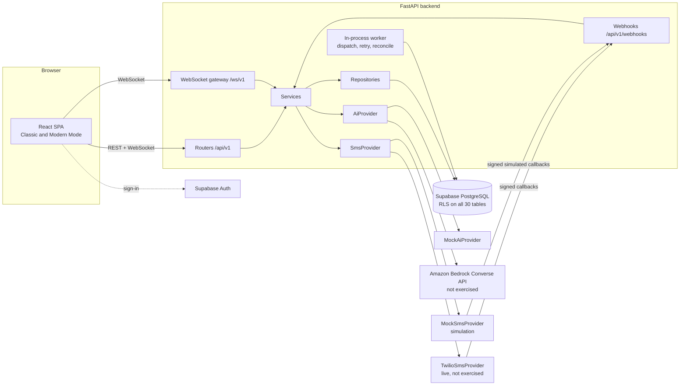

# Kiroween 2026 Devpost Submission Package

Project: **Chikka Reborn — The Messenger That Refused to Die.** Category: **Resurrection**.

Text in `[YOU: ...]` brackets needs a fact only the author knows (a link, a personal anecdote, a screen recording). Nothing in brackets has been invented.

## 0. Submission checklist and blockers

Read this first. Items marked **BLOCKER** are required by the contest or would make a claim in this package false.

| # | Item | Status |
|---|---|---|
| 1 | Public GitHub repository | `origin` is `https://github.com/victorbien/chikka-reborn.git`. [YOU: confirm the repository is public] |
| 2 | Open-source licence file | **BLOCKER.** There is no `LICENSE` file in the repository. Kiroween and Devpost expect an OSI-approved licence that is visible on the repository. Choose one (MIT or Apache-2.0 are common) and add it. I did not choose it for you |
| 3 | `.kiro` directory in the repository | Present and tracked (30 files: 15 steering, 15 hooks). It must not be gitignored. Only `.kiro/hook-reports/` is ignored |
| 4 | Working demo | **BLOCKER.** No hosted deployment exists in the repository. The only runnable stack is local. See section 5 for the two options |
| 5 | Demo video, about 3 minutes, public link | [YOU: record using section 4 and add the link] |
| 6 | Screenshots | None exist in the repository. See section 6 |
| 7 | Landing page | The app has no marketing landing page. `/` is the signed-in home, and signed-out visitors go to sign-in. Use the sign-in page as the "first screen" shot, or build a landing page |
| 8 | README is accurate | Replaced with the README in this change. It still needs screenshots added |
| 9 | Simulated features labelled | Done in all text below |

## 1. Project description (paste into Devpost)

### Tagline

The Filipino web-to-SMS messenger that shut down in 2018, rebuilt as an independent project with honest delivery tracking and an AI assistant that never sends anything by itself.

### Inspiration

Chikka was a Filipino service that let people chat from a computer with friends who only had an ordinary mobile phone. Chikka Philippines, Inc. was founded in 2000 by Chito Bustamante, Dennis Mendiola and Alexandra Roxas. Its Text Messenger linked online users with mobile subscribers, and it connected to Smart in 2001, Globe in 2002 and Sun Cellular in 2004. The name comes from the Filipino word *chika*, meaning small talk. Smart Communications acquired the company in 2009. The service was shut down in 2018.

Its idea still matters. Plenty of people have a phone and no data plan, or a basic handset and no apps. Chikka let them take part in an online conversation without installing anything. The messenger apps that replaced it assume everybody is on the same app, which leaves those people out.

### Why it deserves a revival

The need that Chikka served has not gone away: families split between countries, workers abroad texting home, and relatives on basic phones. Resurrection fits the project directly. A service that was discontinued is brought back with its core idea intact and with what the original could not do: AI help with language and tone, and honest status reporting.

### What it does

- **Chikka-to-Chikka chat.** Buddy list, presence, real-time messages over a WebSocket gateway, typing indicators, read and delivery state, attachments, archive.
- **Internet-to-SMS.** Compose on the web, see the segment count and credit cost before sending, confirm that you have the recipient's permission, then watch the status move through `queued`, `accepted`, `sent` and `delivered`.
- **SMS-to-internet.** A reply from the phone lands in the same conversation thread. Replies are matched by the pair of numbers. STOP-style keywords opt a number out.
- **AI assistant.** Smart replies, translation, rewriting and tone changes, conversation summaries, SMS length optimisation and drafting from a short instruction. Every result is a draft that the user accepts, edits or discards.
- **Credits, notifications and an admin dashboard.** A simulated credit ledger with reservation, deduction and refund. In-app, email and in-page browser notifications. Administrators can see users, SMS delivery, providers, country rules, AI usage and an audit log.
- **Classic Mode and Modern Mode.** The same app, with a nostalgic buddy-list layout or a modern chat layout.

### What is different from the original

- **Delivery status is never overstated.** A message the provider has *accepted* is not shown as *delivered*. Only a provider delivery confirmation sets `delivered`, and a route without receipts shows "sent, delivery not confirmed".
- **Country-aware.** Each country has capability rules (outbound, two-way, sender ID, registration, content limits). The Philippines requires registered sender status and the database enforces it with a constraint.
- **Consent and opt-out are enforced** on every send, not just displayed.
- **Provider-independent.** SMS and AI each sit behind an interface. Live mode refuses to start rather than quietly falling back to simulation.
- **No AI auto-send.** There is no code path in which the assistant transmits a message.

### What is real and what is simulated

This matters, so it is stated plainly:

- **SMS runs in simulation mode.** No real SMS is sent. Every simulated message carries a visible SIMULATED label. The simulation produces signed delivery callbacks through the real webhook code path, but a simulated "delivered" is not carrier delivery.
- **The Twilio live provider is implemented but has never sent a real message.** It is tested against an in-process fake Twilio. Philippine sender-ID registration and real carrier receipts are unverified.
- **The AI assistant demo uses the mock provider**, which returns canned drafts. The Amazon Bedrock adapter is implemented and unit-tested against stubbed responses, and it has not been called against the live service. [YOU: if you run a real Bedrock session before submitting, update this line and say which model.]
- **Authentication is tested against a fake Supabase Auth.** It has not been run on a hosted Supabase project.
- **Credits are simulated.** There is no payment or top-up.

### How it was built

A FastAPI backend (Python 3.12, async SQLAlchemy, Pydantic) and a React 19 + TypeScript + Vite frontend with Tailwind and shadcn-style components, on Supabase PostgreSQL with Row Level Security. 17 migrations create 30 tables, each with RLS enabled. The backend is a modular monolith. Each module has a router, service and repository, and providers are injected through interfaces. Work went in documentation-first order: requirements, architecture and database design, API contract, then UI design, then one module at a time, then testing, a security audit and automation. Details are in sections 2 and 3.

### Challenges

- **Twilio signs the exact public URL it calls**, so webhook validation depends on the configured public base URL. The backend verifies the signature on the raw bytes before parsing anything.
- **Making simulation useful without making it dishonest.** The mock provider has reserved fictional numbers that produce failures, retries, delays, duplicate callbacks and out-of-order callbacks, so the retry and status-transition logic could be tested. Everything stays labelled.
- **Status that never goes backwards.** Out-of-order callbacks must not turn `delivered` back into `sent`. This is enforced in the engine and checked in database tests.
- **Credits that survive retries.** A unique-entry-per-message ledger keeps retries and duplicate callbacks from charging twice and makes refunds happen once.
- **Testing without the real services.** The backend suite runs against an in-process PostgreSQL with every migration applied. A fake Supabase Auth and fake providers stand in for the real ones.
- **A real security finding.** The project's own audit found that `profiles.avatar_path` could be written by a signed-in user and then passed to storage with the service-role key, allowing path traversal into another bucket. It was fixed with an ownership check and a migration, with a regression test.

### What was learned

- Writing the status vocabulary and the "never claim delivery" rule down first made every later decision about the UI and the API easier.
- Interfaces for SMS and AI paid for themselves immediately, because the whole product could be built and tested without an external account.
- A passing test suite says little about integration with services that were never called. The review for this submission lists those gaps in `docs/quality/final-engineering-review.md`.

### Independence notice

Chikka Reborn is an independent project inspired by the original Chikka service. It is not an official relaunch and is not affiliated with or endorsed by Chikka Philippines, Inc., Smart Communications or any of the original owners or carriers. It uses original branding.

### Built with

Python, FastAPI, SQLAlchemy, Pydantic, PostgreSQL, Supabase (Auth, Row Level Security, Storage), React, TypeScript, Vite, Tailwind CSS, TanStack Query, React Hook Form, Zod, Playwright, Vitest, pytest, Amazon Bedrock (adapter), Twilio (adapter), Kiro.

## 2. How Kiro was used

This section lists only what the repository shows. The repository cannot show the chat sessions themselves, so it records the outputs of Kiro use and not the conversations. Items that need your own account of what you did are marked `[YOU]`.

### Evidence summary

| Area | Evidence in the repository |
|---|---|
| Project steering | `.kiro/steering/` holds 15 files: `project-overview`, `product`, `architecture`, `technology-stack`, `development-principles`, `coding-standards`, `backend-guidelines`, `frontend-guidelines`, `database`, `security`, `testing`, `documentation`, `sms-guidelines`, `sms-provider-guidelines`, `ai-guidelines`. They were created in the first commit (`57a73ea`, 2026-11-10: "complete documentation structure, Kiro steering documents, and Functional Requirements Specification") |
| Requirements | `docs/frs.md` and per-module files in `docs/product/frs/` give each requirement an ID, a priority, a phase and acceptance criteria. The `Author` column of the revision tables credits "Kiro (Principal Architect)" |
| Architecture design | `docs/architecture/architecture-decisions.md` (ADL records, some marked superseded as the design changed), `docs/architecture/*.md`, `docs/database/*`, `docs/api/*`. Commit `b0a7aa5` (2026-11-10) added the system architecture, database schema and migrations, and API contract |
| Implementation planning | Commits are labelled in order: foundation, authentication, contacts, messaging engine, SMS gateway, AI assistant with notifications and credits, administration, Classic/Modern Mode, automated testing, security audit, hooks. Docs refer to "Implementation 02" and "Implementation 04". `docs/roadmap.md`, `docs/project-management/implementation-roadmap.md` and `development-backlog.md` hold the plan |
| Code generation and refinement | 17 commits between 2026-11-10 and 2026-11-21. The steering rules shaped the result: layer boundaries, `SmsProvider` and `AiProvider` interfaces, the status vocabulary, no vendor SDK outside `integrations/`. `[YOU: add one or two real examples where Kiro's first output was wrong and you steered it, if you remember them]` |
| Test generation | 719 backend tests, 334 frontend tests, 48 Playwright tests and 5 SQL test files. `docs/quality/test-case-catalogue.md` and `scripts/test_catalogue.py` map cases to requirements. Commit `66e22b1` is "added comprehensive automated testing" |
| Automated quality checks | `scripts/check.ps1` (Ruff, mypy strict, ESLint, Prettier, `tsc`, tests, build). **15 Kiro hooks** in `.kiro/hooks/` backed by `scripts/hooks/` (see below) |
| Documentation maintenance | Hooks that name the API, database and requirements documents to update when code, migrations or requirements change. The decision log and revision tables are kept in step with the code. The final engineering review is `docs/quality/final-engineering-review.md` |

### Steering in practice

The steering files are not generic. They fix the product's rules before any code existed, and several later behaviours trace back to them:

- `sms-guidelines.md` and `sms-provider-guidelines.md`: "never report delivery based on provider acceptance alone", "never silently substitute simulation for live SMS", masked phone numbers in logs, credits deducted only after acceptance. The code and tests follow these rules, for example `factory.py` raising `LiveSmsConfigurationError` instead of returning the mock.
- `ai-guidelines.md`: no auto-send, constant system prompts with user content passed as data, metadata-only logging. The AI router returns drafts and the prompts are constants in `modules/ai/prompts.py`.
- `database.md` and `security.md`: RLS in the same migration as the table, UUID keys, `created_at` and `updated_at`. All 30 tables have RLS enabled.
- `architecture.md`: router → service → repository direction, and no vendor SDKs outside `integrations/`.

### Spec-driven development: what happened

The project is **requirements-first**: the FRS, acceptance criteria, architecture decisions and API contract were written before the modules were built, and each implementation was checked against them. There is **no `.kiro/specs/` directory** in the repository, so I cannot show Kiro's formal spec workflow (requirements.md, design.md, tasks.md) as an artefact. Do not claim it in the submission unless you used it and can show it. `[YOU: if you used spec sessions that were not committed, say so and add the files]`

### Hooks

15 hooks are defined and tested as scripts (`docs/quality/kiro-hooks.md`):

- On save: Ruff, mypy, ESLint, Prettier and `tsc` checks; a test-presence check; a security scan (credential-shaped values, unauthenticated routes, unverified webhook handlers); an architecture check (circular imports, vendor SDKs outside `integrations/`, cross-module internals).
- On create: an agent prompt that proposes a test plan for a new service, router or feature.
- Before tool use: one guard that blocks content that looks like a credential and asks before touching `.env`, migrations or hook files, and one that asks before destructive SQL, deployments, `git push`, live SMS activation and payment actions.
- On prompt: a summary of the findings that are still open.

**Honest caveat, quoted from the project's own documentation:** the scripts were verified by simulating Kiro's calls, and the hooks had not yet been observed firing inside Kiro. Present them as "configured and tested as scripts". `[YOU: if you have since seen them fire, say so and add a screenshot]`

### Not evidenced

- No MCP server configuration in the repository.
- No Kiro "powers" or custom agents.
- No record of which individual files Kiro generated versus which you edited by hand.

Do not describe these as part of the workflow unless you can show them.

## 3. Technical documentation

### Architecture overview

A single React single-page app and a single FastAPI backend (a modular monolith), with Supabase for PostgreSQL, Auth and Storage. SMS and AI providers are reached only through interfaces in `backend/app/integrations/`.

### Technology stack

| Area | Technology |
|---|---|
| Frontend | React 19, TypeScript, Vite, Tailwind CSS, Radix UI primitives, React Router 7, TanStack Query 5, React Hook Form, Zod |
| Backend | Python 3.12, FastAPI, Pydantic 2, SQLAlchemy 2 (async, asyncpg), httpx, Pillow, phonenumbers |
| Data | Supabase PostgreSQL, Auth, Storage, Row Level Security |
| SMS | `SmsProvider` interface with `MockSmsProvider` and `TwilioSmsProvider` (no Twilio SDK; HTTP via httpx) |
| AI | `AiProvider` interface with `MockAiProvider` and `BedrockAiProvider` (Converse API over HTTPS) |
| Testing | pytest, Vitest, React Testing Library, Playwright, SQL tests on in-process PostgreSQL (PGlite) |
| Quality | Ruff, mypy strict, ESLint, Prettier, `tsc --noEmit` |

### Database design

- 30 tables created by 17 timestamp-ordered migrations in `supabase/migrations/`. All have RLS enabled in the creating migration. Six server-only tables (`audit_logs`, `message_delivery_events`, `provider_webhooks`, `rate_limit_counters`, `sms_opt_outs`, `system_settings`) have no client policies, which means clients are denied.
- Messages and deliveries are separate (`messages`, `message_deliveries`, `message_delivery_events`, `message_segments`), so retries and status history keep their own rows.
- Credits use an append-only `credit_transactions` ledger with a unique entry per message and type, so a retry or a duplicate callback cannot charge or refund twice.
- `sms_country_capabilities` is versioned per country. A check constraint prevents the Philippines from being marked as not needing sender registration.
- Reference: `docs/database/database-schema.md`, `entity-relationships.md`, `row-level-security.md`.

### SMS integration architecture

1. `POST /sms/quote` returns segments, cost, consent state and any blockers. It has no side effects.
2. `POST /sms/messages` runs the policy pipeline (sender verified, mode consistent, valid destination, country capability, size, not blocked, not opted out, consent recorded, rate limits), stores the message as `queued` with an idempotency key, reserves credits and returns.
3. The worker dispatches through `SmsProvider`. Transient failures retry with exponential backoff and jitter up to a configured limit. A permanent failure releases or refunds credits.
4. Provider callbacks arrive at `/webhooks/{provider}/status` and `/inbound`. The signature is checked on the raw bytes before parsing, then the raw event is stored, deduplicated by event ID and processed.
5. Statuses only move forward. Inbound replies are routed by the pair (our sender number, the sender's number). Unmatched replies go to an admin queue and are never shown to users.
6. Provider mode is a single startup setting. Live mode needs `SMS_LIVE_CONFIRMED=true`, credentials and a public URL, and refuses to start otherwise.

Reference: `docs/architecture/sms-gateway-architecture.md`, `docs/api/sms-api.md`, `docs/deployment/sms-live-activation.md`.

### AI integration architecture

- Routers call `modules/ai` services, which call `AiProvider`. Nothing calls Bedrock directly.
- System prompts are constants in `prompts.py`. User text goes in as a JSON object, and the prompt tells the model to treat it as data.
- Output is parsed and bounded. SMS optimisation re-checks segment counts on the server.
- The assistant is off by default and each user turns it on. Rate limits apply per user.
- Only a hash of the prompt and the draft is stored. Prompts, drafts and keys are not logged. Token counts are recorded for the admin dashboard.
- Failure never blocks manual sending.

Reference: `docs/architecture/ai-architecture.md`, `docs/api/ai-api.md`.

### Testing approach

| Layer | Tool | Result at review time |
|---|---|---|
| Backend unit, integration and API flows | pytest | 717 passed, 2 skipped, 93% line coverage |
| Frontend unit and component | Vitest | 319 passed, 15 skipped, 89.8% line coverage |
| Browser end-to-end | Playwright (Chromium) | 48 of 48 passed |
| Database constraints, ledger and RLS | SQL tests on PGlite | 5 of 5 files passed |
| Static checks | Ruff, mypy strict, ESLint, `tsc` | Clean |

The 2 backend skips need Twilio test credentials. The 15 frontend skips need a live local stack. No external service is called by any test. Not covered: real Twilio, real Bedrock, real GoTrue, hosted Supabase, other browsers, load, and automated accessibility scans.

### Deployment architecture

- Frontend: static build on Vercel (`VITE_API_BASE_URL` points at the backend).
- Backend: one container or process on a hosted platform (Render, Railway or Fly.io are named in the docs). It must run a single instance, because the WebSocket hub and presence registry are in memory.
- Database, Auth, Storage: a Supabase project, with migrations applied through the Supabase tooling.
- Secrets only in environment variables. Simulation is the default mode in every environment.
- **Status: no hosted deployment has been made.** `scripts/verify-hosted-build.ps1` exists. Reference: `docs/deployment-strategy.md`, `docs/deployment/environment-configuration.md`.

## 4. Demonstration video script (3:00)

Everything on screen that involves SMS must show the SIMULATED label. State "simulation" out loud in the SMS segment. Do not use the words "real text" or "delivered to a phone" for simulated messages.

**Before recording.** Use a stack with seeded fictional users. Have two browser windows: User A (the sender, with a verified simulated mobile number and the AI assistant switched on) and an administrator. Use only fictional numbers: any number ending in the range `+1202555xxxx` from `docs/deployment/local-development.md` section 7. Pre-verify the sender's number so the demo skips the code step. Confirm the SMS delivers in about 6 seconds before filming.

| Time | Screen | Narration |
|---|---|---|
| 0:00–0:25 | Title card, then an archive photo or your own illustration (do not use Chikka's logo). Then the Classic Mode buddy list | "In 2000 three Filipino founders started Chikka. It let you chat from a computer with a friend who only had a basic phone, and the friend's phone just received a text. It was shut down in 2018. The idea, that nobody should be left out of the conversation because of their device, did not stop being true. This is Chikka Reborn, an independent project inspired by it, built with Kiro for the Resurrection category." |
| 0:25–0:50 | Sign-in page, sign in, switch Classic to Modern with the mode toggle | "Sign in with email and password. Sessions can be revoked from settings. The same app has a Classic Mode for the nostalgic buddy list, and a Modern Mode." |
| 0:50–1:20 | User A and a second registered user chatting side by side. Show presence, typing indicator, read state | "Chikka-to-Chikka chat is real time over a WebSocket. You see presence, typing and read state." |
| 1:20–2:00 | **Centrepiece.** SMS → New SMS. Pick a country, type the fictional number. Show the quote: segments and credit cost. Tick the permission box. Send. Show status moving `queued`, `accepted`, `sent`, `delivered`. Switch to the admin window, SMS administration, "Simulate a reply", send a reply. Switch back and show the reply in the same thread with the SIMULATED label | "This is simulation mode. No text message is sent. Before sending I see segments and cost, and I have to confirm I have permission to text this person. The status moves through accepted, sent, delivered. The app does not call a message delivered because a provider accepted it. Now I play the recipient: the administrator page injects a reply through the same signed webhook path a live provider would use. The reply appears in the same thread, labelled simulated." |
| 2:00–2:30 | Open the AI panel on the reply. Translate to English. Ask for smart replies. Pick one and edit it. **Do not send it yet**, or send it only after clicking the explicit send button | "The AI assistant offers translation and smart replies. In this demo it uses the mock AI provider, which returns canned drafts, so the content is not a live model. The Bedrock integration is built behind the same interface. Every result is a draft. I edit it and decide. The assistant never sends." |
| 2:30–2:50 | Message detail with delivery history. Then the admin dashboard: SMS monitoring, country capabilities (show the Philippines row requiring registration), audit log | "Each message keeps its delivery history. The admin dashboard shows delivery health and country rules. The Philippines requires a registered sender, so live sending there is gated." |
| 2:50–3:00 | Repository: `.kiro/steering`, `.kiro/hooks`, test counts | "Kiro steering fixed the SMS, AI and architecture rules before the code existed, and hooks check quality, security and docs as the code changes. Simulated SMS and AI are labelled throughout. Thank you." |

**Timing note.** The 1:20–2:00 slot is 40 seconds. Cut the quote screen if it runs long, but keep the consent tick, the status progression and the reply. If the six-second delivery makes the take drag, show the `queued` and `accepted` states, then cut to `delivered`.

**Do not say:** "free SMS", "works in every country", "real delivery", "powered by Bedrock" (unless you actually run it), "official" or "relaunch".

## 5. Working demo options

The submission needs a working demo. Pick one:

1. **Hosted demo (recommended).** Deploy the frontend to Vercel and the backend to a single-instance host, with a Supabase project. Apply all 17 migrations to that project (this needs your explicit approval), keep `SMS_PROVIDER_MODE=mock` and `AI_PROVIDER_MODE=mock`, and seed fictional users from `supabase/seed/`. Test the sign-up email flow on a hosted project first, because only a fake Supabase Auth has been tested. This is the only option that gives judges a link.
2. **Local demo with instructions.** Judges clone the repository and run `scripts\setup.ps1`, then the two dev scripts. Sign-in still needs a Supabase project (README quick start). The Playwright stack runs without Supabase, but it is a test harness that starts and stops itself, not a demo environment.

Option 2 alone does not meet "includes a working demo" well. Do option 1 if time allows.

## 6. Screenshot plan

Capture at 1440×900 with fictional users only. Put files in `docs/submission/screenshots/` and reference them from the README.

| # | File | Screen | What it must show |
|---|---|---|---|
| 1 | `01-sign-in.png` | Sign-in page (no landing page exists) | Branding and the independence note |
| 2 | `02-classic-mode.png` | Classic Mode buddy list and chat | Presence dots with text labels |
| 3 | `03-modern-mode.png` | Modern Mode chat | Same conversation as shot 2, for comparison |
| 4 | `04-buddy-list.png` | Contacts page | Groups, favourites, contact requests |
| 5 | `05-chikka-chat.png` | Chikka-to-Chikka conversation | Read state, typing indicator, emoji |
| 6 | `06-sms-quote.png` | New SMS | Segment count, credit cost, consent box, SIMULATED label |
| 7 | `07-sms-thread.png` | SMS conversation | Outbound and inbound reply in one thread, both labelled SIMULATED |
| 8 | `08-ai-assistant.png` | AI panel | Draft translation or smart replies with the accept, edit and dismiss controls, and the "AI-assisted" marking |
| 9 | `09-delivery-tracking.png` | SMS message detail | Status history with timestamps. Capture one `delivered` and, separately, one `failed` (fictional number `+12025550101`) with the refund line |
| 10 | `10-admin-dashboard.png` | Admin overview and SMS administration | Delivery monitoring and the country capability table with the Philippines row |

A Playwright script can capture 2 to 10 from the local test stack. I have not written it, and I can if you want one.

## 7. Final submission review

| Requirement | Assessment |
|---|---|
| Fits Resurrection | Yes. A discontinued service is revived, with a stated modern difference (AI, honest status, country awareness) |
| Historical inspiration explained | Yes (section 1). Facts come from Wikipedia and press coverage. [YOU: re-check the founders, dates and acquisition against sources you are comfortable citing] |
| Demonstrates real functionality | Yes for chat, contacts, SMS in simulation, credits, admin and Classic/Modern. 48 of 48 browser tests and the unit and integration suites pass |
| Explains Kiro's role | Yes, limited to repository evidence. Weak points: no `.kiro/specs`, hooks not yet seen firing inside Kiro, no record of individual generated files. Add your own examples |
| Working demo included | **No.** Nothing is deployed. See section 5 |
| Public repository | Remote exists. **No licence file.** [YOU: confirm it is public] |
| Simulated features identified | Yes, in the description, video script and README |
| Unsupported claims avoided | Reviewed. Removed from the old README: "real-time push" notifications, "top-up", "end-to-end controls" and "send to any mobile phone". None of these is supported |
| Outstanding product gaps judges may find | Data export and message reporting (MUST requirements) are not implemented. Message delete, SMS contacts in the buddy list, social login, top-up and Web Push are not implemented. Live Twilio and Bedrock are unexercised. See `docs/quality/final-engineering-review.md` |

### Order of work before submitting

1. Add a licence.
2. Deploy a simulation-mode demo, or decide to submit with local instructions only.
3. Record screenshots and the video.
4. Add the `[YOU]` details about how you used Kiro.
5. Make sure the repository is public and the `.kiro` directory is visible in it.
